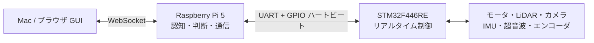

# SURGE Mark.2

Raspberry Pi 5 を上位計算機に使う、自律走行ミニカー **SURGE Mark.2** のソフトウェアリポジトリです。

センサの取得、自己位置推定、経路計画、自動運転、遠隔操縦用 GUI、走行ログの記録・再生、Mac 上のシミュレーションまでを一体で開発しています。リアルタイム性と安全性が必要な低レベル制御は STM32 側で実行し、Raspberry Pi は認知と判断を担当します。

> **開発中のプロジェクトです。** 実車を動かす前に、必ず [システム全体像](docs/system_overview.md) と [開発ガイド](docs/development.md) を確認してください。現在の実装状況は [PROGRESS.md](PROGRESS.md) を参照してください。

## システム概要



| 層 | 主な役割 |
| --- | --- |
| **STM32** | モータ制御、速度・舵角制御、トラクション制御、保護、安全停止 |
| **Raspberry Pi 5** | センサ統合、自己位置推定、経路計画、自動運転、UART/GPIO 通信、ログ記録 |
| **Mac / ブラウザ** | GUI、遠隔操縦、可視化、シミュレーション、解析・学習 |

実車とシミュレータでは、Raspberry Pi 側のコードをできるだけ共通化しています。シミュレータは STM32 との接続部分を仮想化するため、UART プロトコルや安全ゲートを含む上流の処理を Mac 上で検証できます。

## 主な機能

- 前後カメラ、LiDAR、IMU、超音波、車速センサの統合
- ラジコン操縦と自動運転の切り替え
- LiDAR ベースの自己位置推定・地図・経路走行
- WebSocket 経由の React + TypeScript GUI
- UART プロトコル、GPIO ハートビート、デッドマンによる安全停止
- `.sfl` / MCAP の走行ログ記録、再生、オフライン解析
- Mac 専用 2D シミュレータ
- カメラ・LiDAR 系の機械学習モデルの学習と評価

## リポジトリ構成

| パス | 内容 |
| --- | --- |
| [`raspi/`](raspi/) | Raspberry Pi 側のノード、通信、メッセージ、I/O、ナビゲーション、テスト |
| [`gui/`](gui/) | React + TypeScript + Vite の Web GUI |
| [`sim/`](sim/) | Mac 上で実車相当の上流コードを動かす 2D シミュレータ |
| [`slam2d/`](slam2d/) | 2D SLAM、地図生成、自己位置推定 |
| [`config/`](config/) | 車両パラメータ、運転設定、プロトコル等からの生成スクリプト |
| [`ml_cam/`](ml_cam/)、[`ml_cam_e2e/`](ml_cam_e2e/)、[`ml_lidar/`](ml_lidar/) | 学習・評価・モデル出力のパイプライン |
| [`ml_common/`](ml_common/) | 機械学習用 GUI と共通部品 |
| [`tools/`](tools/) | デプロイ、検査、ログ変換、同定などの開発ツール |
| [`models/`](models/) | 推論用モデル |
| [`saved_maps/`](saved_maps/) | 保存済みの地図と走行経路 |
| [`docs/`](docs/) | 設計、仕様、開発手順、運用計画 |

## クイックスタート（Mac）

### 1. 開発環境を用意する

Python 仮想環境を作成し、Raspberry Pi 側の依存関係とシミュレータの依存関係をインストールします。GUI を開発する場合は Node.js 依存関係も用意します。

```bash
cd surge_mk2
python3 -m venv --system-site-packages .venv
.venv/bin/pip install -r raspi/requirements.txt
.venv/bin/pip install -r sim/requirements.txt
cd gui && npm ci && cd ..
```

環境によっては、カメラ・Raspberry Pi GPIO・実機向け依存関係を Mac にインストールする必要はありません。実機のセットアップは [開発ガイド](docs/development.md) を参照してください。

### 2. シミュレータを起動する

```bash
.venv/bin/python -m sim.run
```

シミュレータ、通信ノード、計画ノード、シミュレータ GUI がまとめて起動します。コースを指定する場合は次のようにします。

```bash
.venv/bin/python -m sim.run --course toyota2
```

終了するには `Ctrl-C` を押すか、シミュレータのウィンドウを閉じます。詳細は [sim/README.md](sim/README.md) を参照してください。

### 3. GUI だけを開発する

シミュレータを使わず、モックデータで GUI を確認する場合は、以下を別々のターミナルで実行します。

```bash
.venv/bin/python -m raspi.nodes.telemetry_node
.venv/bin/python -m raspi.tools.bus_demo --allow-arm --faults
cd gui && npm run dev
```

GUI は通常 `http://localhost:5173` で開きます。GUI の構成と操作方法は [gui/README.md](gui/README.md) にまとまっています。

補助ツールを一覧から起動する場合は、リポジトリ直下の `launcher.command` をダブルクリックしてください。

## 開発・検証

生成コードの整合性、Python テスト、補助ツールのテスト、利用可能な場合は TypeScript の型検査をまとめて実行できます。

```bash
./tools/check.sh
```

短時間で生成物だけを確認する場合は次のコマンドを使います。

```bash
./tools/check.sh --fast
```

プロトコル定義や車両パラメータを変更した場合は、生成元と生成物の関係を理解してから更新してください。数値・バイト配置の正は [`raspi/proto/protocol.toml`](raspi/proto/protocol.toml)、車両パラメータの正は [`config/vehicle.toml`](config/vehicle.toml) です。

## 実機への反映

実機は Raspberry Pi 5 と STM32 が接続された走行用車両です。実機への配備、サービスの再起動、ログ取得、E-Stop に関わる操作には安全上の注意があります。手順は [docs/development.md](docs/development.md) の「実機へ反映する」と「触る前の安全ルール」を必ず確認してください。

通常の GUI・Python の配備例は次のとおりです。

```bash
tools/deploy.sh              # GUI をビルドして Raspberry Pi へ配備
tools/deploy.sh --no-gui     # GUI をビルドせず Python 側だけ配備
tools/deploy.sh --test       # 配備後に Raspberry Pi 側のテストを実行
```

`io_node` やプロトコルを変更する操作は車両を停止できる状態で行ってください。実機での検証前に、Mac のシミュレータとログ再生で確認することを推奨します。

## ドキュメント

| 目的 | 文書 |
| --- | --- |
| システム全体を把握する | [docs/system_overview.md](docs/system_overview.md) |
| 設計理由を知る | [docs/architecture.md](docs/architecture.md) |
| 開発・配備・トラブルシューティング | [docs/development.md](docs/development.md) |
| UART プロトコル仕様 | [docs/uart_protocol.md](docs/uart_protocol.md) |
| STM32 とのインターフェース | [docs/stm32_interface.md](docs/stm32_interface.md) |
| 現在の進捗と未検証事項 | [PROGRESS.md](PROGRESS.md) |
| 文書の一覧 | [docs/README.md](docs/README.md) |
| 大会に向けた計画 | [docs/competition_plan.md](docs/competition_plan.md) |

## 設計上の重要な方針

- 速い制御と安全機能は STM32、遅い認知・判断は Raspberry Pi に分離する。
- 実車 GUI にシミュレータ専用の操作を混ぜず、シミュレータであることは明示的な SIM 表示で区別する。
- 通信途絶、E-Stop、電源異常などの異常時は、上位プロセスだけに依存せず下位層でも停止する。
- プロトコルや車両パラメータは生成元を正とし、生成物を直接編集しない。

## ライセンス

このリポジトリのライセンス情報は、リポジトリ内の設定および配布方針に従います。
