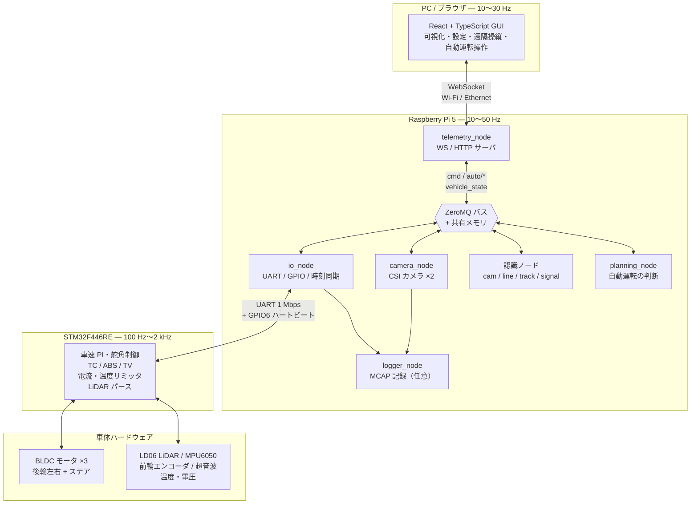
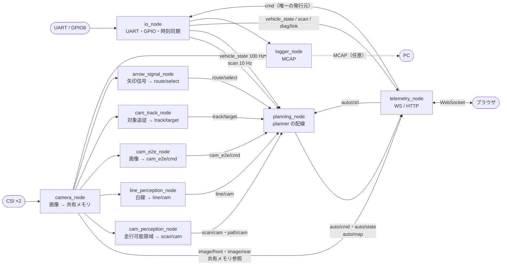
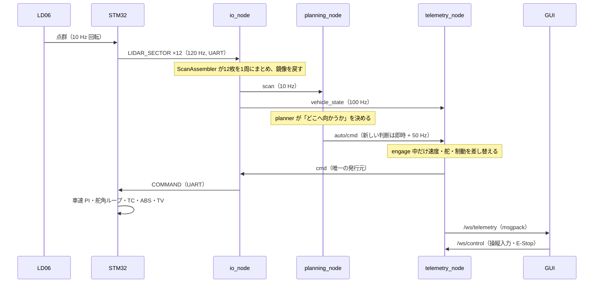
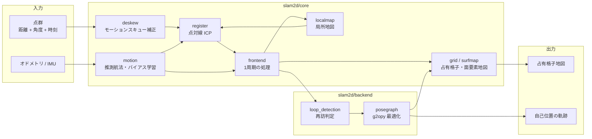
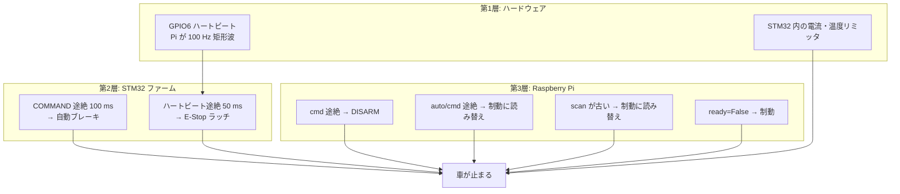
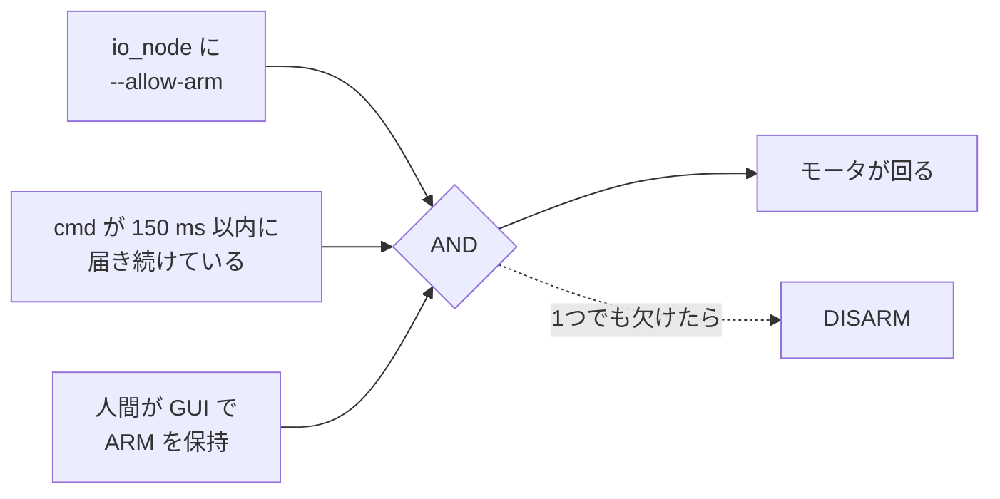

# SURGE Mark.2 システム構成

Raspberry Pi 5 を上位計算機、STM32F446RE をリアルタイム制御器とする自律走行ミニカーの
**システム構成図とモジュール地図**である。

> **この文書の位置づけ**
> 全体像を1枚で把握するための入口。設計理由は [`docs/architecture.md`](docs/architecture.md)、
> 詳細な仕様・実測値は [`docs/system_overview.md`](docs/system_overview.md)、現在地は
> [`PROGRESS.md`](PROGRESS.md) を正とする。
> **数値の正は `raspi/proto/protocol.toml` と `config/vehicle.toml`** であり、
> この文書はそれらを複製しない（複製すると必ず片方が古くなる）。

---

## 目次

1. [全体像](#1-全体像)
2. [ハードウェア構成](#2-ハードウェア構成)
3. [3階層アーキテクチャ](#3-3階層アーキテクチャ)
4. [Raspberry Pi 5 のプロセス構成](#4-raspberry-pi-5-のプロセス構成)
5. [内部バスとトピック](#5-内部バスとトピック)
6. [通信インターフェース](#6-通信インターフェース)
7. [自動運転パイプライン](#7-自動運転パイプライン)
8. [SLAM と地図](#8-slam-と地図)
9. [安全設計](#9-安全設計)
10. [シミュレータと学習パイプライン](#10-シミュレータと学習パイプライン)
11. [設定・データ資産](#11-設定データ資産)
12. [リポジトリ構成](#12-リポジトリ構成)
13. [実行・配備](#13-実行配備)
14. [技術スタック](#14-技術スタック)
15. [設計原則](#15-設計原則)
16. [関連ドキュメント](#16-関連ドキュメント)

---

## 1. 全体像

**PC・Raspberry Pi 5・STM32 の3台が、それぞれ違う周期で違う仕事を担当する。**



### 役割の一言まとめ

| 層 | 主な役割 | 周期 | 言語・実行環境 |
|---|---|---|---|
| **STM32** | モータを実際に回す。速度・舵角・スリップ・保護・安全停止 | 100 Hz〜2 kHz | C（STM32CubeMX + 自作ライブラリ） |
| **Raspberry Pi 5** | センサ統合、自己位置推定、経路計画、自動運転、通信 | 10〜50 Hz | Python 3.13（numpy / ONNX） |
| **PC / ブラウザ** | GUI、遠隔操縦、可視化、解析、学習 | 10〜30 Hz | React 19 + TypeScript + Vite |

**Pi から STM32 へ送る指令は「目標速度・加速度上限・目標舵角」だけ。**
PWM デューティやトルク配分は送らない。

---

## 2. ハードウェア構成

### 2.1 STM32 側

| 機器 | 方式・仕様 | アーキテクチャ上の意味 |
|---|---|---|
| 後輪左右モータ | BLDC + 自作 MD、**トルクモード**、左右独立 | TC・トルクベクタリングを STM32 内で完結 |
| ステアリングモータ | BLDC + 自作 MD、**位置モード**（サーボではない） | モータ角→路面舵角は非線形。STM32 が同定式で換算 |
| LiDAR | LD06、10 Hz 回転、最大約 12 m、UART 230.4 kbps | **裏向き実装で点群が鏡像**。`ScanAssembler` が補正 |
| IMU | MPU6050（6軸、地磁気なし） | 絶対方位は出ない。yaw は積分ドリフトする |
| 車速センサ | 前輪左右のアナログ絶対角エンコーダ | 分解能が粗い。STM32 でカルマンフィルタ／ローパス |
| 超音波 | 前後 ×2、実質 20 Hz 上限 | 100 Hz テレメトリに対して同じ値が連続する |
| 温度 | MD 後左・後右・ステア + STM32 内蔵 | 据え切りでステア MD が過熱する |
| 電源 | 駆動系・制御系の 2 系統、Ni-MH 8セル | 片方だけ落ちても Pi と STM32 は生きる |
| 制御ボード | STM32F446RE | リアルタイム制御（ファームのメインループは 2 kHz） |

### 2.2 Raspberry Pi 5 側

| 接続 | 用途 |
|---|---|
| CSI ×2 | 前方・後方カメラ（`picamera2`、IMX219 広角） |
| GPIO6 | STM32 との **緊急停止ハートビート**（100 Hz 矩形波） |
| GPIO14 / GPIO15 | UART TX / RX（`/dev/serial0`） |
| GPIO18 / GPIO19 / GPIO13 | ブザー / LED 緑 / LED 赤 |
| Wi-Fi / Ethernet | PC との WebSocket、mDNS（`surge-mk2.local`） |

> **Pi 5 固有の制約**: `RPi.GPIO` は RP1 チップのため使えない → `gpiozero` + `lgpio`。
> カメラは `picamera2`、UART はデバイス名を直書きせず `/dev/serial0` を使う。

---

## 3. 3階層アーキテクチャ

### 3.1 階層化の原則

**「速い制御はエッジに、遅い判断は上位に」**

```
┌────────────────────────────────────────────────────┐
│ PC / ブラウザ   人間が見る・触る            10〜30 Hz │
└──────────────────────┬─────────────────────────────┘
                       │ WebSocket（用途別にチャンネル分離）
┌──────────────────────┴─────────────────────────────┐
│ Raspberry Pi 5  認知・判断                  10〜50 Hz │
│   知覚 → 自己位置推定 → 経路計画 → 行動判断           │
└──────────────────────┬─────────────────────────────┘
                       │ UART 1 Mbps + GPIO6 ハートビート
┌──────────────────────┴─────────────────────────────┐
│ STM32F446RE     リアルタイム制御         100 Hz〜2 kHz │
│   車速/舵角ループ・TC・ABS・TV・保護・安全停止         │
└────────────────────────────────────────────────────┘
```

**分ける理由**

- TC・ABS・スリップ制御は数 ms 以内に効かせる必要があり、UART 往復 + Python の遅延では成立しない。
- SLAM・レーシングライン計算は Python の方が速く作れる。
- **上位が落ちても下位が自力で安全を確保できる**（Pi が落ちれば GPIO6 が止まり STM32 が E-Stop をラッチ）。

### 3.2 障害時の挙動

| 落ちたもの | 何が起きるか |
|---|---|
| PC / GUI | 手動操縦は `cmd` 途絶で DISARM。自律走行は継続できる（設定された猶予の範囲） |
| Raspberry Pi | GPIO6 ハートビートが止まる → **STM32 が E-Stop をラッチ** |
| STM32 | Pi 側が TELEMETRY 途絶を検知して DEGRADED / FAULT |
| `surge-io` | 同上。**E-Stop がラッチし、現地でボタンを押すまで動かない** |

---

## 4. Raspberry Pi 5 のプロセス構成

**Python の GIL を避けるため、スレッドではなくプロセスで分ける。**
各ノードは systemd の独立サービスとして起動する。



### 4.1 ノード一覧

| ノード | モジュール | 役割 | 止めると |
|---|---|---|---|
| `io_node` | `raspi.nodes.io_node` | UART 送受信、GPIO6 ハートビート、時刻同期、`.sfl` 記録 | **E-Stop がラッチ** |
| `camera_node` | `raspi.nodes.camera_node` | CSI カメラ 2 台 → 共有メモリリング | カメラ系機能が停止 |
| `telemetry_node` | `raspi.nodes.telemetry_node` | WS / HTTP サーバ、GUI 配信、**`cmd` の唯一の発行元** | GUI が繋がらない |
| `planning_node` | `raspi.nodes.planning_node` | planner の購読・周期実行・`auto/*` publish | 自律走行のみ停止 |
| `cam_perception_node` | `raspi.nodes.cam_perception_node` | 走行可能領域セグメンテーション → 擬似 `Scan` | `ftg_cam` / `cam_centerline` が使えない |
| `cam_e2e_node` | `raspi.nodes.cam_e2e_node` | カメラ画像から操舵・速度を直接回帰 | `cam_e2e` が使えない |
| `line_perception_node` | `raspi.nodes.line_perception_node` | 白線検出 → 地面座標の 2 点 | `line_trace` が使えない |
| `cam_track_node` | `raspi.nodes.cam_track_node` | NanoTrack + LiDAR 融合の対象追従 | `follow_object` が使えない |
| `arrow_signal_node` | `raspi.nodes.arrow_signal_node` | 前方カメラの矢印信号認識 | 信号による経路選択が使えない（既定は無効） |
| `logger_node` | `raspi.nodes.logger_node` | 内部バスを MCAP に記録 | 記録のみ（既定は無効） |
| `replay_node` | `raspi.nodes.replay_node` | `.sfl` を実時間再生し `io_node` の代わりをする | — |

> カメラ系の認識ノードは**常時起動**だが、`auto/ctrl` で対応モードが選ばれている間だけ
> 推論する（IDLE / ACTIVE）。使わない間は CPU・電力をほとんど消費しない。

### 4.2 systemd サービス

`raspi/setup/install_services.sh` が以下を登録する。

```
surge-io              UART / GPIO（Nice=-10）
surge-camera          カメラ取り込み
surge-telemetry       WebSocket / HTTP サーバ
surge-planning        自動運転
surge-cam-perception  カメラセグメンテーション
surge-cam-e2e         カメラ E2E
surge-line-perception 白線検出
surge-cam-track       対象追従
surge-mdns            mDNS ユニキャスト補助
surge-logger          MCAP 記録（任意・既定では無効）
surge-logclean.timer  古いログの定期削除
```

---

## 5. 内部バスとトピック

### 5.1 バスの設計

ZeroMQ を土台に、メッセージ規約だけを自作する（`raspi/bus/zbus.py`）。
**購読者の要求が違うため、3つの配送パターンを使い分ける。**

| パターン | 用途 | 実装 |
|---|---|---|
| **最新値のみ** | 制御指令・車両状態 | ZMQ PUB/SUB + `CONFLATE=1` |
| **取りこぼし厳禁** | ロガー・記録 | ZMQ PUB/SUB + 大きめの HWM |
| **大容量ゼロコピー** | カメラ画像 | `shared_memory` のリングバッファ |

- エンドポイントは**ノード単位**（トピック単位ではない）。既定は `ipc:///tmp/surge-bus/<node>.ipc`。
- 購読は**トピック1本につき SUB ソケット1本**（`CONFLATE` はソケット単位のため）。
- メッセージは msgspec の `Struct` で定義し、msgpack でシリアライズする。
- **全メッセージが `t_capture` / `t_pub` / `seq` を持つ**（後からセンサ融合を足しても定義を書き直さないため）。

### 5.2 主要トピック

| トピック | 中身 | 発行元 | 主な購読者 |
|---|---|---|---|
| `vehicle_state` | 速度・各輪周速・舵角・オドメトリ・IMU・温度・電源・フラグ | `io_node` | planning / telemetry / logger |
| `scan` | LiDAR 1周分の点群（360点 + セクタ時刻・受信有無） | `io_node` | planning / logger |
| `diag/link` | リンク統計（loss / CRC / 往復遅延 / 時刻同期 / SIM バッジ） | `io_node` | telemetry / logger |
| `cmd` | 目標速度・舵角・フラグ | **`telemetry_node` のみ** | `io_node` |
| `auto/ctrl` | 走行モードの意思・パラメータ | `telemetry_node` | planning / 認識ノード |
| `auto/cmd` | 自律走行の目標速度・舵角・制動 | `planning_node` | `telemetry_node` |
| `auto/state` | 判断の根拠（選んだギャップ・自己位置・段・理由） | `planning_node` | telemetry / logger |
| `auto/map` | 占有格子・経路 | `planning_node` | telemetry / logger |
| `scan/cam` | カメラ由来の擬似点群（`ftg_cam` 用） | `cam_perception_node` | planning |
| `path/cam` | カメラ由来の走行可能回廊（`cam_centerline` 用） | `cam_perception_node` | planning |
| `line/cam` | 白線の近傍・遠方 2 点（`line_trace` 用） | `line_perception_node` | planning |
| `cam_e2e/cmd` | 画像からの操舵・速度（`cam_e2e` 用） | `cam_e2e_node` | planning |
| `track/target` | 追従対象の方位・距離（`follow_object` 用） | `cam_track_node` | planning |
| `route/select` | 経路グループの切替要求（信号） | `arrow_signal_node` | planning |
| `image/front` / `image/rear` | 共有メモリ参照（画像本体は共有メモリ） | `camera_node` | telemetry / 認識ノード |
| `hb/<node>` | 各ノードのハートビート | 各ノード | logger |

> **`cmd` の発行元は `telemetry_node` 1本に絞ってある。** planning と telemetry が同じ
> トピックに出すと、購読側から区別できないまま交互に上書きし合い、止める側が負ける。
> planning は `auto/cmd` に出し、engage 中だけ telemetry が速度・舵・制動を差し替える。

### 5.3 WebSocket チャンネル（Pi ⇄ PC）

| チャンネル | 内容 | 形式 |
|---|---|---|
| `/ws/telemetry` | 車両状態・点群・リンク統計・自動運転の判断 | バイナリ（msgpack） |
| `/ws/camera/front` `/ws/camera/rear` | JPEG フレーム | バイナリ |
| `/ws/control` | 操縦入力・設定変更・状態通知 | JSON（イベント駆動） |
| `/ws/map` | 占有格子（2 bit/セル + zlib） | バイナリ（版が変わったときだけ） |
| `/ws/record` | MCAP のライブ中継 | バイナリ（記録中のみ） |

**1本にまとめない。** カメラのフレーム詰まりがラジコン入力の遅延に波及するため。
GUI 本体（`gui/dist`）も `telemetry_node` が HTTP で配るので、WS と同一オリジンになる。

---

## 6. 通信インターフェース

### 6.1 UART フレーム（STM32 ⇄ Pi）

```
┌────────┬──────┬─────┬─────┬───────────┬────────┐
│ SYNC   │ TYPE │ SEQ │ LEN │  PAYLOAD  │ CRC16  │
│ AA 55  │  1B  │ 1B  │ 1B  │  0-255B   │  2B    │
└────────┴──────┴─────┴─────┴───────────┴────────┘
```

- 1 Mbps、8N1、CRC-16/CCITT-FALSE。
- **唯一の定義は `raspi/proto/protocol.toml`**。ここから Python パーサと STM32 用 C ヘッダを生成する。
- バージョン不一致の間は ARM しない。

| TYPE | 名称 | 方向 | 主な内容 |
|---|---|---|---|
| `0x01` | `LIDAR_SECTOR` | STM32 → Pi | 1周を12セクタに分割した距離列 + 時刻 |
| `0x02` | `TELEMETRY` | STM32 → Pi | 速度・舵角・各輪周速・IMU・電流・温度・電圧・超音波・TC/ABS/TV 状態 |
| `0x03` | `CONFIG_ACK` | STM32 → Pi | パラメータ設定の結果 |
| `0x04` | `LOG` | STM32 → Pi | ファームのログ文字列 |
| `0x05` | `LIDAR_SECTOR_I` | STM32 → Pi | 強度付き LiDAR |
| `0x06` | `PONG` | STM32 → Pi | 時刻同期（T2/T3） |
| `0x07` | `VERSION` | STM32 → Pi | プロトコル版・ファーム ID |
| `0x08` | `STATS` | STM32 → Pi | 累積エラーカウンタ |
| `0x0A` | `LIMITS` | STM32 → Pi | 車両の物理的上限 |
| `0x10` | `COMMAND` | Pi → STM32 | mode・flags・目標速度・目標舵角・レート制限・制動/駆動トルク |
| `0x11` | `CONFIG_SET` | Pi → STM32 | 制御パラメータ設定 |
| `0x12` | `PING` | Pi → STM32 | 時刻同期（T1/T4） |
| `0x13` | `CONFIG_GET` | Pi → STM32 | パラメータ読み戻し |
| `0x14` | `VERSION_REQ` | Pi → STM32 | 版の要求 |
| `0x15` | `LIMITS_REQ` | Pi → STM32 | 物理的上限の要求 |

**`COMMAND.flags` が安全の要**（arm / brake / horn / light / passing / torque_mode / auto_stop）。
ゼロ値は安全側に倒してあり、`brake_torque = 0` は「制動なし」ではなく「STM32 側の最大で制動」を意味する。

### 6.2 その他の通信

| 区間 | 方式 | 用途 |
|---|---|---|
| Pi ⇄ PC | Wi-Fi（STA）または有線 Ethernet、WebSocket | GUI・遠隔操縦・ログ |
| Pi 内 | ZeroMQ PUB/SUB + 共有メモリ | ノード間メッセージ・画像 |
| Pi ⇄ STM32 | UART + GPIO6 | 指令・テレメトリ・LiDAR・安全 |
| Pi ⇄ PC（名前解決） | mDNS `surge-mk2.local` | IP を調べ直さず接続 |
| シミュレータ内部 | UDP ループバック | `SimLink` ⇄ `sim.gui`（バスにシム語彙を入れない） |

---

## 7. 自動運転パイプライン

### 7.1 責務の分離

| ファイル / パッケージ | 役割 |
|---|---|
| `raspi/auto/base.py` | `Planner` と `ParamSpec`。**バスも WS も知らない純粋な計算** |
| `raspi/auto/<algo>.py` | アルゴリズム本体 |
| `raspi/auto/registry.py` | id → クラス。GUI へ渡す宣言（`catalog()`） |
| `raspi/nav/` | 経路生成・追従・回避・局所地図などの部品 |
| `raspi/nodes/planning_node.py` | 配線だけ（購読・周期・publish） |

**モードを足しても GUI を触らない。** `registry.py` に1行足せば GUI の選択肢に出て、
パラメータのスライダは planner が宣言した `ParamSpec` から自動生成される。

`Planner` の約束:

1. `plan()` は状態を持ってよいが、`reset()` で完全に初期化できる。
2. 戻り値 `AutoState` には指令と**理由 `reason`** を必ず同時に返す。
3. 走ってよいか分からないときは `ready=False`。planning_node が制動に読み替える。
4. パラメータは `params` に宣言する（GUI が自動生成する）。

### 7.2 実装されている走行モード

| id | 名前 | 地図 | 考え方 |
|---|---|---|---|
| `ftg` | Follow the Gap | 不要 | 点群の最も広い空隙の**真ん中**を狙う |
| `ftg_cam` | Follow the Gap（カメラ） | 不要 | `ftg` と同じロジックを、カメラ由来の擬似点群で走らせる |
| `cam_centerline` | 中心線追従（カメラ） | 不要 | 走行可能領域から前方回廊の中心を作り Pure Pursuit |
| `cam_e2e` | E2E カメラ（模倣学習） | 不要 | 前方画像から操舵を直接回帰 |
| `de` | Disparity Extender | 不要 | 物体の縁を車体半幅ぶん塗り潰してから最遠帯の真ん中を狙う |
| `dp` | Disparity Pursuit | 不要 | `de` の塗り方 + `ftg` の Pure Pursuit（実装済・未検証） |
| `slam2d_raceline` | レーシングライン | 作る / 読む | SLAM 地図上で最小曲率経路を生成して追従 |
| `slam2d_route` | 経路選択走行 | 作る / 読む | 道路グラフ + 経由点で分岐を選ぶ（GUI の主力） |
| `line_trace` | ライントレース | 不要 | 白線の 2 点を Pure Pursuit の目標点にする |
| `e2e_lidar` | E2E LiDAR | 不要 | 強化学習（PPO）で点群→操舵・速度を直接回帰 |
| `follow_object` | 対象追従 | 不要 | 映像で選んだ対象との車間を保って追従 |
| `park_to_point` | 駐車（クリック指定） | 局所地図 | 指定位置・向きへ接近して停止 |

### 7.3 データの流れ（LiDAR → モータ）



### 7.4 座標系と単位

ROS の慣例（REP-103 / REP-105）に従う。内部は**常に SI**。

| 項目 | 規約 |
|---|---|
| 座標系 | 右手系。x = 前、y = 左、z = 上 |
| 角度 | 反時計回りが正（左旋回が正） |
| 単位 | m, m/s, m/s², rad, rad/s, s |
| 時刻 | ns 単位の整数、Pi の `CLOCK_MONOTONIC` 基準 |

```
map ──── odom ──── base_link ──┬── lidar
 │        │            │        ├── cam_front
 │        │            │        └── cam_rear
 │        │            └─ 後輪車軸の中心
 │        └─ 連続で滑らか。ドリフトする → 局所制御
 └─ SLAM が補正する。跳ぶことがある → 大域経路計画
```

`odom` と `map` を分けるのは、ループ閉じの瞬間に自己位置が数十 cm 跳び、
それを制御ループに直接食わせると舵が暴れるため。

---

## 8. SLAM と地図

`slam2d/` は**車体非依存の汎用 2D LiDAR SLAM ライブラリ**。
`raspi.*` を一切 import せず、`raspi/auto/_slam2d_nav.py` の薄いアダプタ越しに使う。



### 主要モジュール

| パス | 役割 |
|---|---|
| `slam2d/core/types.py` | SE(2) の代数・点群・姿勢の型 |
| `slam2d/core/deskew.py` | 点ごとの時刻を使ったモーションスキュー補正 |
| `slam2d/core/grid.py` | 占有格子（ヒット/ミス回数、必要方向へ自動拡張） |
| `slam2d/core/surfmap.py` | 面要素地図（壁セルの平均位置・法線） |
| `slam2d/core/register.py` | 点対線 ICP（Gauss-Newton、推測航法を事前分布に持つ） |
| `slam2d/core/localmap.py` | 直近キーフレームのみの位置合わせ用地図 |
| `slam2d/core/motion.py` | 推測航法の抽象、ジャイロゼロ点・車速倍率の学習 |
| `slam2d/core/frontend.py` | 脱スキュー → 予測 → 位置合わせ → 地図更新 |
| `slam2d/core/localize.py` | 保存地図上でのグローバルローカリゼーション |
| `slam2d/backend/loop_detection.py` | 古いキーフレームの部分地図への再訪判定 |
| `slam2d/backend/posegraph.py` | g2opy ラッパー（Huber・外れ値除去） |
| `slam2d/pipeline.py` | `SlamSystem`（フロントエンド + ループ閉じの公開 API） |

### 地図を使う走行の段階

```
[EXPLORE] → [BUILD] → [DONE] → [LOCATE] → [RACE]
 地図を育てる  中心線と   保存して  保存地図上で  周回
             レーシング  人を待つ  自己位置を復元
             ライン
```

- ループ閉じは EXPLORE → BUILD の瞬間に1回だけ。RACE 中は追跡専用。
- LOCATE は候補姿勢をスコアで比較し、曖昧なら自動決定せず人にヒントを求める。
- 見失ったまま一定時間止まると現在姿勢を種に LOCATE へ戻る。
- 路面で変わる値（横 G・加速・減速の上限）は走行中に学習し、地図の横の `.grip.json` に保存する。

### 保存済み地図

`saved_maps/` に `<map>.json`（地図メタデータ）、`.npz`（地図本体）、
`.routes.json`（ミッション・経由点）、`.grip.json`（路面学習値）、
`.lines.pkl`（仕上げ済み経路のキャッシュ）を置く。

---

## 9. 安全設計

**自律走行で最初に作るべきは走る機能ではなく止まる機能。** 互いに独立した3層にする。



### 9.1 停止条件の一覧

| 何が | どれだけ途絶したら | どうなる |
|---|---|---|
| GPIO6 ハートビート | 50 ms | STM32 が E-Stop をラッチ |
| `COMMAND`（Pi → STM32） | 100 ms | STM32 が自動ブレーキ |
| `TELEMETRY`（STM32 → Pi） | 100 ms / 200 ms | DEGRADED（警告）／ FAULT |
| `cmd`（バス上） | 150 ms | io_node が最大制動、停止後に DISARM |
| `auto/cmd`（planner の死亡） | 200 ms | telemetry_node が制動に読み替え |
| `scan` が古い | 300 ms | planning_node が制動指令に読み替え |
| GUI の無操作 | 20 秒 | DISARM（自律走行中は掛けない） |

### 9.2 モータが回る条件



加えて、`protocol_version` の一致、`[control]` の STM32 への同期、
E-Stop・駆動電源ラッチ・STM32 再起動後の ARM 入れ直しが必要。

### 9.3 安全の原則

- **デッドマンは「速度 0 を送る」ではなく「送信を止める」。** 0 が届かない状況が最も危険なため。
- **engage ≠ ARM。** 自律走行の engage は意思表示にすぎず、planner は `arm` を立てられない。
- **E-Stop の復帰は人間の明示操作のみ。** 車両のボタン2を物理的に押す。自動復帰しない。
- **駆動電源ラッチは異常ではなく仕様。** 通信 FAULT と区別して GUI に表示する。
- **`sector_seen == False` は「障害物なし」ではない。** 欠測方向は距離 0（侵入禁止）として扱う。
- **固定距離の緊急停止は Pi 側に持たない。** STM32 の `auto_stop`（速度に応じた動的停止距離）に任せる。

---

## 10. シミュレータと学習パイプライン

### 10.1 シミュレータ（`sim/`、Mac 専用）

**偽装するのは STM32 だけ。** `SerialLink` の位置に `SimLink` を差し込むので、
`io_node` より上流（プロトコル・CRC・`ScanAssembler`・`LinkTracker`・`cmd` タイムアウト・
`telemetry_node`・GUI）は実機と同一コードが動く。

```
ブラウザ GUI ← SIM バッジだけ。それ以外シムの存在を知らない
   │ WebSocket
telemetry_node ──── ZMQ ──── io_node
                                 │ link.poll() / link.send()
                     ┌───────────┴───────────┐
                SerialLink                SimLink
                     │                        │
                 実 STM32                 仮想 STM32
                                              │ UDP 127.0.0.1
                                           sim.gui (pygame)
```

| モジュール | 役割 |
|---|---|
| `sim/run.py` | io / telemetry / planning / GUI をまとめて起動 |
| `sim/stm32.py` | 仮想 STM32（プロトコル・制御・テレメトリ） |
| `sim/vehicle.py` | 車両動力学・タイヤ・グリップ |
| `sim/lidar.py` | 仮想 LiDAR（ノイズ・欠損・鏡像） |
| `sim/course.py`, `sim/track.py`, `sim/raceline.py` | コース・走路・レーシングライン |
| `sim/gui.py`, `sim/ui.py` | pygame 俯瞰ビュー |
| `sim/editor.py` | コースエディタ |
| `sim/bench.py`, `sim/slam_bench.py` | 自動運転・SLAM のベンチマーク |
| `sim/courses/` | JSON / PNG コース定義 |

### 10.2 機械学習パイプライン

| パッケージ | 内容 |
|---|---|
| `ml_cam/` | カメラ画像のセグメンテーション学習（データ抽出・注釈・学習・ONNX 出力・プレビュー） |
| `ml_cam_e2e/` | カメラ画像 → 操舵・速度の End-to-End 模倣学習 |
| `ml_lidar/` | LiDAR 点群の強化学習（PPO）・特徴量・評価・ONNX 出力 |
| `ml_common/` | 学習 GUI の共通部品（ジョブ実行・ログ・グラフ・システム監視） |
| `models/` | 推論用 ONNX / JSON（`cam_e2e/`, `e2e_lidar/`, `nano_track/`, ほか） |

学習は Mac 上で行い、ONNX に変換して Pi の `onnxruntime` で推論する。
学習環境によって `sim/` を再利用するが、**依存の向きは `sim → 学習` ではなく `学習 → sim`**。

### 10.3 ファームウェア・シミュレーション（`tools/fwsim/`）

STM32 の制御コードをホスト上でそのままコンパイルし、車両モデルと閉ループで回す。
`python -m tools.fwsim.bench` で制御の比較ができる。
ファームの定数と `config/vehicle.toml` の一致は
`tools/fwsim/tests/test_fw_constants.py` が突き合わせる。

---

## 11. 設定・データ資産

| パス | 内容 | 正か |
|---|---|---|
| `config/vehicle.toml` | 車両幾何・質量・動特性・制御・安全タイマ | **数値の正** |
| `config/auto.json` | 自動運転モードとパラメータの保存値 | GUI の保存先 |
| `config/drive_settings.json` | 走行設定 | — |
| `config/odometer.json` | オドメトリ関連の保存値 | — |
| `config/cam_tuning/` | カメラのレンズ・内部パラメータ | 校正値 |
| `config/generate.py` | TOML → Python / TypeScript 生成 | 生成元 |
| `config/gen_msgs.py` | メッセージ定義の生成 | 生成元 |
| `config/check_docs.py` | ドキュメントの整合検査 | — |
| `raspi/proto/protocol.toml` | UART プロトコル定義 | **バイト配置の正** |
| `raspi/proto/generated/` | 生成された Python / C ヘッダ | 生成物（直接編集しない） |
| `saved_maps/` | 地図・経路・路面学習値 | 走行成果物 |
| `models/` | 推論モデル | 学習成果物 |
| `logs/` | `.sfl` / `.mcap` / サービス出力 | 記録 |

> **生成元を正とし、生成物を直接編集しない。** プロトコルは `python3 raspi/proto/generate.py`、
> 車両パラメータは `config/generate.py` で再生成する。

---

## 12. リポジトリ構成

```
surge_mk2/
├── raspi/                  Raspberry Pi 側（実機で動くコード）
│   ├── nodes/              プロセス（io / camera / telemetry / planning / 認識 / logger / replay）
│   ├── auto/               Planner 本体とモード登録
│   ├── nav/                経路生成・追従・回避・局所地図・グリップ学習
│   ├── bus/                ZeroMQ バス・共有メモリリング
│   ├── core/               車両パラメータ・時刻同期・制御パラメータ・リンク追跡
│   ├── io/                 UART・GPIO・Wi-Fi・ファン・Pi 健康監視
│   ├── msgs/               メッセージ型定義
│   ├── proto/              UART プロトコル定義と生成物
│   ├── rec/                .sfl / MCAP 記録・可視化・推測航法
│   ├── setup/              systemd サービス・配備スクリプト
│   ├── tools/              補助 CLI（バスデモ・ログ変換・校正 等）
│   └── tests/              単体・結合テスト
├── gui/                    React + TypeScript + Vite の Web GUI
│   ├── src/views/          ラジコン / 自動運転 / 診断 / システム同定
│   ├── src/components/     パネル・計器・設定・地図・ログ操作
│   ├── src/ws/             WebSocket クライアント
│   ├── src/render/         点群・地図の Canvas 描画
│   ├── src/store/          Zustand ストア
│   └── src/generated/      config から生成された定数
├── sim/                    Mac 用 2D シミュレータ（仮想 STM32）
├── slam2d/                 車体非依存の 2D LiDAR SLAM
├── ml_cam/                 カメラセグメンテーション学習
├── ml_cam_e2e/             カメラ End-to-End 学習
├── ml_lidar/               LiDAR 強化学習
├── ml_common/              学習 GUI の共通部品
├── tools/                  配備・検査・校正・ログ変換・ファームシム
├── config/                 車両パラメータ・生成スクリプト
├── models/                 推論モデル
├── saved_maps/             保存地図・経路
├── site/                   公開用の技術解説サイト（MkDocs）
├── docs/                   設計・仕様・開発手順
├── logs/                   実行ログ
├── launcher.command        補助ツールのランチャー
└── README.md
```

---

## 13. 実行・配備

### 13.1 Mac でシミュレータを起動

```bash
python3 -m venv --system-site-packages .venv
.venv/bin/pip install -r raspi/requirements.txt
.venv/bin/pip install -r sim/requirements.txt

.venv/bin/python -m sim.run                  # 全部まとめて起動
.venv/bin/python -m sim.run --course toyota2 # コース指定
```

`sim.run` は以下を子プロセスとして起動する。

```
io_node --sim  ＋  telemetry_node --no-camera  ＋  planning_node  ＋  sim.gui
```

### 13.2 GUI だけを開発

```bash
.venv/bin/python -m raspi.nodes.telemetry_node
.venv/bin/python -m raspi.tools.bus_demo --allow-arm --faults
cd gui && npm run dev
```

### 13.3 実機へ配備

```bash
tools/deploy.sh            # GUI をビルドして Pi へ配備
tools/deploy.sh --no-gui   # Python 側だけ
tools/deploy.sh --test     # 配備後に Pi 側のテスト
```

`io_node` やプロトコルを変更する操作は、**車両を停止できる状態で**行う。
実機検証の前に Mac のシミュレータとログ再生で確認する。

### 13.4 検証

```bash
./tools/check.sh          # 生成物の整合・Python テスト・型検査
./tools/check.sh --fast   # 生成物だけ
```

### 13.5 ログ

| 形式 | 書き手 | 内容 | 置き場所 |
|---|---|---|---|
| `.sfl` | `io_node` | UART を流れた生バイト（送受信） | Pi の SD |
| `.mcap` | `logger_node` | 解釈済みトピック + カメラ画像 | 主に PC（SD 寿命のため） |

`.sfl` は `python3 -m raspi.tools.sfl2mcap` で MCAP に変換できる。
`replay_node` は `.sfl` を実時間再生し、実機なしで知覚・計画・GUI を検証できる。

---

## 14. 技術スタック

| 層 | 採用技術 |
|---|---|
| STM32 | C、STM32CubeMX、自作 MD ドライバ（別リポジトリ） |
| Pi ランタイム | Python 3.13、numpy、msgspec、pyzmq、websockets、pyserial、mcap |
| 画像・認識 | picamera2、ONNX Runtime、OpenCV（headless、contrib） |
| SLAM | 自作 2D LiDAR SLAM、g2opy（ポーズグラフ最適化） |
| GUI | React 19、TypeScript 5.9、Vite 7、Zustand、uPlot、Canvas 2D、msgpack |
| シミュレータ | pygame、numpy、Pillow |
| 学習 | PyTorch（`ml_*`）、Stable-Baselines3（PPO）、ONNX |
| 通信 | UART 1 Mbps、ZeroMQ PUB/SUB、共有メモリ、WebSocket、mDNS |
| 配備 | systemd、NetworkManager、mDNS（avahi）、シェルスクリプト |
| ドキュメント | Markdown、MkDocs Material、Mermaid |

---

## 15. 設計原則

1. **速い制御はエッジ、遅い判断は上位。** 数 ms の応答が要るものは STM32 に閉じる。
2. **上位が落ちても下位が止められる。** 安全を上位プロセスだけに依存させない。
3. **指令の発行元は1つ。** 同じトピックを複数ノードが publish すると、止める側が負ける。
4. **数値の正を1箇所に置く。** プロトコルは `protocol.toml`、車両は `vehicle.toml`。生成物を直接編集しない。
5. **モードは増える前提で作る。** planner と `ParamSpec` を宣言し、GUI にモード名を書かない。
6. **「走る」より「止まる」を先に決める。** `ready=False` と `brake=True` を区別する。
7. **異常時は安全側に倒す。** 欠測は侵入禁止、ゼロ値は最大制動、復帰は人間の明示操作。
8. **計測できないものは設計に使わない。** 遅延・路面・同定値は実測してから定数にする。
9. **シミュレータは STM32 だけを偽装する。** 上流コードを実機と共通に保つ。
10. **記録・再生を開発の中心に置く。** 実車がなくても、本物のセンサノイズで再現できる。

---

## 16. 関連ドキュメント

| 知りたいこと | 文書 |
|---|---|
| システム全体を詳しく | [`docs/system_overview.md`](docs/system_overview.md) |
| なぜその設計にしたか | [`docs/architecture.md`](docs/architecture.md) |
| UART プロトコル仕様 | [`docs/uart_protocol.md`](docs/uart_protocol.md) |
| STM32 側の実装 | [`docs/stm32_interface.md`](docs/stm32_interface.md) |
| 開発・配備・トラブル対応 | [`docs/development.md`](docs/development.md) |
| 校正手順 | [`docs/calibration.md`](docs/calibration.md) |
| 制御定数の根拠 | [`docs/control_constants.md`](docs/control_constants.md) |
| シミュレータ | [`sim/README.md`](sim/README.md) |
| GUI のコード地図 | [`gui/README.md`](gui/README.md) |
| SLAM ライブラリ | [`slam2d/README.md`](slam2d/README.md) |
| 現在の進捗・実測値 | [`PROGRESS.md`](PROGRESS.md) |
| 公開用の技術解説 | [`site/`](site/) |
