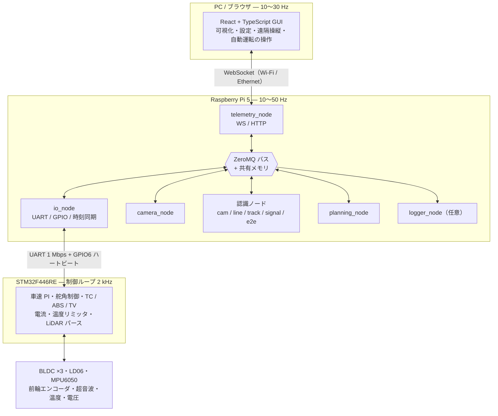
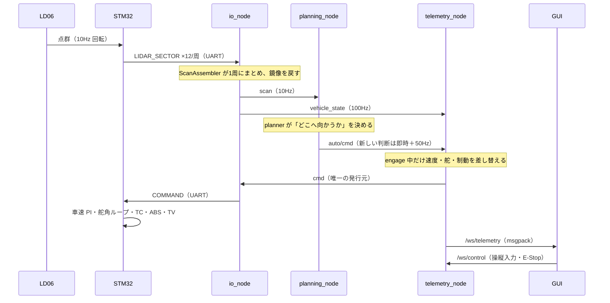

# SURGE Mark.2 システム概要

自律走行ミニカー **SURGE Mark.2** の Raspberry Pi 5 側（＋PC 側 GUI）が、**何を・どこで・どういう順番で**
やっているかと、**なぜそう設計したか**をまとめた唯一の概要文書。

> **数値・手順の正はこの文書に置かない**（複製すると片方が古くなる）。
>
> | 何の正か | 置き場所 |
> |---|---|
> | 車両の幾何・質量・動特性・制御・安全タイマ | `config/vehicle.toml`（読み手は `raspi/core/vehicle.py`） |
> | UART のバイト配置・パケット・版 | `raspi/proto/protocol.toml`（仕様の説明は [`uart_protocol.md`](uart_protocol.md)） |
> | 制御定数の出どころ | [`control_constants.md`](control_constants.md) |
> | コマンド・反映手順・トラブルシューティング | [`development.md`](development.md) |
> | 校正の手順と値の意味 | [`calibration.md`](calibration.md) |
> | 今どこまで進んだか・実測値 | `../PROGRESS.md`（冒頭の「現在の状態」） |
>
> この文書とコードが食い違ったら**コードが正**。

---

## 目次

1. [全体像](#1-全体像)
2. [ハードウェア](#2-ハードウェア)
3. [3階層アーキテクチャと責務分割](#3-3階層アーキテクチャと責務分割)
4. [データが一周する流れ](#4-データが一周する流れ)
5. [通信路](#5-通信路)
6. [Raspberry Pi の中身 — プロセスとトピック](#6-raspberry-pi-の中身--プロセスとトピック)
7. [座標系・単位・車両パラメータ](#7-座標系単位車両パラメータ)
8. [安全設計 — 止まる仕組み](#8-安全設計--止まる仕組み)
9. [自動運転のしくみ](#9-自動運転のしくみ)
10. [GUI](#10-gui)
11. [記録と再生](#11-記録と再生)
12. [シミュレータ・学習・ファームのホストシム](#12-シミュレータ学習ファームのホストシム)
13. [リポジトリ構成と技術スタック](#13-リポジトリ構成と技術スタック)
14. [現在地とロードマップ](#14-現在地とロードマップ)
15. [用語集](#15-用語集)

---

## 1. 全体像

**PC・Raspberry Pi 5・STM32 の3台が、それぞれ違う周期で違う仕事をする。**



| 誰が | 何を | 周期 | 実装 |
|---|---|---|---|
| **STM32** | モータを実際に回す。速度・舵角・スリップ・保護・安全停止 | 制御 2 kHz、テレメトリ 100 Hz | C（ファームは別リポジトリ） |
| **Raspberry Pi 5** | センサ統合・自己位置推定・経路計画・行動判断・通信・記録 | 10〜50 Hz | Python（numpy / ONNX Runtime、一部 C） |
| **PC** | 人間が見る・設定する・遠隔操縦する・学習する | 10〜30 Hz | React + TypeScript + Vite |

**Pi から STM32 へ送るのは「目標」であって出力ではない**（目標速度・加速度の上限・目標路面舵角。全体は `COMMAND`）。
PWM やトルク配分を Pi が決めようとすると遅延で破綻する。例外は `torque_mode`（校正試験・手動のトルク操縦）と `launch` だけ。

---

## 2. ハードウェア

### STM32（制御ボード）に付いているもの

| センサ／アクチュエータ | 内容 | Pi 側の設計に効く制約 |
|---|---|---|
| **LiDAR LD06** | 10Hz 回転・最大約12m。専用 UART | **裏向きに実装**され点群は鏡像（`ScanAssembler` が戻す）。1周 100ms の間に車が動き、点群が扇形に歪む（脱スキューが要る） |
| **超音波 ×2**（前・後） | HC-SR04 系 | **実質 20Hz が上限**。100Hz の TELEMETRY に同じ値が連続する |
| **駆動モータ ×2**（後輪左右独立） | BLDC ダイレクトドライブ + 自作 MD。**トルクモード** | TC・ABS・トルクベクタリングは STM32 内で完結（[`uart_protocol.md` §5.3](uart_protocol.md#53-telemetry-0x02--len--102)） |
| **ステアリングモータ ×1** | BLDC + 自作 MD。**位置モード**（サーボではない） | モータ角 → 路面舵角は**線形ではない**（中立付近 0.5、大舵角ほど切れない）。STM32 が同定式で換算し、Pi は路面舵角を扱う（`vehicle.toml` の `steer_link_*`・`max_steer`） |
| **車速センサ** | 前輪左右の**アナログ絶対角エンコーダ**（ADC） | 分解能が粗い。車速 `speed` は STM32 が加速度計とのカルマンフィルタで出す（[`uart_protocol.md` §5.3.1](uart_protocol.md#531-車速の推定とその一貫性の診断)）。**ここから加速度を微分しない**。前輪は操舵輪 |
| **IMU MPU6050**（6軸） | **地磁気センサ無し** | **絶対方位が出ない**。yaw は積分ドリフトする |
| **温度センサ ×4** | MD 後左 / 後右 / ステア / STM32 内蔵 | 据え切りを続けると**ステア MD が過熱**する（planner は停車が続くと舵を中立へ戻す。`raspi/auto/base.py` の `StandstillSteer`） |
| **電源 2系統** | 駆動系／シグナル系。各 Ni-MH 8セル | **片方だけ落ちる**（駆動を切っても Pi と STM32 は生きている）。駆動系の遮断はラッチする（§8.4） |

### Raspberry Pi 5 に付いているもの

| ピン／接続 | 用途 |
|---|---|
| CSI ×2 | 前方 / 後方カメラ（`picamera2`）。IMX219 160° 広角（魚眼）。内部パラメータは `config/vehicle.toml` のレンズのプロファイル（[`calibration.md` §7](calibration.md#7-カメラ魚眼レンズ)） |
| **GPIO6** | STM32 と接続。**緊急停止ハートビート**（100Hz 矩形波、§8.1） |
| GPIO14 / GPIO15 | UART TX / RX ⇄ STM32（`/dev/serial0`） |
| GPIO18 / GPIO19 / GPIO13 | ブザー / LED 緑 / LED 赤（`raspi/io/gpio.py`） |
| Wi-Fi / Ethernet | PC との WebSocket（§5.4） |

> **Pi 5 は Pi 3/4 と違う。** `RPi.GPIO` は RP1 チップで動かないので `gpiozero` + `lgpio`、
> カメラは `picamera2`、UART はデバイス名を直書きせず `/dev/serial0`。

---

## 3. 3階層アーキテクチャと責務分割

**「速い制御はエッジに、遅い判断は上位に」**

```
┌──────────────────────────────────────────────┐
│ PC        人間が見る・触る            10〜30 Hz │
└───────────────────┬──────────────────────────┘
                    │ WebSocket（用途別にチャンネル分離）
┌───────────────────┴──────────────────────────┐
│ Pi 5      認知・判断                  10〜50 Hz │
│           知覚 → 自己位置 → 経路 → 行動判断      │
└───────────────────┬──────────────────────────┘
                    │ UART 1 Mbps ＋ GPIO6 ハートビート
┌───────────────────┴──────────────────────────┐
│ STM32     リアルタイム制御                       │
│           速度/舵角ループ・TC・ABS・TV・保護      │
└──────────────────────────────────────────────┘
```

TC・ABS・スリップ制御は数 ms 以内に効かせる必要があり、UART 往復 + Python の遅延を挟むと成立しないので STM32 に閉じる。
SLAM・経路計算は Python の方が速く作れる。そして**上位が落ちても下位が自力で安全を確保できる**。

| 層 | 担当 |
|---|---|
| **STM32** | 駆動・舵角の制御ループ、TC・ABS・TV、LD06 のパースとセクタ分割、超音波測距、電流・温度リミッタ、`COMMAND` 途絶時の自動ブレーキ、GPIO6 ハートビート監視、動的停止距離の `auto_stop` |
| **Pi 5** | 点群処理、カメラ認識、自己位置推定・地図、経路生成、行動判断、テレメトリ配信、記録 |
| **PC** | 可視化、パラメータ設定、ラジコン入力、学習（Mac） |

| 落ちたもの | 何が起きるか |
|---|---|
| PC（GUI） | 手動操縦は `cmd` 途絶で DISARM。自律走行は `auto_link_grace_ms` の範囲で継続（§8.2） |
| Pi / `surge-io` | GPIO6 ハートビートが止まる → **STM32 が E-Stop をラッチ**。現地でボタンを押すまで動かない |
| STM32 | Pi 側が TELEMETRY 途絶を検知して DEGRADED → FAULT |

---

## 4. データが一周する流れ

**LiDAR が壁を見てから、モータが反応するまで。**



**ステアリングの応答遅れ**は校正で測って `vehicle.toml` に置き、Pure Pursuit の注視距離と遅延補償（`steer_delay`）に入れる
（[`calibration.md`](calibration.md)）。入れないと「低速では動くのに速度を上げた瞬間に蛇行が発散する」。GUI は実測
`steer_actual` と受理済み指令 `steer_cmd_echo` を重ねて遅れを見せる。

### ★ 指令の発行元は `cmd` 1本に絞ってある

`planning_node` と `telemetry_node` の両方が `cmd` に publish すると、購読側からは区別できないまま交互に
上書きし合い、**止める側が負けることがある**（telemetry_node は操縦者不在でも 50Hz で DISARM を流し続けている）。

```
GUI ──cmd(mode, arm, 灯火…)──▶ telemetry_node ──cmd──▶ io_node
planning_node ──auto/cmd(速度・舵)──▶     ↑ ここで差し替える（_cmd_pump）
```

増える遅延は telemetry_node の中継ぶんだけで、指令の生成元が1つに定まる価値の方が大きい。
この形なら自律走行中も人間の安全網（ARM 保持・`cmd` 途絶で DISARM・E-Stop）がそのまま生きる。

---

## 5. 通信路

**役割も方式も違う3本があり、混ぜていない**: STM32 ⇄ Pi は UART の自作バイナリフレーム、Pi 内部は ZeroMQ ＋共有メモリ
（msgspec / msgpack）、Pi ⇄ PC は WebSocket（msgpack と JSON）。

### 5.1 UART フレーム（STM32 ⇄ Pi）

```
┌────────┬──────┬─────┬─────┬───────────┬────────┐
│ SYNC   │ TYPE │ SEQ │ LEN │  PAYLOAD  │ CRC16  │
│ AA 55  │  1B  │ 1B  │ 1B  │  0-255B   │  2B    │
└────────┴──────┴─────┴─────┴───────────┴────────┘
```

パケットの一覧・頻度・フィールドは [`uart_protocol.md` §4](uart_protocol.md#4-パケット一覧) と `protocol.toml` が正。
`protocol.toml` から Python パーサ（`packets.py`）と STM32 用 C ヘッダ（`surge_proto.h`）を `raspi/proto/generate.py`
で生成する（定義が2箇所にあると必ずズレるため）。版が一致しない間は ARM しない。

- **`COMMAND.flags` が安全の要**（`arm` / `brake` / `torque_mode` / `auto_stop` ほか）
- **ゼロ値は安全側に倒してある。** `brake_torque = 0` は「制動 0」ではなく「未指定＝STM32 側の最大で制動」。
  フィールドの埋め忘れでブレーキが効かなくなる方が危険なため（[`uart_protocol.md` §5.6.2](uart_protocol.md#562-brake_torque-の約束)）
- 制御パラメータは `vehicle.toml` の `[control]` を io_node が `CONFIG_SET` で送る（ファームは揮発）

### 5.2 内部バス（Pi 内部）

**ZeroMQ を土台にし、メッセージ規約だけ自作する**（`raspi/bus/zbus.py`）。輸送層まで自作するのは無駄。
購読者の要求が違うので **3つの配送パターンを使い分ける**。

| パターン | 用途 | 実装 |
|---|---|---|
| **最新値のみ** | 制御指令・車両状態 | ZMQ PUB/SUB + `CONFLATE=1` |
| **取りこぼし厳禁** | ロガー・記録 | ZMQ PUB/SUB + 大きめの HWM |
| **大容量ゼロコピー** | カメラ画像 | `shared_memory` のリングバッファ（`raspi/bus/shm_ring.py`） |

- **なぜ CONFLATE か**: 購読側が追いつかないとキューに溜まり、**制御ノードが2秒前の点群で舵を切る**。
  見た目は正常に動くので気づきにくい。同じトピックを購読者ごとに違うポリシーで受けるのが要点
- **なぜ画像を ZMQ に流さないか**: 640×480×3 を 30Hz で送ると約 27MB/s のコピーになる。共有メモリに置き、
  ZMQ には `{buf_id, w, h, format, t_capture}` の参照だけ流す
- エンドポイントは**ノード単位**。既定は `ipc:///tmp/surge-bus/<node>.ipc`（`SURGE_BUS_DIR` で移動、`SURGE_BUS_TCP` で TCP）
- **新しいトピックは `TOPIC_OWNER` に登録する**。漏れると「動くのにデータが来ない」。前方一致に誤って拾われないか
  も確かめる（`scan/cam` が `scan` に吸われた事故がある）

> **ZeroMQ の落とし穴3つ**（`raspi/tests/test_zbus.py` で固定）
> 1. **`CONFLATE` は multipart 非対応** → `topic + b"\0" + msgpack` の1フレームにした
> 2. **`CONFLATE` はソケット単位**。1本の SUB に相乗りさせると LiDAR が来るたびに車両状態が捨てられる
>    → **トピック1本につき SUB ソケット1本**
> 3. **ipc の同じ経路への二重 bind はエラーにならず、後から来た方が黙って奪う** → `Publisher` が
>    `<node>.ipc.lock` を排他ロックし、同名の2つ目は起動を拒否する

**メッセージ規約**: `msgspec.Struct` で定義し msgpack で流す。**全メッセージが `t_capture`（センサ取得時刻、
Pi の単調時刻に換算済み）/ `t_pub` / `seq` を持つ**。無いと、後でセンサ融合を作るときに全定義を書き直すことになる。

### 5.3 WebSocket / HTTP（Pi ⇄ PC）

**1本にまとめない。** カメラのフレームが詰まった瞬間にラジコン入力まで遅延するため。メッセージの形は `raspi/msgs/types.py` が正で、GUI 側は `gui/src/types.ts` に手写し。

| チャンネル | 内容 | 方式 |
|---|---|---|
| `/ws/telemetry` | 車両状態・点群・リンク統計・自動運転の判断 | msgpack。`vehicle_state` が届いた周に送り、他は変わったときだけ載せる |
| `/ws/camera/{front,rear}` | JPEG フレーム | バイナリ。頻度の上限は GUI のカメラ設定 |
| `/ws/control` | 操縦入力・設定変更・状態通知 | JSON |
| `/ws/map` | 地図（3値を2bitに詰めて zlib）・中心線・経路 | msgpack。変わったときだけ（接続時に最新の1枚） |
| `/ws/map_upload/<name>` | 地図のアップロード | 操作時のみ |
| `/ws/record` | MCAP のライブ中継 | 記録中のみ |

- **GUI 本体（`gui/dist`）も telemetry_node が HTTP（ポート 8000）で配る**ので WS と同一オリジンになり、接続先をコードに
  書く場所が無い（`gui/src/ws/url.ts`）。`GET /logs/<name>` でログも落とせる
- **1台の詰まりを他へ波及させない。** 受信が止まったクライアントは短時間で見切って切断する
- **遅れて届いた「走れ」は捨てる**（`_cmd_lateness_ms`）。詰まりの後にまとめて届いてもデッドマンは生き返らない（止める指令は通す）
- engage 中は操縦者以外が自律の設定を変えられない（解除は誰でも通る）。ARM 中のシャットダウンは拒否。Host 名も検査する
  （DNS リバインディング対策、`SURGE_ALLOWED_HOSTS`）

### 5.4 ネットワーク — **Pi は常に STA。繋ぎ先を変えるだけ**

研究室は研究室の AP、本番・屋外は**持込ルーター**に STA で繋ぐ（SSID を NetworkManager に登録しておくだけ）。
フォールバックは有線 Ethernet 直結（据置開発用。走行はできない）。**AP モードは実装しない**:
①AP では Pi の基板アンテナが電波の上限になり、切断は `cmd` 途絶 → 停止に直結する
②ヘッドレスの Pi でモード切替に失敗すると救出手段が消える ③屋外の 5GHz は日本では W56（DFS 必須、レーダー検出で長く止まる）
のみで、屋外は 2.4GHz 固定にする ④インターネットが来ず NTP が効かない。
NetworkManager は知らない SSID に自動接続しないので、**持込ルーターの SSID は研究室で（直結が使えるうちに）登録**しておく。

**mDNS**: `avahi-daemon` で **`surge-mk2.local`** に解決できる（`http://surge-mk2.local:8000`）。クライアントは IPv4 に固定する
（ssh は IPv6 リンクローカルを優先して Wi-Fi 経由になる）。Wi-Fi だけの端末向けに `surge-mdns` がユニキャストで応答し、
それでも引けない Mac は `tools/find_pi.py` で IP を引いて IP で開く。接続情報の実値は `setup_credentials.md`（gitignore 済み）。

---

## 6. Raspberry Pi の中身 — プロセスとトピック

**Python の GIL があるので、スレッドではなくプロセスで分ける。** `io_node` は UART・GPIO に専念し、他の処理を混ぜない。

流れは §1 の図と下の「主要トピック」の発行元を見る。

### systemd サービス

`raspi/setup/install_services.sh` が登録する（反映の操作は [`development.md` §2](development.md#2-変更--反映の対応表最重要)）。

| unit | モジュール | 役割 | 止めると |
|---|---|---|---|
| `surge-io` | `raspi.nodes.io_node` | UART 送受信・GPIO6 ハートビート・時刻同期・`.sfl` 記録 | **★ E-Stop がラッチする** |
| `surge-camera` | `raspi.nodes.camera_node` | picamera2 → 共有メモリ | カメラ系が止まる |
| `surge-telemetry` | `raspi.nodes.telemetry_node` | WS / HTTP サーバ。**`cmd` の唯一の発行元** | GUI が繋がらない |
| `surge-planning` | `raspi.nodes.planning_node` | planner の購読・周期実行・`auto/*` の publish | 自律走行だけ止まる |
| `surge-cam-perception` | `raspi.nodes.cam_perception_node` | 走行可否セグメンテーション → `scan/cam`・`path/cam` | `ftg_cam` / `cam_centerline` が使えない |
| `surge-cam-e2e` | `raspi.nodes.cam_e2e_node` | 画像から操舵を回帰 → `cam_e2e/cmd` | `cam_e2e` が使えない |
| `surge-line-perception` | `raspi.nodes.line_perception_node` | 白線検出 → `line/cam` | `line_trace` が使えない |
| `surge-cam-track` | `raspi.nodes.cam_track_node` | 対象追従 → `track/target` | `follow_object` が使えない |
| `surge-mdns` | `raspi.tools.mdns_unicast` | Wi-Fi 端末向けの mDNS 応答 | 名前が引けない端末がある |
| `surge-arrow-signal` | `raspi.nodes.arrow_signal_node` | 前方カメラの矢印信号 → `route/select`。**unit だけ置き既定は無効** | 信号による経路選択が使えない |
| `surge-logger` | `raspi.nodes.logger_node` | MCAP 記録。**既定では無効**（`--with-logger`、§11） | — |
| `surge-logclean.timer` | — | 古いログを定期的に消す | ディスクが埋まる |

- **カメラ系の認識ノードは常時 enable。** `auto/ctrl` で対応モードが選ばれている間だけ推論する（IDLE/ACTIVE）
- **`surge-planning` は常時上げてよい。** `auto/cmd` に出すだけで `cmd` には publish しないので、起動していること
  自体は車を動かす条件にならない

### 主要トピック

持ち主の正は `raspi/bus/zbus.py` の `TOPIC_OWNER`、型の正は `raspi/msgs/types.py`。

| トピック | 中身 | 発行元 |
|---|---|---|
| `vehicle_state` | 速度・各輪周速・路面舵角・オドメトリ・IMU・温度・電源2系統・フラグ（100Hz） | io_node |
| `scan` | LiDAR 1周分（360点＋セクタごとの時刻・受信有無、10Hz） | io_node |
| `diag/link` | リンク統計（loss / CRC / 往復 / 時刻同期 / ARM 禁止の理由 / **SIM バッジ**） | io_node |
| `cmd` | 目標速度・舵角・フラグ | **telemetry_node（唯一）** |
| `auto/ctrl` | どのモードで走るかの意思・パラメータ | telemetry_node |
| `log/ctrl`・`cam/*`・`*/model`・`track/roi`・`signal/config` ほか | GUI の意思・設定の中継 | telemetry_node |
| `auto/cmd` | 自律走行の目標速度・舵角・制動（新しい判断は即時＋50Hz） | planning_node |
| `auto/state` | 判断の根拠（自己位置・段・理由 `reason`） | planning_node |
| `auto/map` | 占有格子・中心線・経路（版が変わったとき） | planning_node |
| `image/front`・`image/rear` | 共有メモリ参照 | camera_node |
| `scan/cam`・`path/cam`・`cam/mask` | カメラ由来の擬似点群・走行可能回廊・マスク | cam_perception_node |
| `line/cam` | 白線の近傍・遠方2点（地面座標） | line_perception_node |
| `cam_e2e/cmd` | 画像からの操舵・速度 | cam_e2e_node |
| `track/target` | 追従対象の方位・距離 | cam_track_node |
| `route/select`・`signal/status` | 経路グループの切替要求・直近の判定 | arrow_signal_node（名前 `signal`。試験用 `raspi/tools/route_select.py` も同名） |
| `hb/<node>` | ハートビート（logger_node が記録するだけ） | 各ノード |

`hb/*` を監視する Watchdog ノードは無い。その役は GPIO6 ハートビートと `cmd`・`auto/cmd` の途絶判定が分担する（§8）。

---

## 7. 座標系・単位・車両パラメータ

**ROS の慣例（REP-103 / REP-105）に従う。** 自作フレームワークでも、である。①論文・教科書の式がそのまま使える
②ROS 2 に移る場合の摩擦がゼロ ③独自ルールは3ヶ月後に思い出せない。

| 項目 | 規約 |
|---|---|
| 座標系 | **右手系。x = 前、y = 左、z = 上**（地図では x = 右、y = 上） |
| 角度 | **反時計回りが正**（左旋回が正） |
| 単位 | **SI 固定**（m, m/s, m/s², rad, rad/s, s） |
| 時刻 | ns 単位の整数、Pi の `CLOCK_MONOTONIC` 基準 |

**内部は絶対に SI。km/h や度への変換は GUI の表示直前（`gui/src/format.ts`）でだけ行う。**

### フレーム階層

```
map ──── odom ──── base_link ──┬── lidar
 │        │            │        ├── cam_front
 │        │            │        └── cam_rear
 │        │            └─ 後輪車軸の中心
 │        └─ 連続で滑らか。ただしドリフトする → 局所制御（経路追従）
 └─ SLAM が補正する。跳ぶことがある → 大域経路計画
```

- **`odom` と `map` を分ける理由**: ループ閉じが効いた瞬間に自己位置は数十 cm 跳ぶ。制御ループに直接食わせると舵が暴れる
- **`base_link` を後輪車軸中心に置く理由**: 自転車モデルが最も簡潔になる（重心基準だとスリップ角の項が入る）。
  Pure Pursuit の標準式も後輪基準

$$\dot{x} = v\cos\theta,\quad \dot{y} = v\sin\theta,\quad \dot{\theta} = \frac{v}{L}\tan\delta \qquad (L = \text{ホイールベース},\ \delta = \text{路面舵角})$$

### 車両パラメータは `config/vehicle.toml` に集約

**全ノードがそこだけを見る**（Python は `raspi/core/vehicle.py` の `Vehicle`、GUI は `config/generate.py` が生成する
`gui/src/generated/vehicle.ts`）。形式は TOML（`tomllib` で読めて依存が増えず、`protocol.toml` と流儀が揃う）。
スキーマ（幾何・質量・センサ取付位置・`[dynamics]`・`[control]`・`[safety]`・`[limits]`）と各値の出どころは
ファイル内のコメントが正。動特性・制御の値は車両の校正で測る（[`calibration.md`](calibration.md)）。

---

## 8. 安全設計 — 止まる仕組み

**自律走行で最初に作るべきは走る機能ではなく止まる機能。** 互いに独立した3層にする
（全体表は [`uart_protocol.md` §10](uart_protocol.md#10-安全層の全体像)）。

```
[1] ハードウェア層   GPIO6 ハートビート、STM32 内の電流・温度リミッタ、駆動電源の遮断
[2] STM32 ファーム層 COMMAND 途絶で自動ブレーキ、auto_stop（速度に応じた動的停止距離）
[3] Pi ソフト層      cmd・auto/cmd 途絶の検知、点群の鮮度、planner の ready=False
```

### 8.1 GPIO6 ハートビート（第1層）

**単純なアクティブ Low の E-Stop はフェイルセーフにならない。** 断線するとプルアップで High（＝正常）に戻り、
異常を検知できないため。Pi が GPIO6 に 100Hz の矩形波を出し続け、STM32 はエッジが途切れたら即ブレーキ＋
`estop_active` を**ラッチ**する（詳細は [`uart_protocol.md` §9](uart_protocol.md#9-緊急停止ラインuart-とは独立した第1安全層)）。
この1本で **Pi のフリーズ・電源断・断線・プロセスのクラッシュ**をすべて検出できる。

- **★ 復帰は必ず人間の明示操作。** ラッチの解除は**車両のボタン2**を物理的に押す。自動復帰させない（原因未解消の
  まま走り出すため）。つまり **`surge-io` を止める＝車が現地に行くまで動かなくなる**
- **ボタン2で解除しても、ARM を入れ直すまで走らない。** E-Stop・駆動電源ラッチ・STM32 の再起動・`COMMAND` 途絶の後は、
  ARM ビットが一度 0 になるまで ARM を通さない。io_node（`_update_rearm_latch`、理由は `diag/link` の
  `arm_inhibit_reason`）と STM32（`rearm_required`）の両方が持つ。GUI は ARM 禁止を見ると ARM 要求を下ろすので、
  人が ARM を押し直せば通る

### 8.2 タイムアウトの一覧

| 何が | 閾値の正 | どうなる |
|---|---|---|
| GPIO6 ハートビート | [`uart_protocol.md` §9](uart_protocol.md#9-緊急停止ラインuart-とは独立した第1安全層) | **STM32 が E-Stop をラッチ** |
| `COMMAND`（Pi→STM32） | [`uart_protocol.md` §8](uart_protocol.md#8-エラー処理と統計) | STM32 が自動ブレーキ |
| `TELEMETRY`（STM32→Pi） | 同上（2段） | DEGRADED（警告のみ）→ FAULT（io_node が最大制動を送り DISARM） |
| `cmd`（バス上・GUI→telemetry） | `vehicle.toml` `[safety] cmd_deadman_ms` | telemetry_node と io_node が**独立に**判定。最大制動を送り、止まってから DISARM |
| GUI の途絶（自律走行中） | `[safety] auto_link_grace_ms` | 猶予の間は planner が走らせ続け（**その間は GUI から止められない**）、超えたら DISARM して engage も解除 |
| `auto/cmd`（planner の死亡） | `[safety] auto_cmd_stale_ms` | telemetry_node が制動に読み替える |
| `scan` が古い | `Planner.stale_ms`（`raspi/auto/base.py`） | planning_node が制動指令に読み替える |
| GUI の無操作 | GUI の設定（`armIdleTimeoutMs`） | DISARM（**自律走行中は掛けない**。人が触らないのが正常なため） |

**上りと下りで非対称にしてある。** 上り（TELEMETRY）を2段にするのは単発の CRC エラーや一時的なロスで即 FAULT に
落とさないため、下り（COMMAND）は安全に直結するので一段で厳しくする。

### 8.3 モータが回る条件は3つ

**①io_node が `--allow-arm` で起動している ②`cmd` が途絶せず届き続けている ③人間が GUI で ARM を保持している** の AND。
1つでも欠けたら DISARM。加えて `protocol_version` の一致、`[control]` の STM32 への同期、E-Stop・駆動電源ラッチ・STM32 再起動の
後の ARM の入れ直し（§8.1）が要る。

- **デッドマンは「離したら `speed=0` を送る」ではなく「送信そのものを止める」。** 0 を送る設計だと、その指令が
  届かない状況（＝一番止めたい状況）で止まらない。ブラウザのフリーズ・タブの離脱・Wi-Fi 断が同じ経路で停止になる
- **engage ≠ ARM。** engage は「自律に任せてよい」という意思表示にすぎず、planning_node は `arm` を立てられない。
  engage は保存しない（`config/auto.json` に入るのはモードとパラメータだけ）ので、**電源を入れただけで走り出す経路が無い**

### 8.4 駆動電源ラッチは異常ではない

過電流などで `DRIVE_POWER` がハード遮断されると**ラッチし、電源をリセットするまで復帰しない**。STM32 は
`drive_power_locked` を立て、Pi が `arm` を要求しても `armed` を立てない。GUI は通信 FAULT と区別して
「駆動電源ラッチ中 — 電源を入れ直してください」と出す。

### 8.5 「なぜ止まったか」を必ず出す

汎用の状態機械は持たない（操縦モード `mode`＋ARM・engage、`LinkDiag` と STM32 のフラグ、planner ごとの段に分かれる）。
各 planner は `AutoState` に理由 `reason` を載せ、GUI は `ui.disarmReason` と合わせて画面に出す。

---

## 9. 自動運転のしくみ

### 9.1 「純粋な計算」と「配線」を分けてある

| ファイル | 役割 |
|---|---|
| `raspi/auto/base.py` | `Planner` と `ParamSpec`。**バスも WS も知らない純粋な計算** |
| `raspi/auto/<algo>.py` | アルゴリズム本体 |
| `raspi/auto/registry.py` | id → クラス（`PLANNERS`）。GUI へ渡す宣言（`catalog()`）もここ |
| `raspi/nav/` | 経路生成・追従・回避・局所地図・学習などの部品（SLAM 本体は `slam2d/`） |
| `raspi/nodes/planning_node.py` | 配線だけ（購読・周期・publish） |

**モードは増える前提で作る。** `registry.py` に1行足せば GUI の選択肢に出て、設定の UI も planner が宣言した
`ParamSpec`（スライダ・チェックボックス・ボタン・表示条件）から自動生成される。**GUI にモード名を書かない**
（増やすたびに2箇所直すことになり、いつか片方が古くなる）。`ParamSpec(hidden=True)` は GUI に出さない定数。

`Planner` が守る**4つの約束**:

1. `plan()` は状態を持ってよいが、`reset()` で完全に初期化できること
2. 戻り値は `AutoState`。指令（速度・舵・制動）と**理由 `reason` を必ず同時に返す**
3. 走ってよいか分からないときは `ready=False`。planning_node が制動に読み替える
4. パラメータは `params` に宣言する

### 9.2 実装されているモード

`raspi/auto/registry.py` の `PLANNERS` が正（`category = "sysid"` の `calib_*` はシステム同定タブ専用）。学習系の使い方は [`development.md` §12](development.md#12-学習ベースの自動運転を動かすlidar-e2e--カメラセグメンテーション--カメラe2e)。

| id | 名前 | 地図 | 考え方 |
|---|---|---|---|
| `ftg` | Follow the Gap | 不要 | 点群の中で**最も広く空いた区間**を選び、**その真ん中**を狙う |
| `ftg_cam` | Follow the Gap（カメラ） | 不要 | `ftg` と同じロジックを、カメラのセグメンテーションから作った擬似点群で走らせる |
| `cam_centerline` | 中心線追従（カメラ） | 不要 | 走行可能領域から前方の回廊中心を作り Pure Pursuit で追う |
| `cam_e2e` | E2E カメラ（模倣学習） | 不要 | 前方画像から操舵を直接回帰。速度は舵の切れ具合から決める |
| `de` | Disparity Extender | 不要 | 物の縁を車体半幅ぶん**塗り潰してから**、一番遠い帯の真ん中を狙う |
| `dp` | Disparity Pursuit | 不要 | `de` の塗り方・狙点選択＋ `ftg` の Pure Pursuit 舵角＋狙点のヒステリシス |
| `slam2d_raceline` | レーシングライン(slam2d) | 作る/読む | 地図を作り最小時間寄りのラインを追う。`listed = False` で GUI に出ず、`slam2d_route` の土台と `sim.bench` 用 |
| `slam2d_route` | **経路選択走行(slam2d)** | 作る/読む | 道路グラフ＋経由点で分岐を選んで周回。**GUI の主力** |
| `line_trace` | ライントレース（カメラ） | 不要 | 白線の2点を Pure Pursuit の目標点にする。障害物回避なし |
| `e2e_lidar` | E2E LiDAR | 不要 | 強化学習（PPO）で点群→操舵・速度を直接回帰 |
| `follow_object` | 対象追従 | 不要 | 映像で選んだ対象との車間を保って追従（前進のみ） |
| `park_to_point` | 駐車（クリック指定） | 局所地図 | LiDAR 画面でクリックした位置・向きへ Hybrid A* で接近して停止 |

各モードの要点:

- **`ftg`**: 最遠点ではなく区間の真ん中を狙う（最遠点狙いは壁際を縫い、外輪が当たる）
- **`de`**: 測定値が大きく飛ぶ所を物の縁とみなし、遠い側を近い側の値で塗る（近いほど広く）。**速度は狙う方向の見通しで決め、
  正面の扇で測り直さない**（狭い走路では正面の扇の最小値が常に短く出て踏み切れない）
- **`ftg_cam`**: `ftg` の `plan()` は上書きせず、`cam_perception_node` がセグメンテーションを `raspi/nav/ipm.py` で地面へ逆投影して
  `scan` と同じ形にする（ギャップ探索はセンサを問わないため）
- **`line_trace`・`e2e_lidar`**: 障害物には固定距離の停止策を持たず、STM32 の `auto_stop` で受ける。`e2e_lidar` はシム上の PPO
  （`ml_lidar/train_rl.py`）で学習するので `de` を超えうるが、未知の点群への挙動は保証できない

### 9.3 「走る」より「止まる」を先に決める

**`ready=False`（計画を放棄）と `brake=True`（意図した停止）を区別している。**

| 誰が | 条件 | 挙動 |
|---|---|---|
| planner | セクタ受信率が視野の一定割合未満（`follow_the_gap.MIN_SEEN_RATIO`） | `ready=False` → 制動 |
| planner | 通れる隙間が1つも無い | `ready=False` |
| `slam2d_*` | 自己位置の一致度が下限未満・経路から離れすぎた | `ready=False`（理由を reason に出す） |
| planning_node | 点群が古い・モード未選択・点群未着 | 制動に読み替える／`ready=False` |
| telemetry_node | `auto/cmd` の途絶（planner の死亡） | 制動に読み替える |
| GUI | 人が舵・スロットル・ブレーキを触った | 自律を解除して手動に戻す（クルコンと同じ作法） |
| GUI | E-Stop / 操縦権の解放 / 接続断 | engage も同時に落ちる |

> ⚠ **`sector_seen == False` は「障害物なし」ではない。** 欠測方向は距離 0（侵入禁止）として扱う。空きとして扱うと
> **LiDAR が片側だけ落ちた瞬間にその方向へ舵を切る。** 一方 **`dist == 0`（測距不能）だけは空き**として扱う — 唯一危険側に倒す判断で、
> STM32 の `auto_stop` で受ける取引の上に成り立つ（大半が測距不能なら走らない。契約の正は `raspi/auto/base.py` の `scan_window`）。
> **地図に焼くときは逆に捨てる**（一度「空き」と書いた場所は後から直せない）。
>
> **固定距離の緊急停止は Pi 側に持たない。** STM32 の `auto_stop`（速度に応じた動的停止距離。[`uart_protocol.md` §5.6.4](uart_protocol.md#564-auto_stop-の約束)）
> の方が高性能なため。前方余裕による減速は走行の一部として planner に残る。

### 9.4 地図を使う走行（`slam2d_raceline` / `slam2d_route`）

```
[EXPLORE] → [BUILD] → [DONE] → [LOCATE] → [RACE]   （障害物で進めないときだけ [DETOUR]）
 地図を育てる  中心線と   保存して  保存地図上で  周回
 （FTG か人）  経路      人を待つ  自己位置を復元
```

保存済みの地図を読めば `LOCATE` から始まる。自己位置は `slam2d/`（`raspi/auto/_slam2d_nav.py` 経由、§9.5）。

- **ループ閉じは EXPLORE→BUILD の瞬間に1回だけ**、RACE 中は追跡専用。EXPLORE を複数周にするのは1周では動く物が地図から消えないため
- **BUILD 中は止まるのが正しい。** `plan()` が重いと `auto/cmd` が途絶して制動に落ちるので、重い計算は周期に分けるかワーカースレッドへ
- **LOCATE** は候補姿勢を点数で比べ、曖昧なら自動で決めず地図のクリック（ヒント）で絞る。見失って止まると LOCATE へ戻る
- **判断は 10Hz、追従は 50Hz**（`tick()`）。合間は推測航法で姿勢を進めて舵と速度だけ更新する

**分岐のあるコースは `slam2d_route`**（`Slam2dRaceLine` の派生）。最後の1周の軌跡から中心線を作ると走らなかった枝が
経路に現れないので、経路を**地図全体の上の探索問題**にした: 3値地図を細線化した道路グラフ（`raspi/nav/roadgraph.py`）→
経由点を有向エッジの Dijkstra でつなぐ（`raspi/nav/route.py`）→ 選ばなかった枝を壁とみなす回廊でラインを引く →
走行中の切替は保留して乗り換えられる周期に移る（`raspi/nav/route_switch.py`）→ ミッション（n周／t秒 → 停止・駐車）で終える。

- **グラフ＋経由点を採り、地図全体の Hybrid A\* は採らない。** 全体探索は Pi で遅く、地図の微小な差で分岐の選択が揺れる。
  グラフは速く、何が選ばれるか人間に読める。Hybrid A\* は駐車と DETOUR だけ
- **分岐は「行きたい枝に経由点を置く」**で選ぶ。経由点が無い間は、周回を全部挙げて見積もりラップが最短のものを走る
  （`route.enumerate_loops`）。ルール上通れない道は `avoid_rects` で道路グラフを作る前に壁として塗る
- **大会用と汎用で実装を分けない。** 周回数・停止点・信号の対応は `saved_maps/<name>.routes.json`（`raspi/auto/route_config.py`）というデータ
- **経路への合流は計画する**（`_join_back`・`avoid.join_in`）。今の位置・向きから経路へ滑らかにつなぐ一時経路を引き、周回と
  同じ速度計画で乗る（速度だけ抑えて追従で乗ると、ずれたまま大回りして壁に当たった）。外れすぎ・スタックは Hybrid A* で戻る
- **障害物・他車は Frenet 格子で追い抜く**（`raspi/nav/overtake.py`）。抜けない相手には付いていく

**速度と経路は同定値から決める。**

- **限界は `Vehicle`（`raspi/core/vehicle.py`）が出し、「限界の何割を使うか」の設定は無い。** 手の絶対値だと同定し直しても走りが
  変わらず、実行できない楽観的な値も入る
- 速度は「横 G の上限 → 後ろ向き（減速）→ 前向き（加速）」。**減速を先に掛ける**
- ラインは最小曲率を出発点に**見積もりラップを直接最小化**する（`raceline.refine_time`。最小曲率は最高速で頭打ちの所でも大回りする）
- **路面で変わる値は走りながら決める**（`grip_learn`。正は `raspi/nav/grip.py` の docstring）。車に固有の値は校正、路面で変わる値
  （横・加速・減速の上限）は走行中という分担で、校正値は出発点として読むだけ。横はラップタイムで（`GripLearner`）、前後は
  横の使い具合ごとの包絡で（`LongLearner`）決め、地図の横の `.grip.json` に置く（[`development.md` §4.3](development.md#43-走行中の学習を確かめる)）
- **追従**は既定 Pure Pursuit（速度比例の注視距離＋遅延補償＋曲率 FF）、`ctrl_mode` で MPC（`raspi/nav/mpc.py`。舵角・舵レートの
  制約を明示的に持ち、numpy だけの射影ニュートン法で解く。遅延は Smith 予測器）
- **速度指令は速度 PI の逆モデルで前倒しする**（`raspi/nav/speedctl.py`）。`brake`・`torque_mode`・`launch` はコーナーの減速に使わない
  （brake は解いた後に目標が 0 から立ち上がり直す、`torque_mode` は ABS が効かない）

**重い内側は C で回す。** Pi の numpy は参照 BLAS で密行列が非常に遅く、scipy・numba も無い。`raspi/nav/_native.c`
（`native.py` が初回 import 時に `cc` でビルド）が経路の QP・ラインの評価・駐車の Hybrid A* などを、`slam2d/core/_native.c` が
レイキャスト・採点を持つ。**Python 版と演算の順を揃えてビット一致させる**（`test_native.py`）。組めなければ Python 版に落ちる
（遅いだけ）。式を変えるときは両方を直す。

### 9.5 SLAM（`slam2d/`）

`slam2d/` は**車体非依存の汎用 2D LiDAR SLAM**（構成・API は [`slam2d/README.md`](../slam2d/README.md)）。`raspi.*` を import せず、
`raspi/auto/_slam2d_nav.py` の薄いアダプタ越しに使う。精度は専用ベンチ `sim.slam_bench`（[`sim/README.md`](../sim/README.md#slam-だけの評価simslam_bench)）。

処理は 脱スキュー（`core/deskew`）→ 推測航法の予測（`core/motion`）→ 点対線 ICP（`core/register`）→ 地図更新（`core/grid`・`core/surfmap`）、
ループ閉じは `backend/loop_detection` と `backend/posegraph`（g2opy）、保存地図上の再特定は `core/localize`。

**方式は LiDAR スキャンマッチング。** 地磁気センサが無いのでオドメトリ単体の推測航法は方位がドリフトして成立しない。
姿勢はスキャンマッチングが決め、オドメトリと IMU は**点群の歪み補正とマッチングの初期値**を担う。カメラ系は別の自動運転
モードとして併存する。

実装で効いた教訓: **姿勢の基準時刻は点群の終端時刻**にする（「今」にすると毎周期後ろへ引き戻される）。**回頭はジャイロ、前進は
`speed`**（前輪は操舵輪で低速ではばたつく）。未探査領域に落ちる点は照合から外す。**ループ閉じ後の評価は点群と地図の照合**で
測る（「始点に戻った」と仮定すると誤差を自分で注入する）。地図は `saved_maps/` に `<map>.json`・`.npz`・`.routes.json`・
`.grip.json`・`.lines.pkl` で置く。

---

## 10. GUI

React + TypeScript + Vite（コード地図は [`gui/README.md`](../gui/README.md)）。

### 10.1 情報を「見る頻度」で4層に分ける

**「何を表示するか」から入ると破綻する。** 表示したい項目は20個以上あり、全部を同じ大きさで並べると何も読めない。
項目の重要度ではなく、**人間がどれくらいの頻度でそこに視線を置くか**で分ける。

| 層 | 性質 | 扱い | 該当項目 |
|---|---|---|---|
| **A. 常時凝視** | 走行中ずっと見ている | 画面の大部分 | 前方カメラ、LiDAR 俯瞰、予定進路 |
| **B. 常時周辺視** | 横目で追う | 小さく固定配置、色で異常を伝える | 速度、舵角、モード、遅延 |
| **C. 異常時のみ** | 普段は見ない | **平常時は畳み、閾値超えで前に出す** | 温度、電圧、CPU、パケットロス |
| **D. 診断・設定** | 走行後・調整時 | **別タブに隔離** | パラメータ、グラフ、校正 |

**C の扱いが設計の肝。** 正常な間の温度・電圧は情報量ゼロ。**「今まさに異常」だけを自動展開の条件にし、累積カウンタは
バッジで数字だけ出す**（起動直後の CRC エラー1回でパネルが開きっぱなしになるため）。ラジコンでは開発者にしか意味がない数字
（CRC・時刻同期・スリップ量）を診断タブへ寄せる。**隠すのは正常時の数字だけで、異常は必ず出す**（E-STOP・ARM・ラッチ警告・通信断）。

### 10.2 タブは4枚

| タブ | 誰のための画面か | 特徴 |
|---|---|---|
| **ラジコン**（既定） | 運転する人 | 前方映像を主に、バックミラー（後方 PIP）・計器・介入ランプ・電池と温度を重ねる。設定は ⚙ ドロワー |
| **自動運転** | 開発する人 | 前方・後方・LiDAR を並べ、指令と実測・判断の根拠を出す。モード選択・engage・地図・経路（`gui/src/views/AutoView.tsx`） |
| **診断** | 原因を追う人 | 現在値の全項目・時系列グラフ・ログのファイル一覧 |
| **システム同定** | 車両を測る人 | 校正試験の選択・実行・記録の取得（[`calibration.md`](calibration.md)） |

**同じデータを2つの運転画面が見る**が、ラジコンは「周辺視で読めるか」、自動運転は「原因を切り分けられるか」で選ぶ。
**モード選択と engage は自動運転タブ1箇所だけ。** 記録の開始・停止はタブバーに常設。**診断グラフは走行中ずっと裏で記録する**
（異常に気づいてから開いても手遅れなため）。押しっぱなしのボタンは置かず、ドロワーを閉じる操作に Esc は使わない（E-STOP のため）。

### 10.3 20〜30Hz のデータを React の state に入れない

入れると再レンダリングで即座に破綻する。**流量で3つに分ける**（`gui/src/bus/live.ts`）。

```
WebSocket ─┬─▶ 点群・地図・カメラ → live.ts に置き、Canvas が requestAnimationFrame で読む（React を経由しない）
           ├─▶ 数値表示         → 間引いて配る（人間は 20Hz で変わる数字を読めない）
           └─▶ 接続状態・設定    → イベント時のみ zustand（gui/src/store/ui.ts）
```

状態管理は **Zustand**（Redux はこの規模に過剰）、時系列グラフは **uPlot**（Chart.js / Recharts はリアルタイムで重い）、
点群・地図は **Canvas 2D**。

### 10.4 操縦と停止経路

キー・ゲームパッドの割り当てと制御方式（速度/トルク/MT）の正は **`gui/src/input/useDriving.ts` 冒頭のコメント**。

- **ARM は保持＋無操作タイムアウトの方式**（トグル）。`Esc` / E-STOP は即 DISARM。`Space` はデッドマンではなくブレーキ
- ARM 方式で失ったのは「手を離した瞬間に止まる」性質。**代わりに残してある即時停止経路**:

| 経路 | 応答 |
|---|---|
| `Esc` / 画面の E-STOP / パッド | 即 DISARM（**権限も条件も要らない**） |
| ウィンドウのフォーカス喪失 | 押していたキーを全部離したことにする（DISARM はしない。iPad では離席しなくても起きる） |
| タブが背後に回る | 即 DISARM |
| ブラウザのフリーズ・Wi-Fi 断 | 送信が止まる → `cmd` 途絶で DISARM（自律走行中は猶予の後、engage も解除。回線が戻っても人が engage し直すまで走らない） |
| 操縦権を失う（他端末の E-STOP・切断） | ARM 要求を下ろす。自動では取り直さない |

- **操縦権は同時に1人**（2画面から舵を切ると「勝手にハンドルが戻る」）。**E-Stop だけは権限を問わず誰でも押せる。**
  GUI の E-STOP の後は操縦者が `arm=false` を一度送るまで telemetry_node が ARM を通さない
- **灯火・ホーンは ARM していなくても効く**（速度0の `cmd` にビットだけ載せる）。出すものが無いときは送らない（送り続けると操縦権を握りっぱなしになる）
- **自律走行中も指令を 50Hz で送り続けているのは GUI**（速度・舵はサーバが差し替える）。上の停止手段がそのまま自律の停止手段になる。
  手動との違いは ①人が操作したら自律を解除 ②無操作タイムアウトを掛けない、だけ

### 10.5 設定は Pi 側が single source of truth

起動時に全設定を取得し、変更は個別に送って Pi の確定値で表示を更新する。**楽観的更新をしない**（範囲外の値はクランプされ、
表示と実機が食い違う）。設定の状態は全クライアントに配る。

---

## 11. 記録と再生

**開発効率を最も大きく左右する部分。** 実データの記録・再生は物理シミュレータより安く、本物のセンサノイズが入っている。
記録ファイルを `io_node` の代わりに流し込めるので、実車なしで知覚・SLAM・経路生成・GUI を開発でき、
**バグ再現が確定的にできる**（「あの時だけ壁に突っ込んだ」を再現できる）。録り方・見方は [`development.md` §9](development.md#9-ログの取り方見方)。

| | `.sfl` | `.mcap` |
|---|---|---|
| 書く人 | `io_node`（実時間ループの中、`raspi/rec/framelog.py`） | `logger_node`（別プロセス、`raspi/rec/mcap_log.py`） |
| 中身 | **UART の生バイト**（送受信とも。CRC エラー・SEQ 逆行も残る） | 解釈済みトピック **＋ カメラ画像** |
| 依存 | **stdlib のみ** | `mcap` |
| 置き場 | **Pi の SD**。GUI の記録操作（`log/ctrl`）で開始/停止 | **PC に流す**（GUI の記録・`tools/record.sh`） |
| 尻切れ | **前半は必ず読める** | 索引が `finish()` で書かれるので弱い → `raspi.tools.mcap_repair` で救う |

- **2段構えの理由**: 実時間の `io_node` に外部依存を持ち込まないため。MCAP は Foxglove Studio で開ける標準形式（自作 GUI＝ライブ、
  Foxglove＝オフライン解析）
- **`.mcap` を SD に常時書かない**（SD の書き換え寿命）。`logger_node -o -` で標準出力に出して PC に落とす。Pi 単体で画像も録りたいときだけ
  `install_services.sh --with-logger`
- **再生**は `replay_node`（[`development.md` §3](development.md#3-コマンド早見表)）。`.sfl` → `.mcap` の変換（`raspi.tools.sfl2mcap`）も
  `replay_node` + `BusBridge` を通すので、**実機・再生・変換で同じ解釈コードが動く**
- MCAP は JSON + jsonschema で書き（Foxglove の MCAP に msgpack が無いため）、Foxglove 用の `/viz/*` と推測航法の `/odom`・`/tf` を足す。
  **`map` と `odom` は tf でつながない**（独立した推定で原点が一致する保証が無い）。`log_time` は UNIX epoch、メッセージ内の時刻は単調時刻のまま
- `raspi/tools/slam_replay.py` は記録に実機と同じ設定の slam2d を回し、比較用トピックを足した `<入力>_slam.mcap` を作る

---

## 12. シミュレータ・学習・ファームのホストシム

### 12.1 シミュレータ（`sim/`、Mac）

使い方は [`sim/README.md`](../sim/README.md)、手順は [`development.md` §4.1](development.md#41-シミュレータとベンチ)。

**偽装するのは STM32 だけ。入れ替え点は `SerialLink` の位置。**

```
                            ┌─── SerialLink ──→ 実 STM32
io_node ── link.poll/send ──┤
                            └─── SimLink ────→ 仮想 STM32 + 車両モデル + 仮想 LD06 + コース
                                                   │ UDP 127.0.0.1
                                                sim.gui（pygame）
```

`IoNode` は link をコンストラクタ注入で受け、`import serial` はリポジトリ全体で `raspi/io/serial_link.py` の1箇所だけ。
ここに同じ約束を満たす偽物を差すと **`io_node` より上流は1行も変わらない**（パケット定義・CRC・`convert.py` の換算と
クランプ・`ScanAssembler`・時刻同期・`--allow-arm` ゲート・`cmd` タイムアウト・`telemetry_node`・GUI が実機と同じ）。

- **シムの概念を実機側に持ち込まない。** コース切替・ノイズ量など実機に対応物が無いものの UI は `sim/gui.py` に置き、
  シム ↔ シム GUI は内部バスではなく **UDP ループバック**（`types.py` と `TOPIC_OWNER` にシムの語彙を入れない）
- **唯一の例外が SIM バッジ**（`LinkDiag.sim`）。**安全要件**で、画面が見分けられないと「シムのつもりで `--allow-arm` した実車が動く」
- **わざと鏡像で出している。** 素直に出すと反転処理が壊れていても画面が正しく見え、バグを検出できない
- **モデル化の深さ**: 自転車モデル・操舵のむだ時間＋1次遅れ・ファームと同じ速度 PI・簡易のグリップ限界・車体外形での衝突。
  タイヤの非線形・後輪の滑り・TC/TV の内部は持たない。**センサは逆に作り込んである**（ノイズ・セクタ欠損・遅延・走査ゆがみ・
  独立した STM32 の時計）。綺麗すぎる点群で開発すると実車で初めて破綻するため
- `raspi/tools/bus_demo.py` は GUI の配管確認用の運動学モック（UART を通らない）で、物理シミュレータに育てない

### 12.2 学習パイプライン（Mac）

`ml_cam/`（セグメンテーション）・`ml_cam_e2e/`（カメラの模倣学習）・`ml_lidar/`（LiDAR の PPO）・`ml_common/`（学習 GUI の共通部品）。
Mac で学習して ONNX にし、Pi の `onnxruntime` で推論する（`models/`）。依存の向きは `学習 → sim`（sim は学習を知らない）。

### 12.3 ファームのホストシム（`tools/fwsim/`）

STM32 の制御コード（別リポジトリ）をホストでそのままコンパイルし、車両モデルと閉ループで回す（`python -m tools.fwsim.bench`）。
ファームの定数と `vehicle.toml` の一致は `tools/fwsim/tests/test_fw_constants.py` が突き合わせる。

---

## 13. リポジトリ構成と技術スタック

| パス | 中身 |
|---|---|
| `raspi/` | Pi で動くコード。`nodes/`（プロセス）・`auto/`（planner・地図の保存・校正試験。バスも WS も知らない）・`nav/`（経路・追従・回避・学習・C の内側）・`bus/`・`msgs/`・`proto/`・`core/`（車両諸元・時刻同期・リンク健全性）・`io/`・`rec/`・`setup/`・`tools/`・`tests/` |
| `gui/` | React + TypeScript + Vite（`src/generated/` は生成物） |
| `slam2d/` / `sim/` | 車体非依存の SLAM / Mac 用シミュレータ |
| `ml_*/` / `models/` | 学習（Mac のみ）/ 推論モデル |
| `tools/` | 配備・検査・校正の解析（`calib`）・ファームのホストシム（`fwsim`）・ランチャー |
| `config/` | `vehicle.toml` と生成器・GUI の保存値（`auto.json` ほか） |
| `saved_maps/` / `logs/` | 地図・経路 / 記録 |

**生成元を正とし、生成物を直接編集しない**（`raspi/proto/generate.py`、`config/generate.py`。整合は `tools/check.sh`）。

| 領域 | 採用 | 却下した選択肢と理由 |
|---|---|---|
| ミドルウェア | **自作軽量フレームワーク**（ZeroMQ + 共有メモリ） | ROS 2 — 独自ハード・独自 GUI で既存資産の恩恵が薄く、依存が重い |
| Pi 側言語 | **Python 中心**、重い内側は numpy / C | C++ 全面 — 開発速度が落ちる |
| シリアライズ | **msgspec**（内部）/ **msgpack**（WS） | pickle — 遅く、型が無い |
| GUI | **React + TypeScript**（ブラウザ） | バニラ JS — 表示項目20以上で状態管理が破綻する |
| ログ | **MCAP**（＋自作 `.sfl`） | 独自形式のみ — Foxglove で開けない |
| GPIO / カメラ | **gpiozero + lgpio** / **picamera2** | RPi.GPIO / picamera — Pi 5 で動かない |
| ネットワーク | **NetworkManager（nmcli）** | hostapd + dnsmasq — Bookworm 以降は競合する |

---

## 14. 現在地とロードマップ

設計上の Phase（UART・GPIO・記録・GUI → 可視化と校正 → 反射行動 → 自己位置と地図 → 経路計画と追従 → カメラ認識と駐車）は
すべて実装済みで、モードは §9.2 のとおり。

**未解決・要相談の事項はこの文書に表として持たない。** 今の状態・未検証の項目・原因が分かっていないことは
`../PROGRESS.md` 冒頭の「現在の状態」と「原因が分かっていないこと」、大会に向けた優先順位は
[`competition_plan.md`](competition_plan.md)、実装上の小さな穴は [`development.md` §11](development.md#11-既知の穴と文書の読み方) を見る。

---

## 15. 用語集

| 用語 | 意味 |
|---|---|
| **ARM / DISARM** | モータへの通電を許可した状態／禁じた状態。ARM は人間が GUI で保持し続ける必要がある |
| **engage** | 自律走行に任せるという意思表示。**ARM とは別物**で、これだけでは車は動かない |
| **E-Stop** | 緊急停止。GPIO6 ハートビート途絶で STM32 が**ラッチ**する。解除は車両のボタン2 |
| **デッドマン** | 人が手を離したら止まる仕組み。**「0 を送る」のではなく「送信そのものを止める」**（§8.3） |
| **ready / brake** | planner の「計画を放棄した」／「計画できているが**意図して止めている**」 |
| **`.sfl`** | UART の生バイトを記録する自作形式（Surge Frame Log）。stdlib だけで読み書きできる |
| **セクタ** / **`sector_seen`** | LiDAR 1周を12分割した単位／その受信有無。**False は「障害物なし」ではなく「不明＝侵入禁止」** |

関連文書: [`stm32_interface.md`](stm32_interface.md)（STM32 側の実装仕様）・[`competition_plan.md`](competition_plan.md)・[`../sim/README.md`](../sim/README.md)・[`../gui/README.md`](../gui/README.md)・[`../slam2d/README.md`](../slam2d/README.md)（ほかは冒頭の表）
