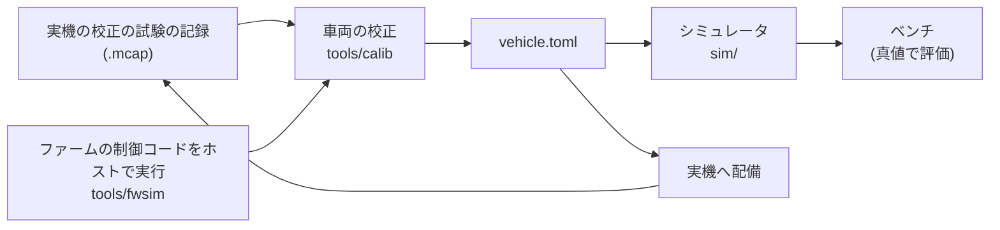

# 検証の仕組み

!!! note "【設計の説明】"
    確認した版: 上位 `19291eb`、ファーム `2a2e9a8`。ここで述べるツールの出力は、ほとんどが**シム／ホスト検証**です。

実車を走らせられる時間は限られます。このプロジェクトは、**実車の前に確かめられることを、できるだけ実機と同じコードで確かめる**ための道具を揃えています。

## シミュレータは STM32 だけを偽装する

[`sim/`][sim-dir] は、`SerialLink` の位置に `SimLink` を差して**仮想 STM32** につなぎます。これが最も深い切り口で、
`io_node` より上流は**1 行も変えずに動きます。**

実機と同一のコードが走る部分: `protocol.toml` のパケット定義 / CRC-16 とフレーミング / SI ⇄ 整数の換算とクランプ / LiDAR の鏡像戻し（`ScanAssembler`）/
リンク状態と PING-PONG 時刻同期 / `--allow-arm` ゲート / `cmd` 150 ms タイムアウト → DISARM / `telemetry_node` / GUI。

- **シミュレーションの操作は実機 GUI に入れない。** コース切替・ノイズ量などは実機に対応物が無く、実機 GUI に UI を持たせると、
  表示判定を 1 つ間違えた瞬間に実車の画面にシム用コントロールが出ます。
- **例外は「SIM」バッジだけ**です。これは利便性ではなく安全要件で、シムと実機の画面が見分けられないと「シムのつもりで `--allow-arm` した実車が動く」ためです。
- シムとシミュレータ GUI の間は ZeroMQ ではなく **UDP ループバック**にします（バスに乗せると、メッセージ型とバスにシムの語彙が入り込む）。
- 仮想 STM32 の時計は Pi と独立で、実機で実測したドリフト（+3378 ppm）を持たせます。**Pi の時計をそのまま返すと、時刻同期のコードが仕事をしているか確認できない**ためです。
- **仮想 STM32 は TC/TV を実装していません**（タイヤモデルが無く、介入する材料が無い）。TC/TV の検証は次の `tools/fwsim` が担います。

### 評価ベンチ（真値で測る）

| ベンチ | 何を測るか | 設計上の要点 |
|---|---|---|
| `sim.bench` | planner 全体（EXPLORE → BUILD → RACE）の周回タイム・衝突 | バスも GUI もプロセスも使わない。実機と同じ変換コードを通す。**ラップはプランナーの周回カウンタではなく、真値の位置に置いたゲート線を跨いだ時刻で測る**（planner の数え方は時刻の分解能が 0.1 s しかない）。1 周目はスタンディングスタートを含むので、比較には 2 周目以降 |
| `sim.slam_bench` | SLAM 単体の ATE・見失い・処理時間 | **SLAM を制御から切り離す**（真値の中心線に沿って純追従）。推定が崩れると走り方が変わり、原因が切り分けられなくなるため。仮想時間で回す |
| `sim.park_bench` | 駐車の成功率・衝突 | **成否は planner の「完了」申告ではなく真値**で決める（デッドレコニングがドリフトすると、planner は誤った場所で「完了」と言う）。申告の瞬間では締めず、1.5 秒回して判定 |

センサの不完全さ（ジャイロバイアス、車速の倍率誤差、LiDAR の欠損・ノイズ・遅延）は、車両モデル本体ではなく**センサ誤差の注入層**で入れます。
物理モデルは「真値」を持つ役で、ここに不完全さを混ぜると他のベンチの意味が変わってしまうためです。

## ファームの制御コードをそのままホストで回す

[`tools/fwsim`][fwsim] は、STM32 ファームの `src/control`（Drive・TorqueVectoring・ControlParams・車速のカルマンフィルタ）を
**ホスト（Mac/Linux）でそのままコンパイル**し、後輪＋タイヤ＋車体のモデルと閉ループにします。動かすのは実物のコードなので、
**Python に写した制御とのずれが起きません。**

!!! warning "リポジトリをまたぐ依存"
    ファームのリポジトリが**このリポジトリの隣**（`../AutonomousCar/Program/MainF446RE_V3`）にあることを前提にします
    （違う場所なら環境変数 `SURGE_FW_DIR`）。ファームのソースをコミット単位で取り出して比べる機能（`--ref v0.15`）もあります。
    **ファームの制御コードを変えたら `python -m tools.fwsim.bench` と `pytest tools/fwsim/tests` を回す**、が手順です。

| ファイル | 役割 |
|---|---|
| `host/host_sim.c`（ファーム側） | 車両モデルと閉ループの本体。2 kHz の制御周期を 20 に刻んで積分。前輪エンコーダの真の特性（出力の範囲・周期誤差）も持てる |
| `host/shim/*.h`（ファーム側） | HAL に触るヘッダ（timer・encoder・imu・bldc_motor・serial）の差し替え |
| `fw.py` | ファームの `src/control` と `lib/` を取り出してコンパイルし、呼び出す |
| `plant.py`・`scenarios.py` | 車のモデルの値と、比べる場面（発進・制動・旋回の加速など） |
| `bench.py` | 2 つのファーム（コミット済み／作業ツリー）を同じ車両モデル・同じ場面で並べて比べる |

テスト（`tools/fwsim/tests`）は**制御の約束**を回帰として固定しています。例:

- 定速で介入しない（`test_no_intervention_when_cruising`）
- 停止からの発進で TC が働く（`test_tc_works_from_standstill`）
- 浮いた輪が吹け上がらない（`test_lifted_wheel_does_not_run_away`）
- 片輪を絞ったトルクを反対輪に移さない（`test_cut_wheel_torque_is_not_moved_to_the_other_wheel`）
- 前輪エンコーダが死んでも暴走しない（`test_dead_front_encoder_does_not_runaway`）
- 制動中は加速度 FF を足さない、ローンチの開始・終了条件、TV の配分
- ファームの定数の写しが `vehicle.toml` と一致する（`test_fw_constants.py`）

## 車両の校正

[`tools/calib`][calib] は、専用の試験（`calib_encoder`・`calib_steer`・`calib_steer_dyn`・`calib_latency`・`calib_speed`・
`calib_speed_check`・`calib_wheel`・`calib_tyre`・`calib_tc_gain`・`calib_traction_check`）の記録から `vehicle.toml` の値を決めます
（2026-10-18 に旧システム同定 `tools/sysid`・旧制御の調整 `tools/ctrl_tune` から作り直した）。設計は
[`docs/calibration.md`][calib-md] が正です。

**1 つの校正は「測る → 式で決める → 閉ループで確かめる」の 3 段**です。

- 測る: 開ループで車体の性質を測る。モデルは物理の式で、パラメータは少なく。例: 車速は走行距離そのものに当てはめ、
  遅れだけを格子で探して残り（利得・転がり抵抗・初速）は線形の最小二乗で解く（大域解が一意）
- 決める: 車速の PI のゲインは、測った植物と遅れから**位相余裕 60°** の式（`loop.py`）。TC・ABS のゲインは、同じく積分器の式で
  交差周波数ごとの基準を作り、**実機で交差周波数を低い方から上げて**（発進・制動を実走）発振の手前を採る（式の前提がタイヤの揺れで成り立たないため）
- 確かめる: 閉ループで制御そのものの効きを測り、合否を出す。モデルではなく「制御が狙いどおりに効いているか」を実機で直接見る

**解析そのものも確かめます。** 各解析は「真値の分かっているシムで試験を走らせ、解析が真値を復元するか」をテストに持ち
（`tools/calib/tests`）、検証器が誤りを見分けられること（わざと誤ったゲインを入れると確かめの試験が不合格にする）も確かめます。

!!! bug "作り直しで見つかったこと"
    旧②前後運動の解析は PI を通した応答に記録時のゲインを既知として当てはめていて、車体の利得を 21.5 と出していました。
    同じ記録を PI を仮定せず STM32 が実際に出したトルクから当てはめると 16.5〜16.8（名目 16.7）です。

## 記録と再生

- `.sfl`（送受信フレームを生のまま）を `replay_node` で再生すると、**実機を走らせなくても知覚・SLAM・経路生成を開発できます**（[ノード構成](../raspi/index.md#再生と実機を同じコードにする)）。
- mcap の記録は、車両の校正・グリップの解析・ビデオ化（`tools/mcap_video.py`）に使います。

## 「検査を人間の記憶に頼らない」

CI（[`.github/workflows/ci.yml`][ci-yml]）の本体は、**生成物が正と一致しているか**の 4 つの `--check` です。

| 検査 | 内容 |
|---|---|
| `config/generate.py --check` | `vehicle.toml` → GUI の TypeScript 定数 |
| `raspi/proto/generate.py --check` | `protocol.toml` → Python のパーサ・C ヘッダ |
| `config/gen_msgs.py --check` | メッセージ型 → GUI の TypeScript 型 |
| `config/check_docs.py --check` | `protocol.toml` → **文書中のプロトコル版番号** |

最後のものは、`docs/README.md` が 2 版遅れたまま誰も気づかなかった、という過去の事故が理由です。
**版番号だけ**を見ます（本文が仕様と合っているかは機械には判定できない。「表紙の数字が古い」という、読む人ほど間違える形の腐り方を潰す）。

加えて ruff（未使用 import・未定義名）、`raspi/tests` の pytest（Python 3.12 と 3.13 の両方。実機は 3.13、開発機は 3.12）、GUI の `tsc`（`strict` ＋ `noUncheckedIndexedAccess`）とビルドを回します。
`tools/check.sh` が同じ検査をローカルで 1 コマンドで走らせます。

## 配備

`tools/deploy.sh` は Mac から Pi へ反映します。**何を直したかで必要な操作が変わります。** `io_node` を再起動すると 100 Hz のハートビートが止まり、
**STM32 が E-Stop をラッチして、車両のボタン 2 を物理的に押すまで戻りません。** そのため `--restart-io` は独立した、明示的なオプションです。

[sim-dir]: https://github.com/banbatakumi/AutonomousCar_RasPi/tree/master/surge_mk2/sim
[fwsim]: https://github.com/banbatakumi/AutonomousCar_RasPi/tree/master/surge_mk2/tools/fwsim
[calib]: https://github.com/banbatakumi/AutonomousCar_RasPi/tree/master/surge_mk2/tools/calib
[calib-md]: https://github.com/banbatakumi/AutonomousCar_RasPi/blob/master/surge_mk2/docs/calibration.md
[ci-yml]: https://github.com/banbatakumi/AutonomousCar_RasPi/blob/master/.github/workflows/ci.yml
