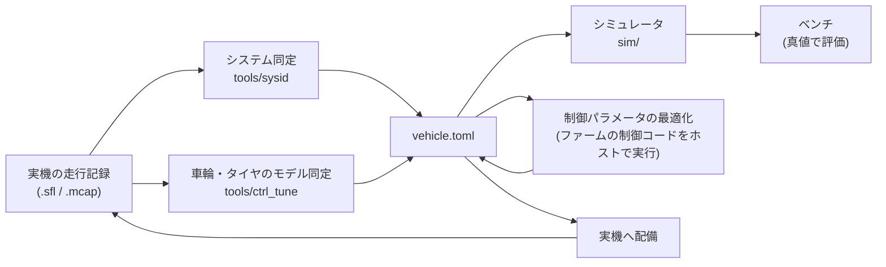

# 検証の仕組み

!!! note "【設計の説明】"
    確認した版: 上位 `19291eb`、ファーム `2a2e9a8`。ここで述べるツールの出力は、ほとんどが**シム／ホスト検証**です。

実車を走らせられる時間は限られます。このプロジェクトは、**実車の前に確かめられることを、できるだけ実機と同じコードで確かめる**ための道具を揃えています。

## シミュレータは STM32 だけを偽装する

[`sim/`][sim-dir] は、`SerialLink` の位置に `SimLink` を差して**仮想 STM32** につなぎます。これが最も深い切り口で、
`io_node` より上流は**1 行も変えずに動きます。**

実機と同一のコードが走る部分: `protocol.toml` のパケット定義 / CRC-16 とフレーミング / SI ⇄ 整数の換算とクランプ / LiDAR の鏡像戻し（`ScanAssembler`）/
リンク状態と PING-PONG 時刻同期 / `--allow-arm` ゲート / `cmd` 150 ms タイムアウト → DISARM / `telemetry_node` / GUI。

- **シミュレーションの操作は実機 GUI に入れない。** コース切替・ノイズ量などは実機に対応物が無く、実機 GUI に UI を持たせると、
  表示判定を 1 つ間違えた瞬間に実車の画面にシム用コントロールが出ます。
- **例外は「SIM」バッジだけ**です。これは利便性ではなく安全要件で、シムと実機の画面が見分けられないと「シムのつもりで `--allow-arm` した実車が動く」ためです。
- シムとシミュレータ GUI の間は ZeroMQ ではなく **UDP ループバック**にします（バスに乗せると、メッセージ型とバスにシムの語彙が入り込む）。
- 仮想 STM32 の時計は Pi と独立で、実機で実測したドリフト（+3378 ppm）を持たせます。**Pi の時計をそのまま返すと、時刻同期のコードが仕事をしているか確認できない**ためです。
- **仮想 STM32 は TC/TV を実装していません**（タイヤモデルが無く、介入する材料が無い）。TC/TV の検証は次の `ctrl_tune` が担います。

### 評価ベンチ（真値で測る）

| ベンチ | 何を測るか | 設計上の要点 |
|---|---|---|
| `sim.bench` | planner 全体（EXPLORE → BUILD → RACE）の周回タイム・衝突 | バスも GUI もプロセスも使わない。実機と同じ変換コードを通す。**ラップはプランナーの周回カウンタではなく、真値の位置に置いたゲート線を跨いだ時刻で測る**（planner の数え方は時刻の分解能が 0.1 s しかない）。1 周目はスタンディングスタートを含むので、比較には 2 周目以降 |
| `sim.slam_bench` | SLAM 単体の ATE・見失い・処理時間 | **SLAM を制御から切り離す**（真値の中心線に沿って純追従）。推定が崩れると走り方が変わり、原因が切り分けられなくなるため。仮想時間で回す |
| `sim.park_bench` | 駐車の成功率・衝突 | **成否は planner の「完了」申告ではなく真値**で決める（デッドレコニングがドリフトすると、planner は誤った場所で「完了」と言う）。申告の瞬間では締めず、1.5 秒回して判定 |

センサの不完全さ（ジャイロバイアス、車速の倍率誤差、LiDAR の欠損・ノイズ・遅延）は、車両モデル本体ではなく**センサ誤差の注入層**で入れます。
物理モデルは「真値」を持つ役で、ここに不完全さを混ぜると他のベンチの意味が変わってしまうためです。

## ファームの制御コードをそのままホストで回す

[`tools/ctrl_tune`][ctrl-tune] は、STM32 ファームの `src/control`（Drive・TorqueVectoring・ControlParams）を
**ホスト（Mac/Linux）でそのままコンパイル**し、後輪＋タイヤ＋車体のモデルと閉ループにして、TC・ABS・TV のパラメータを最適化します。
調整するのは実物のコードなので、**Python に写した制御とのずれが起きません。**

!!! warning "リポジトリをまたぐ依存"
    `ctrl_tune` は、ファームのリポジトリが**このリポジトリの隣**（`../AutonomousCar/Program/MainF446RE_V3`）にあることを前提にします
    （違う場所なら環境変数 `SURGE_FW_DIR`）。ファームのソースをコミット単位で取り出して比べる機能（`--ref v0.15`）もあります。
    **ファームの制御コードを変えたら、Pi 側のリポジトリで `python -m tools.ctrl_tune.bench` と `pytest tools/ctrl_tune/tests` を回す**、が手順です。

| ファイル | 役割 |
|---|---|
| `host/host_sim.c`（ファーム側） | 車両モデルと閉ループの本体。2 kHz の制御周期を 20 に刻んで積分。速さのため車両モデルも C で書く |
| `host/shim/*.h`（ファーム側） | HAL に触るヘッダ（timer・encoder・imu・bldc_motor・serial）の差し替え |
| `fw.py` | ファームの `src/control` と `lib/` を取り出してコンパイルし、呼び出す |
| `plant.py` | 後輪＋タイヤ＋車体のモデルのパラメータと、それを揺らした「あり得る車」の組 |
| `optimize.py` | パラメータの最適化 |
| `bench.py` | 2 つのファーム（コミット済み／作業ツリー）を同じ車両モデル・同じ場面で並べて比べる |

最適化は、**あり得る車の組すべてで場面を回して「平均と最悪の中間」が最小になる値**を探します（平均だけだと、ある 1 つの条件で破綻する値が選ばれる）。
コストの主役は目標スリップからの行き過ぎと深く滑っていた時間で、効率の損は小さい重みに留めます
（効率を主にすると、積分を弱くして目標より上に居座るゲインが選ばれる）。

テスト（`tools/ctrl_tune/tests`）は**制御の約束**を回帰として固定しています。例:

- 定速で介入しない（`test_no_intervention_when_cruising`）
- 停止からの発進で TC が働く（`test_tc_works_from_standstill`）
- 浮いた輪が吹け上がらない（`test_lifted_wheel_does_not_run_away`）
- 片輪を絞ったトルクを反対輪に移さない（`test_cut_wheel_torque_is_not_moved_to_the_other_wheel`）
- 前輪エンコーダが死んでも暴走しない（`test_dead_front_encoder_does_not_runaway`）
- 制動中は加速度 FF を足さない、ローンチの開始・終了条件、TV の配分

## システム同定

[`tools/sysid`][sysid] は、実機の走行記録から `vehicle.toml` の `[dynamics]` を推定します。専用の planner（`sysid_encoder`・`sysid_steer`・`sysid_accel`・`sysid_corner`・`sysid_latency`・`sysid_speed_pi`・`sysid_wheel`・`sysid_tyre`）が試験の走り方を持ちます。

最初に録るのは**エンコーダ校正**（`sysid_encoder`）です。前輪の絶対角エンコーダの1回転の周期誤差と出力の範囲、前後輪の有効転がり半径を測り、STM32 が読みを直してから車速・走行距離にします。前輪の半径の基準は、直線の端で止まっている間の LiDAR のスキャンどうしの移動量です（メジャーが要りません）。車速のカルマンフィルタの調整値は、走行の記録に同じフィルタを通した残差の尤度を最大にして決めます（`tools/sysid/kf_tune.py`）。

**方針は「シムのモデルそのものを当てはめる」**ことです。モデルとは別の特徴量（10 % 到達時刻、IMU の加速度の 95 パーセンタイルなど）から値を読むと、
読んだ値をシムに入れても実機の応答を再現する保証がありません（IMU のノイズ・傾き・バイアスで加速度が STM32 の上限を超えて読まれた）。

- 舵: シムの `SteerServo`（むだ時間 → 定常ゲイン → 1 次遅れ → 角速度上限 → ヒステリシス）に実機の指令を入れ、出てくる舵角が実機に最も近くなるパラメータを探す（**出力誤差法**）。
- 速度・加減速: 同じく `SpeedController`（ランプ → PI → 加速度の上限 → 車体）に実機の `/cmd` を入れて、車速に合わせる。
- 黙って誤った値を返さないための仕組み: 有効自由度を**残差の自己相関**から決める（決め打ちだと存在しないガタ・ヒステリシスを採る）、
  前輪エンコーダの**周期誤差の推定と補正**（ガタと不感帯を取り違える）、残差をノイズの床と比べて「モデルの形から外れている」と警告する。
- **解析が正しい値を返すかを真値と突き合わせる検証器**（`tools/sysid/bench.py`）を先に持ちます。真値の分かっているシムで各試験を閉ループで回し、解析が復元できるか見ます。
  ただし復元できるのは「解析がシムのモデル構造に対して正しい」ことまでです。

!!! bug "検証器があって見つかった不具合"
    前後運動の解析がファームの加速度フィードフォワードを知らず、FF 有効の車で利得が 9 倍（22 → 196）に出ていました。合成データで 21.98 を復元できる形に直しています（開発記録 2026-10-14）。

## 記録と再生

- `.sfl`（送受信フレームを生のまま）を `replay_node` で再生すると、**実機を走らせなくても知覚・SLAM・経路生成を開発できます**（[ノード構成](../raspi/index.md#再生と実機を同じコードにする)）。
- mcap の記録は、システム同定・グリップの解析・ビデオ化（`tools/mcap_video.py`）に使います。

## 「検査を人間の記憶に頼らない」

CI（[`.github/workflows/ci.yml`][ci-yml]）の本体は、**生成物が正と一致しているか**の 4 つの `--check` です。

| 検査 | 内容 |
|---|---|
| `config/generate.py --check` | `vehicle.toml` → GUI の TypeScript 定数 |
| `raspi/proto/generate.py --check` | `protocol.toml` → Python のパーサ・C ヘッダ |
| `config/gen_msgs.py --check` | メッセージ型 → GUI の TypeScript 型 |
| `config/check_docs.py --check` | `protocol.toml` → **文書中のプロトコル版番号** |

最後のものは、`docs/README.md` が 2 版遅れたまま誰も気づかなかった、という過去の事故が理由です。
**版番号だけ**を見ます（本文が仕様と合っているかは機械には判定できない。「表紙の数字が古い」という、読む人ほど間違える形の腐り方を潰す）。

加えて ruff（未使用 import・未定義名）、`raspi/tests` の pytest（Python 3.12 と 3.13 の両方。実機は 3.13、開発機は 3.12）、GUI の `tsc`（`strict` ＋ `noUncheckedIndexedAccess`）とビルドを回します。
`tools/check.sh` が同じ検査をローカルで 1 コマンドで走らせます。

## 配備

`tools/deploy.sh` は Mac から Pi へ反映します。**何を直したかで必要な操作が変わります。** `io_node` を再起動すると 100 Hz のハートビートが止まり、
**STM32 が E-Stop をラッチして、車両のボタン 2 を物理的に押すまで戻りません。** そのため `--restart-io` は独立した、明示的なオプションです。

[sim-dir]: https://github.com/banbatakumi/AutonomousCar_RasPi/tree/master/surge_mk2/sim
[ctrl-tune]: https://github.com/banbatakumi/AutonomousCar_RasPi/tree/master/surge_mk2/tools/ctrl_tune
[sysid]: https://github.com/banbatakumi/AutonomousCar_RasPi/tree/master/surge_mk2/tools/sysid
[ci-yml]: https://github.com/banbatakumi/AutonomousCar_RasPi/blob/master/.github/workflows/ci.yml
