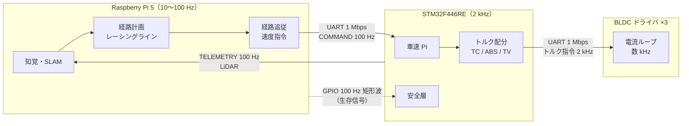

# SURGE Mark.2 技術解説

自律走行ミニカー **SURGE Mark.2** の制御・システム設計・自動運転アルゴリズムを、
ソースコードを読み直して書いた解説サイトです。

「何が動いているか」だけでなく、**なぜその形にしたか**と**うまくいかなかったこと**を残すことを重視しています。

## 車体の概要

| 項目 | 内容 |
|---|---|
| サイズ・質量 | 約 0.37 m × 0.18 m、2.0 kg、ホイールベース 0.23 m、後輪トレッド 0.155 m |
| 駆動 | 後輪左右独立のダイレクトドライブ BLDC。減速機なし、車輪直径 60 mm |
| 操舵 | BLDC 1 個の位置制御（サーボではない）。モータ角から路面舵角への換算は非線形 |
| 車速の計測 | 非駆動輪である前輪の絶対角エンコーダ |
| 外界センサ | LiDAR（LD06）、前後 CSI カメラ 2 台、前後超音波 2 個、IMU（MPU6050） |
| 計算機 | Raspberry Pi 5（認識・計画）＋ STM32F446RE（リアルタイム制御） |

車体寸法・質量・車輪径は [`config/vehicle.toml`][vehicle-toml] の実測値、後輪トレッドと車輪径は
ファームの [`drive.h`][drive-h] の定数です。

## 3 つの層

- **上位（Pi）は「どこへ・どれだけの速さで」を決める。** 自己位置推定、地図、レーシングライン、障害物回避。
- **下位（STM32）は「どうやってタイヤにトルクを伝えるか」を決める。** 車速の閉ループ、スリップ制御、左右トルク配分、安全停止。
- **モータドライバ（MD）は電流ループだけを持つ。** MD のファームは別リポジトリで、このサイトでは扱いません。

上位が落ちても下位が単独で車を止められること、が設計の出発点です。

## このサイトの読み方

| 知りたいこと | 読むページ |
|---|---|
| 全体を 10 分で掴みたい | [システム構成](overview/system.md) → [検証状況](overview/status.md) |
| TC・ABS・トルクベクタリングの作り方 | [スリップ制御](stm32/traction.md)、[トルクベクタリング](stm32/torque-vectoring.md) |
| 安全設計（止め方・フェイルセーフ） | [安全層](stm32/safety.md)、[上位の安全設計](raspi/safety.md) |
| 周回タイムを縮める仕組み | [レーシングライン](raspi/raceline.md)、[経路追従](raspi/tracking.md) |
| 2D LiDAR SLAM の構成 | [地図と自己位置推定](raspi/mapping.md) |
| 開発・検証のやり方 | [検証の仕組み](dev/workflow.md)、[設計上の教訓](dev/lessons.md) |

## 数値と記述の信頼度

このサイトは、**ソースコードを正として**書いています。数値や挙動は、各ページの末尾にある
参照先（ファイルと関数名）で確かめられます。それでも、次の区別は必ず見てください。

!!! success "【実機確認】"
    実車の走行記録・計測で確かめられている。

!!! info "【シム／ホスト検証】"
    シミュレータや、ファームをホストでコンパイルした閉ループで確かめている。実車では未確認。

!!! warning "【未検証】"
    計算や設計上の見積もり（机上値）。実車で確かめていない。

!!! note "【設計の説明】"
    動作の優劣は主張せず、「こう作ってある」とその理由だけを述べている。

どの機能がどれに当たるかは [検証状況](overview/status.md) にまとめています。

## 対象の版

| リポジトリ | 内容 | 確認したコミット |
|---|---|---|
| [`AutonomousCar_RasPi`][raspi-repo] | Raspberry Pi 側（`surge_mk2/`） | `19291eb`（2026-10-14） |
| [`AutonomousCar`][fw-repo] | STM32 ファーム（`Program/MainF446RE_V3`、ブランチ `FW/MainBoard_V3`） | `2a2e9a8`（2026-10-13） |

開発は続いているため、リンク先のコードはこのサイトより新しくなっていることがあります。
**食い違いを見つけたらコードを信じてください。** 直し方は [このサイトについて](about.md) にあります。

[vehicle-toml]: https://github.com/banbatakumi/AutonomousCar_RasPi/blob/master/surge_mk2/config/vehicle.toml
[drive-h]: https://github.com/banbatakumi/AutonomousCar/blob/FW/MainBoard_V3/Program/MainF446RE_V3/src/control/drive.h
[raspi-repo]: https://github.com/banbatakumi/AutonomousCar_RasPi
[fw-repo]: https://github.com/banbatakumi/AutonomousCar/tree/FW/MainBoard_V3
