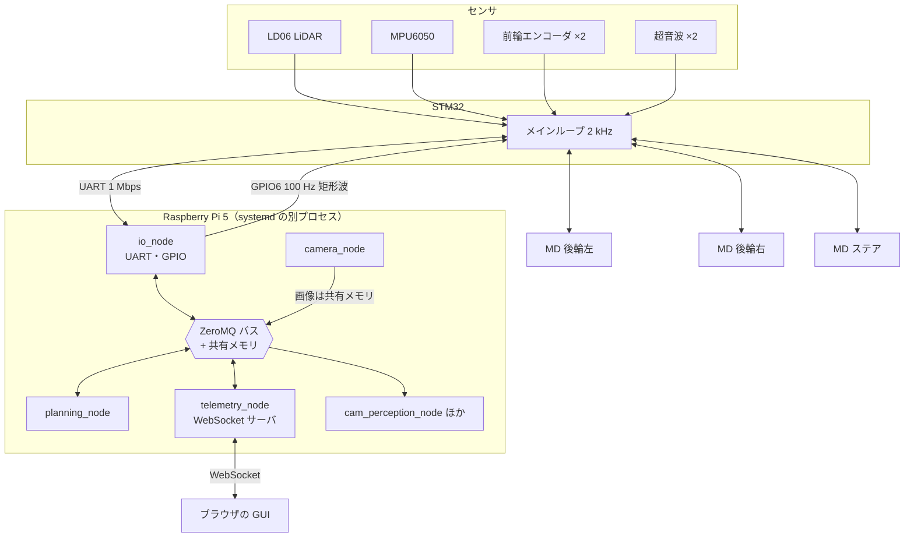

# システム構成

!!! note "【設計の説明】"
    確認した版: ファーム `2a2e9a8`、上位 `19291eb`。

## 役割分担

| | Raspberry Pi 5（上位） | STM32F446RE（下位） | BLDC ドライバ（MD）×3 |
|---|---|---|---|
| 担当 | 知覚、地図、経路計画、経路追従、GUI | 車速制御、TC / ABS / TV、舵角制御、安全層、センサ取得 | 電流（トルク）ループ |
| 周期 | LiDAR 10 Hz、指令 50〜100 Hz | **2 kHz（500 µs 周期のメインループ）** | 数 kHz |
| 失敗したとき | STM32 が最大制動で停車保持 | IWDG でリセット、ハートビート断で緊急停止ラッチ | 通信 100 ms 無応答で STM32 が検出 |
| 言語 | Python 3.13（numpy、ONNX） | C（STM32CubeMX + 自作ライブラリ） | 別リポジトリ |

MD は後輪左・後輪右・ステアの 3 台で、STM32 と 1 Mbps の UART で別々につながっています。

### なぜ 2 層に分けたか

- **車速制御・スリップ制御は 2 kHz 級の応答が要る。** Python の 10〜100 Hz では足りません。
  この車の後輪は軽く、実機の ABS の記録では、グリップの限界を超えるトルクを掛けると **約 20 ms で深くロック** しました
  （[`tools/fwsim/plant.py`][plant-py] のコメント）。
- **一方、SLAM やレーシングライン計算は Python の方が速く作れる。** 地図計算は Pi 5 でも 100 ms を超えることがあります
  （[地図と自己位置推定](../raspi/mapping.md) の実測を参照）。
- **上位が落ちても止まれること。** 安全に関わる処理を下位に置くと、上位の不具合・遅延・Wi-Fi 切断が車の暴走に直結しません。

## データの流れ

### Pi 側のプロセス

`raspi/setup/install_services.sh` が systemd のサービスとして次を立てます
（[`UNITS`][install-services] の定義）。

| サービス | 役割 |
|---|---|
| `surge-io` | STM32 との UART 送受信、GPIO のハートビート、時刻同期。`Nice=-10` で優先度を上げてある |
| `surge-camera` | CSI カメラ 2 台の取り込み。画像を共有メモリへ書く |
| `surge-telemetry` | ブラウザ GUI との WebSocket サーバ。操縦権・デッドマン・自律走行の中継 |
| `surge-planning` | 点群から走行指令を作る（自動運転モードを持つ） |
| `surge-cam-perception` / `surge-cam-e2e` / `surge-line-perception` / `surge-cam-track` | カメラ系の認識（走行可能領域、模倣学習、白線、対象追従） |
| `surge-mdns` | `<ホスト名>.local` の問い合わせに、Wi-Fi 端末向けにユニキャストで答える補助（アクセスポイントがマルチキャストを中継しない環境の対策） |
| `surge-logger`（任意） | mcap 形式の記録。SD への書き込みを避けるため既定では入れない |

`surge-io` が止まる、または Pi が落ちると、STM32 側のハートビート監視が **緊急停止をラッチ** します
（[安全層](../stm32/safety.md)）。

## 時刻と遅延

- STM32 の時刻は `micros` のカウンタ（32 bit、約 71.6 分でラップ）で、Pi の `CLOCK_MONOTONIC` とは別物です。
  PING／PONG の 4 つのタイムスタンプからクロックオフセットとドリフトを推定して換算します
  （[プロトコル](../link/protocol.md#時刻同期)）。SLAM と遅延測定がこれに依存します。
- 実測値（[`vehicle.toml`][vehicle-toml] の `[dynamics]`。舵は 2026-09-28 の旧同定、遅延は 2026-10-18 の記録）:

    | 量 | 値 |
    |---|---|
    | 操舵のむだ時間（`dead_time_s`） | 約 8 ms |
    | 操舵の 1 次遅れ時定数（`tau_steer_s`） | 約 0.8 ms |
    | LiDAR スキャン完了 → 反応した指令を STM32 が受理（`control_latency_s`） | 約 12 ms |

    舵そのものはほとんど遅れません。経路追従はこれらを [遅延補償](../raspi/tracking.md#遅延補償) で見込んでいます。

## このサイトで扱わないもの

- **MD（BLDC ドライバ）のファーム** — 別リポジトリ（`BLDC/ProgramV4`）です。
  STM32 とは CRC-8 付きの 6 バイト指令／11 バイト状態で通信します（ファーム側の記述より）。
- **基板（回路）**
- **V1 の `robotcar/`** — Raspberry Pi 3 の手動遠隔操縦システム。この解説の対象外です。

[install-services]: https://github.com/banbatakumi/AutonomousCar_RasPi/blob/master/surge_mk2/raspi/setup/install_services.sh
[plant-py]: https://github.com/banbatakumi/AutonomousCar_RasPi/blob/master/surge_mk2/tools/fwsim/plant.py
[vehicle-toml]: https://github.com/banbatakumi/AutonomousCar_RasPi/blob/master/surge_mk2/config/vehicle.toml
