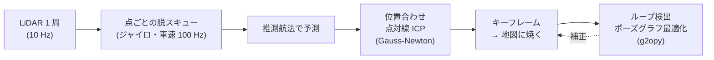
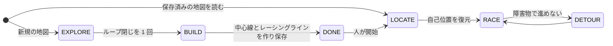

# 地図と自己位置推定（slam2d）

!!! info "【シム／ホスト検証】＋【実機確認】（処理時間と周回）"
    対象: [`slam2d/`][slam2d-dir]（車体非依存の汎用 2D LiDAR SLAM ライブラリ）と、それを使う走行モード
    [`slam2d_raceline.py`][raceline-py] / [`slam2d_route.py`][route-py]。確認した版: 上位 `19291eb`。
    精度の数値はほとんどが**シミュレータ**（`sim/slam_bench.py`）の値です。公開データセットでの検証は未着手です（`slam2d/README.md`）。

## 設計の骨格

`slam2d/` は `raspi.*` を一切 import しない独立ライブラリで、車体・センサ構成に依存しません。特定車両の動力学、LD06 のプロトコル、
Ackermann 固有のロジックは、`MotionModel` の抽象と薄いアダプタ（`raspi/auto/_slam2d_nav.py`）から注入します。

### 1. 点ごとの脱スキュー

回転式 LiDAR は 1 周が瞬時ではない（LD06 は 100 ms）ので、車体が動くと点群が扇形に歪みます。歪んだまま地図に焼くと壁が二重になります。
「この周のあいだ twist は一定」と仮定する近似は、**高速のヘアピンで破綻**します（1 周 100 ms のあいだにヨーレートが 0 から 2.2 rad/s まで立ち上がると、3 m 先の点が 30 cm ずれ、
2 m/s で残差 RMS が 10〜15 cm になって位置合わせが誤った姿勢に貼り付いた）。そこで、**ジャイロ・車速の時系列（100 Hz）から点ごとの時刻の姿勢を作って補正**します。
このため、`planning_node` は 10 Hz の `plan()` とは別に、`vehicle_state` を受けるたびに SLAM に流し込みます。

点の扱いは 3 種類に分けます: 実測点（壁を打ち、手前を空きに彫る）、飽和点（測距上限。手前を空きに彫るだけ）、無効点（**捨てる**。「知らないことは書かない」）。

### 2. 位置合わせ — 点対線 ICP ＋ 推測航法を事前分布に

$$
\min_T\ \sum_i \rho\!\left(\frac{r_i}{\sigma}\right)^2 + (T \ominus T_{\mathrm{pred}})^{\!\top}\Omega_{\mathrm{pred}}\,(T \ominus T_{\mathrm{pred}})
$$

- \(r_i\): 点と最寄りの壁の面要素との距離（平面なら法線方向、角や柱なら点対点）。\(\rho\) は Huber。
- 第 2 項が推測航法（ジャイロ ＋ 車速）の事前分布で、\(\Omega_{\mathrm{pred}}\) は運動モデルの予測共分散の逆。**予測の不確かさは「走った量」に比例**させます
  （車輪径・ジャイロ倍率の誤差は距離・角度に比例、ゼロ点ずれは時間に比例）。

**観測できる方向（壁に垂直）では点群の情報が桁違いに大きいので点群が勝ち、観測できない方向（通路の進行方向）では推測航法が残る**——
方向ごとの利得を手で決める必要がありません（Cartographer の Ceres スキャンマッチャや PL-ICP と同じ考え方、とコードにあります）。

!!! note "相関スキャンマッチをやめた理由"
    候補姿勢の総当たり（相関スキャンマッチ）は初期値が悪いときに強い一方、答えが探索格子に量子化され、推測航法との融合が「得点 − 罰則」の近似になるため、
    **推測航法の系統誤差を正せません。** シムの実測では、車速の倍率誤差 2 % だけで ATE が 1.2 cm → 6 cm、ジャイロのゼロ点ずれ 0.5°/s だけで複雑なコースの ATE が 11 cm でした。
    総当たりは、見失いからの復帰とループ検出の初期値づくりにだけ使います。

#### 面要素の地図

距離変換そのものを残差にすると、複数スキャンを重ねた地図で壁が 2〜3 セルの厚みになり、**壁の内側が距離 0 の平らな台地**になって、そこに落ちた点は姿勢を何も拘束しません。
回頭方向の情報が推測航法と同程度まで落ち、ジャイロのゼロ点ずれが地図ごと回っていきました（2 周で向きが 17° ずれた）。
そこで壁のセルごとに「落ちた点の平均位置」と「近傍の点の主成分から作った法線」を持ち、残差を \(r = \mathbf{n}\cdot(\mathbf{p}-\mathbf{q})\) にします。
近傍の裏付けが少ないセルは対応に使いません（遠くの壁でまばらな点が「角」に見え、**平行な壁しかない通路なのに進行方向が決まっているかのような情報**が出るため）。

### 3. 地図作成中は「直近のキーフレームだけの局所地図」に合わせる

全体の地図に合わせると、周回して戻ったとき、ドリフトしてずれた「前の周の壁」と「今の周の壁」の両方に点が引っ張られ、**壁が二重になった地図に中途半端な姿勢が出て、二重の壁が太り続けます。**
周回のずれを正すのはループ閉じの役目で、フロントエンドは小さくなめらかにドリフトさせておく方が正しく直せます（Cartographer の local SLAM と pose graph の分担と同じ）。
凍結した地図の上では全体の地図に合わせます（追跡専用、ドリフトが溜まらない）。

### 4. ジャイロのゼロ点ずれは「止まっているとき」に測る

走行中の回頭は、地図作成中は局所地図を基準に測っています。ゼロ点ずれで姿勢がゆっくり回ると、その姿勢で焼いた局所地図も一緒に回るので、点群は「ずれていない」と答えます。
実測でも、真のゼロ点ずれ 0.5°/s に対して走行中の学習値は 0.01°/s にしかなりませんでした。
**止まっている間はヨーレートの読みがそのままゼロ点ずれ**なので、静止中に速く学びます（ZUPT）。実車は ARM → engage の操作の間ずっと止まっているので、走り出す前に較正が終わります。
車速の倍率誤差も学びますが、**進行方向が点群で観測できているときだけ更新**します（通路の直線では点群が進行方向を決められず、比を取ると 1.0 が返って正しい値から引き戻されるため）。

### 5. 見失いの扱い

- 当たり率（照合できた点のうち壁から 5 cm 以内の割合）が下限を切るか、照合できた点が少ないとき、その周期は推測航法の予測を採り、**地図は焼かない**。
- 続いたら、予測の周りを総当たりで探し直す。
- 地図作成中にさらに続いたら、**局所地図を今の点群から作り直して走り続ける**（ずれを受け入れる）。
  「見失い中は地図を更新しない」方式だと、一度見失うと永久に戻れませんでした。

## ループ閉じ

- **古いキーフレームだけで作った部分地図**に照合します。「今作っている全体の地図」に照合すると、現在地付近は直前の数秒で焼いた壁（今の推定と整合している）が大半を占め、
  照合は今の推定をほぼ追認し、「ドリフトした関係」がそのままループ拘束になります（ループ閉じ後に地図の精度が 0.72 → 0.26 に**悪化**したコースがあった）。
- 総当たりの 1 位が 2 位より十分高い、照合できた点・当たり率・RMS が基準を満たす、をすべて満たしたものだけを拘束にします（対称な形の取り違えを弾く）。
- 拘束は Huber で入れ、最適化してみて**残差が桁違いに大きいものを外してやり直す**。ポーズグラフの最適化は `g2opy`。

!!! warning "ループ閉じは走行中には回さない"
    地図の焼き直しはキーフレーム数に比例して重いので、**EXPLORE → BUILD に遷移する瞬間に 1 回だけ**行います（車両は `ready=False` で停止させる）。
    RACE 中は `Frontend` を直接使う追跡専用で、最適化は挟みません。
    Pi 5 の実測では、360 キーフレームで 1.76 秒かかります（開発記録 2026-10-14）。キルスイッチ `ENABLE_LOOP_CLOSURE` で `Frontend` 単体運用に戻せますが、地図の大域的な歪みは直りません。

## 走行モードとしての状態機械

`slam2d_raceline` は 6 段の状態機械です。

| 状態 | 内容 |
|---|---|
| `EXPLORE` | 地図作成。engage 中は Follow the Gap で走る（していなければ人のラジコン） |
| `BUILD` | 中心線とレーシングラインを引く |
| `DONE` | 保存して人を待つ |
| `LOCATE` | 保存地図の上で自己位置を復元（グローバルローカリゼーション） |
| `RACE` | 周回 |
| `DETOUR` | 障害物で進めないときだけ、Hybrid A* で抜ける |

### 自己位置の復元（LOCATE）

保存済みの地図を読んで RACE から走り始める場面では、直前の姿勢がありません。地図の「空きと確信できるセル」に候補位置をばら撒き、角度は粗い刻みで全周を回して、
各候補で今のスキャンを面要素地図に対して採点します。

- 候補の評価は **1 周期に 1 角度ずつ**進めます（全探索を一度にやると、大きい地図では数百 ms〜秒のブロッキングになり、バス通信を止める）。車両は静止させたままです。
- **左右対称・繰り返し形状のコースでは誤認識しうる**ので、1 位と 2 位が僅差のときは自動では採用しません（`ambiguous`）。
- ただし、粗い尺度だけで諦めてはいけません。オーバル状のコースでは反対側の直線が僅差で並びますが、上位候補を `Frontend.refine()` で仕上げてから当たり率で比べると、
  差が 0.03 しかなかったものが **0.98 対 0.60** に開きました。

### 重い計算は別プロセスで

道路グラフ（Pi で数百 ms）や経路ごとのレーシングライン（1 本数十〜数百 ms）を `plan()`（10 Hz）の中で回すと、指令が途切れて
`cmd_deadman_ms`（150 ms）で DISARM になります。そのため**別プロセスのワーカー**に投げ、`plan()` は毎周期、出来上がりを覗くだけにします。
ワーカーは地図の写しだけを触ります。

## Pi 5 での処理時間（実測）

開発記録（2026-10-14）の実測で、**Mac の約 5.5〜8 倍遅い**とされています。

| 処理 | 平均 | p99 | 最大 |
|---|---|---|---|
| 地図作成中の 1 スキャン | 16.5 ms | 105 ms | 133 ms |
| 凍結地図での追従 | 8.2 ms | — | 11.1 ms |
| ループ閉じの `flush`（360 キーフレーム） | 1.76 s | — | — |

**地図作成中は LiDAR 周期（100 ms）を超えることがあります。** 設計が「走りながら地図を作り込む」ではなく
「まず地図を作り（EXPLORE）、ループ閉じを 1 回払って、凍結地図で走る（RACE）」になっているのは、この制約と整合しています。

[slam2d-dir]: https://github.com/banbatakumi/AutonomousCar_RasPi/tree/master/surge_mk2/slam2d
[raceline-py]: https://github.com/banbatakumi/AutonomousCar_RasPi/blob/master/surge_mk2/raspi/auto/slam2d_raceline.py
[route-py]: https://github.com/banbatakumi/AutonomousCar_RasPi/blob/master/surge_mk2/raspi/auto/slam2d_route.py
