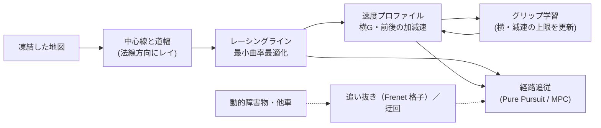

# レーシングラインと速度プロファイル

!!! info "【実機確認】（周回）＋【シム／ホスト検証】"
    対象: [`raspi/nav/`][nav-dir] の `centerline.py`・`raceline.py`・`grip.py`・`obstacles.py`。確認した版: 上位 `19291eb`（`grip.py` の横の学習は 2026-10-29 の作り直しに合わせた）。
    実機の周回は 2026-10-13 の記録で **5.3〜5.9 s/周**（走行ごとに地図が違う。周長 14.7 m のコースでは 5.77〜5.89 s。走行中の学習あり。開発記録）。
    走行中の学習は**初版が実機で悪化し、直した版は実機未検証**です（[検証状況](../overview/status.md)）。

地図ができたあとの流れは次のとおりです。

## 1. 中心線と道幅

レーシングラインの最適化が入力に取るのは、**中心線 \(c_i\)・法線 \(n_i\)・左右の余裕 \(w_i\)** の 3 つです。地図の 1 周目の軌跡から作ります。

- 1 周目は Follow the Gap で走っているので、軌跡は**道の真ん中を通っていません**（コーナーでは内側に寄る）。それでも初期値に使えるのは、
  実行可能な範囲を決めるのが \(c_i\) ではなく \((n_i, w_i)\) だからです。
- 本当に効く弱点は**法線の向き**です。\(c_i\) が壁に対して斜めだと、道幅を過大に測って「壁にめり込む解が実行可能に見える」。
  そこで「幅を測る → 真ん中へ寄せる」を数回繰り返します（1 回 1 ms 以下）。
- 距離変換（EDT）で「尾根」を探す方式は使いません。400×400 で数百 ms かかり、近似すると 2 割近い誤差が出るためです。
  **法線方向にレイを撃って測る方が速く、`scipy` も要りません。**

!!! warning "壁の小さな穴と、ヘアピンでの知覚エイリアシング"
    壁の小さな穴を抜けたレイは奥の別の壁に当たり、その 1 点だけ幅が跳ね上がります。この異常値がそのまま `w_left`/`w_right` に入ると、
    実際には無い余白があるとレーシングラインが誤認して壁側へ寄った経路を引きかねません。**近傍の中央値より明らかに大きい値だけ**を中央値にクランプします
    （小さい方へは倒さない。本当に道が狭い場所を広げたくないため）。

    ところが急な 0.5 m 半径のシケインでは、**穴が無くても**幅が数点にわたって暴れました。原因は穴ではなく**法線の推定の脆さ**で、急カーブでは接ベクトルのわずかな傾きで
    法線が通路に沿って何 m も先まで抜けてしまうためです（`centerline.py` のコメント）。

分岐のあるコースでは、地図全体から**道路グラフ**（空き領域 → 壁までの距離で車体が入れる領域だけを残す → 細線化 → 分岐／端点／エッジに分解）を作り、
経由点を順に通る経路を最短路でつなぎます。状態を「どのエッジをどちら向きに走っているか」にして**節点での曲がり角の大きい遷移を禁じる**（turn-restricted routing）のは、
節点だけを状態にした Dijkstra が、Y 字分岐で「左の枝から入って右の枝へ折り返す」経路を返してしまうためです（アッカーマン車はその場で折り返せない）。

## 2. 最小曲率最適化 — アウトインアウトは「結果として出てくる」

中心線の各点を法線方向に \(\alpha_i\) だけずらした点 \(p_i = c_i + \alpha_i\, n_i\) について、

$$
J(\alpha) = \lVert D\,p_x \rVert^2 + \lVert D\,p_y \rVert^2 + \lambda \lVert \alpha \rVert^2
$$

を、\(\alpha_i\) が走路の内側に収まる範囲で最小化します。\(D\) は巡回 2 階差分です。第 1 項は経路の曲がりの総量で、
**これを減らそうとすると、コーナーの手前で外へ開き、頂点で内へ付き、立ち上がりで外へ逃げます。** 曲率が一番小さく済むのがその通り方だからで、
アウトインアウトを「そう走れ」と教えているわけではありません。

\(\lambda\) は中心線へ引き戻す重みで、**「最短経路寄りにするか、曲率最小寄りにするか」のつまみ**そのものです（上げるほど中心線寄り、下げるほど振れ幅が大きい）。

??? info "解き方: 反復法は使えない"
    2 階差分作用素の低周波モードの固有値が \((2\pi/N)^4\) で潰れるため、ヘッセ行列 \(H\) の条件数は \(10^5\) オーダーになります。
    射影ガウス・ザイデルや射影勾配法は高周波を均すスムーザであって低周波モードのソルバではなく、実測でも 20 万反復して誤差が桁で改善しませんでした。
    そこで**直接解き**、箱制約は**アクティブセット**（範囲を出た点を境界に固定して残りを解き直す）で、通常 3〜8 回の反復で収まります。
    \(H\) は巡回 5 重対角（帯幅 2 ＋ 巡回の角）なので、**帯のまま Cholesky 分解**して \(O(N)\) で解きます。
    固定した点を抜いた残りも帯幅 2 のままで、巡回の結合は最初と最後の 2 点の間にしか出ないので、末尾 2 行を縁にした矢形の行列として分解できます。
    以前は稠密の `np.linalg.solve` で解いていて、Mac では \(N=400\) で 1 ms 以下でしたが、Pi の numpy は参照実装の BLAS で \(O(N^3)\) がそのまま効き、
    長いコース（magp2、510 点）では仕上げ前の経路だけで 15 秒かかっていました（帯にして 0.7 秒、2026-11-02）。

??? info "計算時間: 仕上げの内側を C で回す"
    見積もりラップの仕上げ（下の §3 の速度プロファイルを数万回評価する）は、速度の漸化式が 1 点ずつしか進めず numpy にできません。
    評価（曲率・車体外形の余裕・速度プロファイル・走行時間）を C で書き、`ctypes` で呼びます（Pi には scipy も numba も無い）。
    演算の順を Python 版と揃え、積和の融合（FMA）を禁止して組むので、**できる経路は Python 版とビット単位で同じ**です。
    1 回の評価で変わるのはこぶの周りの点だけ（magp2 で平均 1/4）なので、点ごとの値は前回の評価から使い回します。
    停車中は出発点 2 本を 2 プロセスで同時に回します。magp2 の自動経路は Pi で 75 秒 → 約 3〜5 秒になりました。

## 3. 速度プロファイル

1. \(v = \min\!\left(v_{\max},\ \sqrt{a_{\mathrm{lat}}/|\kappa|}\right)\) — 横 G の上限
2. **後ろ向きパス**: その先で減速が間に合う上限
3. **前向きパス**: そこまでで加速できる上限

2 と 3 は閉ループなので 2 周させて端をつなぎます。**後ろ向きを先にやる**のは、「止まれない速度で入る」方が「加速が足りない」より危険だからです。

- **速度に使う曲率は、弦 0.4 m の外接円で測ります**（`speed_kappa`）。経路の点は 0.1 m 刻みで、3 点の外接円で測ると**1 点の折れが半径を半分に見せ**ます。
  多角形の壁のコースでは最小曲率の解でも \(\kappa\) が 1 → 4 /m と跳ね、その 1 点のために手前から減速していました。車は前方注視（0.3 m〜）より細かい折れをなぞらないので、
  速度の曲率だけ粗く測り、**経路の形そのものは変えません。**
- **摩擦円**: 横 G を使っている所では前後に使える加速度が減る: \(a_x\sqrt{1-(v^2\kappa/a_{\mathrm{lat}})^2}\)。これを見込まないと、コーナーの中で加減速する速度を出してしまい、
  `a_lat` をグリップの限界より大きく下げておくしかありませんでした。
- **曲がれる限界の近くでも横 G を経験則で削らない。** 次の 3 つで足りるため（グリップを −10 % にした車でも衝突 0）: ①経路そのものを「その速さで出せる曲率（アンダーステアで割り引く）− 追従がずれを直すための余裕 0.4 1/m」までしか曲げない、
  ②追従の姿勢を「今」へ進めて 50 Hz で舵を更新する、③速度指令を前倒しして、コーナーへ速すぎる速度で入らない。削ると、舵が上限に張り付いたとき経路からのずれを直せず、遅延のぶん外へ膨らみます。
- **舵が上限になる所だけは、余裕を横の力で取る。** 道幅で半径を開けないヘアピンでは、舵を上限まで切っても前輪が横に滑り始めると曲がらず、
  曲率は「舵の上限で出せる横加速度 \(a_{\mathrm{lock}}\)」÷ \(v^2\) で頭打ちになります（アンダーステア勾配の直線の式では表せない）。
  実機では横の学習値が上がるにつれてヘアピンが 1.4 → 1.9 m/s になり、舵が上限のまま外へ 38 cm ずれて壁に当たりました。
  そこで \(a_{\mathrm{lock}}\) を走行中に学び（舵が上限の標本は K の推定から外し、式より曲がっていない標本の横加速度を取る）、
  「線の曲率＋余裕」が舵の上限を超える点だけ \(v \le \sqrt{a_{\mathrm{lock}}/(\kappa + 0.4)}\) に抑えます。

## 4. 走行中のグリップ学習 【実機で悪化→修正済み・実機未検証】

車に固有の値（質量・遅延など）はシステム同定で決められますが、**路面で変わる横方向のグリップ上限は、走行中の車の反応から決めたい**。そこで学習します
（既定は「切」で、同定値で固定。`grip_learn` = 0）。

### 横の上限

周回の**タイム**で決めます（`GripLearner`）。上限を 1 段上げて 1 周走り、速度プロファイルが縮むはずの時間の `time_gain` 以上縮んだら採用、縮まなければやめる。横の上限は**コースで 1 つ**。

行き過ぎた段を早くやめる安全装置は、結果に直結する 3 つだけです: リアが滑る（舵とヨーが逆向き、またはヨーレート×車速が IMU の横加速度を上回る＝横滑りが増えている）、線から 12 cm 外れる、コーナーの横偏差がその場所の普段より 4 cm 増える。

以前は「舵に対して曲率が足りない」前兆を検出して、出るまで上げる方式でした。**実機では検出の穴の両側へ外れ**（誤検出で 4.41 m/s² に止まる／リアの滑りを見られず 8.0 m/s² まで上がる）、
タイムで決める方式に替えた後も、その検出器は安全装置として残って誤検出の出所になっていたので、2026-10-29 に消しました（学習の定数 94 → 42）。

安全装置が働いたときは**最後に上げたものを疑います**: 横の段を試している最中ならその段を、横を採用した後に前後の上限（包絡）を上げていたらその包絡を元に戻します。

### 学習を終えた地図は、2 回目から 1 周目もベストの設定で走る

地図の横には、学習した値に加えて「学習を終えた値」（横の探索を終えた後の値と、前後の包絡）と、仕上げた経路の写しを保存します。
同じ地図で走り直すと、その値で 1 周目から走り（0.92 倍に下げて探し直すことをしない）、経路も計算し直さずに最初から仕上げた線を使います。
シム（実機の地図）では、2 回目の走行は 2 周目から収束後と同じ 6.59 秒、1 周目は 7.91 → 7.36 秒でした。
安全装置で下げる向きは今までどおり働きます。床が変わったときは、その地図の学習値を消して学習し直します。

### 学習値は地図ごと

学習した値は地図の横（`<地図名>.grip.json`）にだけ置き、新しい地図は同定値の 0.85 倍から学習します。
地図によらない「路面の記録」から始める版（2026-10-20）は、別の走行の低い値が天井になって学習が上へ伸びなかったので消しました（2026-10-21）。

### 加速と減速の上限（横の使い具合ごと）

コーナーの中でどれだけ加減速できるかは、横をどれだけ使っているかで変わります。そこで、加速・減速それぞれについて
「横の使い具合（横加速度 ÷ 横の限界）が 0・50 %・100 % のときに出せる前後の加速度」の 3 点を持ち、走りながら実測で決めます（実測の g-g 図）。

- 校正で測った値は出発点にだけ使います。上の天井は、STM32 へ指令が届く上限（4.0 m/s²）だけです。
- 測るのは、計画がこの上限いっぱいを求めている所の「車速 − その場所の計画の速度」の傾きです。場所で比べるので、指令の前倒しや一定の遅れは傾きに出ません。出だしの過渡は捨てます。
- 点ごとに 0.3 秒ぶん溜まったら判断します。出た ÷ 求めた が 0.90 未満ならその比だけ下げ、0.97 以上なら 1 段（5 %）上げます。一度付いて行けなかったら、実際に出た値の少し上までしか上げ直しません。
- 横を使いながら出せたなら直線でも出せるので、横の使い具合の大きい点を上げたら小さい点も持ち上げます（逆に直線の値を下げたら、大きい点も下げます）。
- 加速・減速しながら曲がり切れなかった・リアが滑った・線から膨らんだときは、横の上限ではなく、直前に加減速していた所の横の使い具合の前後の値を下げ、それより上は試しません。前後に付いて行けたかの測り方では、横への影響が見えないためです（コーナーの入口で強く減速しすぎると、膨らむのは頂点でも、原因は手前の減速です）。
- 減速は、コーナーの入口で車速が計画より 0.10 m/s 以上速かったら 1 段下げる安全装置も残しています。

以前は、加減速の上限・減速側の摩擦円の比（周回タイムで探す）・出口の加速の形（前兆で下げる）を別々の仕組みで決めていました。
形の違いだけで計画のラップが 1〜3 % 変わるのに、比の探索は横が落ち着いた後に 50 秒ほどかかり、形の指数は下がる一方でした。これを 1 つの仕組みにまとめました（2026-10-27）。

μ だけを学習して車軸ごとの摩擦のモデルから加速・減速を決める方式も試しましたが、モデルの誤差でコースごとに安定して速く走れないので消しました（2026-10-21）。

### 実機での経緯

| 日付 | 出来事 |
|---|---|
| 2026-10-12 | 初版の学習を実機に入れたら、**誤検出で 1 周 5.7 s → 13.1 s** になった |
| 2026-10-13 | 周回タイムで決める方式（`TimeLearner`）で、横が 3.48 → 6.70 m/s² に約 170 秒で収束。収束後 **5.95〜5.99 s** |
| 2026-10-13 | 減速・加速の学習を作り直し。横 3.48 → 6.75、収束後 **5.77〜5.89 s**。その走行の周ごとの集計では、この車・この床の横の限界は **6.3〜6.8 m/s²** |

!!! warning "限界を実際に超えた記録はまだない"
    ソースのコメントが「実機で本当に限界を超えた記録はまだ無い」と書いています。「本物の前兆を見逃さない」ことは、雑音を足したシミュレータでしか確かめていません。

!!! tip "手当てを積み上げて複雑にしない"
    減速の学習は、窓の取り方・雑音の扱い・摩擦円の補正・TC やスリップ率での判定と、手当てが増え続けて**定数が約 35 個**になったため、捨てて作り直されました（定数 約 8 個）。
    作り直しの契機は開発者の指摘「全体的に対処療法で修正している気がするから、複雑系にならないように。定数も減らしたい」でした。

## 5. 障害物

- **「空きだと確信しているセルに点が落ちた」ものだけ**を動的障害物にします。「未知」を空き扱いにしないのが誤検出を出さない最大のコツです
  （1 周目に見えなかった場所を通るたびに「障害物だ」と言い出す planner は使い物にならない）。
- **壁の近くは見ない**（自己位置は数 cm〜数十 cm ずれ、壁の点が隣の空きセルに落ちるのは日常的）。壁を太らせる幅は**セル数ではなく距離で指定**します
  （格子を 5 cm から 2.5 cm に細かくしたとき、セル数のままだと膨張幅が黙って半分になり、壁が障害物として検出されて「前方 0.0 m に障害物」で止まり続けた）。
- **1 周期では信じない**: 近い位置に 2 周期連続で出たものだけ。10 Hz なので 200 ms の確認遅延が乗ります。
- 経路上の障害物と前を走る車は、**レーシングラインに対する横ずれ \(d(s)\) の候補を数百本まとめて作り、相手の予測位置と時刻つきで重なりを調べて、
  いちばん速く抜けるものに乗る**一時経路で避けます（Frenet 格子。Werling ら 2010、TUM の graph-based local planner、ForzaETH の Predictive Spliner と同じ考え方）。
  候補は「今の横ずれ・向きから 5 次多項式で横へ出る → 並ぶ → 戻る」で、出る長さ・並ぶ長さ・戻る長さを振ります。
  候補ごとに曲率と摩擦で速度を付けて各点を通る時刻を出し、相手をその時刻の位置（経路に沿った速度 × 時刻）に置くので、
  静止物も同じ向きに走る遅い車も 1 本の計算で扱えます。**避ける間も速度は抑えません**（安全は横・前後の余裕で持つ）。
  毎周期、今の位置から引き直します（前の計画の上に居ればその状態から出発するので、形は連続）。
  点の数と添字が元の経路と同じなので、追従・周回の数え方・経路の乗り換えがそのまま使えます。
- 抜ける隙が無い前の車には、止まらずに相手の速さで付いていきます（相手が止まっても止まれる車間）。隙ができた周期に抜きます。
  地図に障害物を書き込んで引き直す方法は、中心線の初期値が障害物の真上を通るため抜け出せず、Pi で数百 ms〜1 s かかるので採らない、とあります。
- 進めないときだけ **Hybrid A\***（連続姿勢＋離散格子、Reeds-Shepp の解析展開、二重ヒューリスティック）で迂回します。

[nav-dir]: https://github.com/banbatakumi/AutonomousCar_RasPi/tree/master/surge_mk2/raspi/nav
