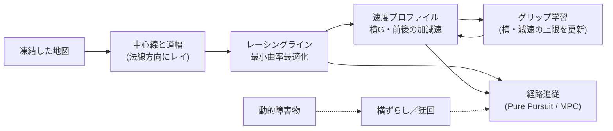

# レーシングラインと速度プロファイル

!!! info "【実機確認】（周回）＋【シム／ホスト検証】"
    対象: [`raspi/nav/`][nav-dir] の `centerline.py`・`raceline.py`・`grip.py`・`obstacles.py`。確認した版: 上位 `19291eb`。
    実機の周回は 2026-10-13 の記録で **5.3〜5.9 s/周**（走行ごとに地図が違う。周長 14.7 m のコースでは 5.77〜5.89 s。走行中の学習あり。開発記録）。
    走行中の学習は**初版が実機で悪化し、直した版は実機未検証**です（[検証状況](../overview/status.md)）。

地図ができたあとの流れは次のとおりです。

## 1. 中心線と道幅

レーシングラインの最適化が入力に取るのは、**中心線 \(c_i\)・法線 \(n_i\)・左右の余裕 \(w_i\)** の 3 つです。地図の 1 周目の軌跡から作ります。

- 1 周目は Follow the Gap で走っているので、軌跡は**道の真ん中を通っていません**（コーナーでは内側に寄る）。それでも初期値に使えるのは、
  実行可能な範囲を決めるのが \(c_i\) ではなく \((n_i, w_i)\) だからです。
- 本当に効く弱点は**法線の向き**です。\(c_i\) が壁に対して斜めだと、道幅を過大に測って「壁にめり込む解が実行可能に見える」。
  そこで「幅を測る → 真ん中へ寄せる」を数回繰り返します（1 回 1 ms 以下）。
- 距離変換（EDT）で「尾根」を探す方式は使いません。400×400 で数百 ms かかり、近似すると 2 割近い誤差が出るためです。
  **法線方向にレイを撃って測る方が速く、`scipy` も要りません。**

!!! warning "壁の小さな穴と、ヘアピンでの知覚エイリアシング"
    壁の小さな穴を抜けたレイは奥の別の壁に当たり、その 1 点だけ幅が跳ね上がります。この異常値がそのまま `w_left`/`w_right` に入ると、
    実際には無い余白があるとレーシングラインが誤認して壁側へ寄った経路を引きかねません。**近傍の中央値より明らかに大きい値だけ**を中央値にクランプします
    （小さい方へは倒さない。本当に道が狭い場所を広げたくないため）。

    ところが急な 0.5 m 半径のシケインでは、**穴が無くても**幅が数点にわたって暴れました。原因は穴ではなく**法線の推定の脆さ**で、急カーブでは接ベクトルのわずかな傾きで
    法線が通路に沿って何 m も先まで抜けてしまうためです（`centerline.py` のコメント）。

分岐のあるコースでは、地図全体から**道路グラフ**（空き領域 → 壁までの距離で車体が入れる領域だけを残す → 細線化 → 分岐／端点／エッジに分解）を作り、
経由点を順に通る経路を最短路でつなぎます。状態を「どのエッジをどちら向きに走っているか」にして**節点での曲がり角の大きい遷移を禁じる**（turn-restricted routing）のは、
節点だけを状態にした Dijkstra が、Y 字分岐で「左の枝から入って右の枝へ折り返す」経路を返してしまうためです（アッカーマン車はその場で折り返せない）。

## 2. 最小曲率最適化 — アウトインアウトは「結果として出てくる」

中心線の各点を法線方向に \(\alpha_i\) だけずらした点 \(p_i = c_i + \alpha_i\, n_i\) について、

$$
J(\alpha) = \lVert D\,p_x \rVert^2 + \lVert D\,p_y \rVert^2 + \lambda \lVert \alpha \rVert^2
$$

を、\(\alpha_i\) が走路の内側に収まる範囲で最小化します。\(D\) は巡回 2 階差分です。第 1 項は経路の曲がりの総量で、
**これを減らそうとすると、コーナーの手前で外へ開き、頂点で内へ付き、立ち上がりで外へ逃げます。** 曲率が一番小さく済むのがその通り方だからで、
アウトインアウトを「そう走れ」と教えているわけではありません。

\(\lambda\) は中心線へ引き戻す重みで、**「最短経路寄りにするか、曲率最小寄りにするか」のつまみ**そのものです（上げるほど中心線寄り、下げるほど振れ幅が大きい）。

??? info "解き方: 反復法は使えない"
    2 階差分作用素の低周波モードの固有値が \((2\pi/N)^4\) で潰れるため、ヘッセ行列 \(H\) の条件数は \(10^5\) オーダーになります。
    射影ガウス・ザイデルや射影勾配法は高周波を均すスムーザであって低周波モードのソルバではなく、実測でも 20 万反復して誤差が桁で改善しませんでした。
    \(N=400\) なら稠密の `np.linalg.solve` が 1 ms 以下で終わるので**素直に直接解き**、箱制約は**アクティブセット**
    （範囲を出た点を境界に固定して残りを解き直す）で、通常 3〜8 回の反復で収まります。

## 3. 速度プロファイル

1. \(v = \min\!\left(v_{\max},\ \sqrt{a_{\mathrm{lat}}/|\kappa|}\right)\) — 横 G の上限
2. **後ろ向きパス**: その先で減速が間に合う上限
3. **前向きパス**: そこまでで加速できる上限

2 と 3 は閉ループなので 2 周させて端をつなぎます。**後ろ向きを先にやる**のは、「止まれない速度で入る」方が「加速が足りない」より危険だからです。

- **速度に使う曲率は、弦 0.4 m の外接円で測ります**（`speed_kappa`）。経路の点は 0.1 m 刻みで、3 点の外接円で測ると**1 点の折れが半径を半分に見せ**ます。
  多角形の壁のコースでは最小曲率の解でも \(\kappa\) が 1 → 4 /m と跳ね、その 1 点のために手前から減速していました。車は前方注視（0.3 m〜）より細かい折れをなぞらないので、
  速度の曲率だけ粗く測り、**経路の形そのものは変えません。**
- **摩擦円**: 横 G を使っている所では前後に使える加速度が減る: \(a_x\sqrt{1-(v^2\kappa/a_{\mathrm{lat}})^2}\)。これを見込まないと、コーナーの中で加減速する速度を出してしまい、
  `a_lat` をグリップの限界より大きく下げておくしかありませんでした。
- **曲がれる限界の近くでも横 G を経験則で削らない。** 次の 3 つで足りるため（グリップを −10 % にした車でも衝突 0）: ①経路そのものを限界の `kappa_use` 倍までしか曲げない、
  ②追従の姿勢を「今」へ進めて 50 Hz で舵を更新する、③速度指令を前倒しして、コーナーへ速すぎる速度で入らない。削ると、舵が上限に張り付いたとき経路からのずれを直せず、遅延のぶん外へ膨らみます。

## 4. 走行中のグリップ学習 【実機で悪化→修正済み・実機未検証】

車に固有の値（質量・遅延など）はシステム同定で決められますが、**路面で変わる横方向のグリップ上限は、走行中の車の反応から決めたい**。そこで学習します
（既定は「切」で、同定値で固定。`grip_learn` = 0）。

### 横の上限

- **`TimeLearner`（既定）**: 周回の**タイム**で決める。上限を 1 段上げて走り、速度プロファイルが縮むはずの時間の `time_gain` 以上縮んだら採用、縮まなければやめる。
  前兆は「行き過ぎた段を早くやめる」安全装置としてだけ使う。横の上限は**コースで 1 つ**。
- **`GripLearner`（元の方式）**: 前兆（舵に対して曲率が足りない）が出るまで上げ、出た値のすぐ下で止まる。**実機では検出の穴の両側へ外れた**
  （誤検出で 4.41 m/s² に止まる／リアの滑りを見られず 8.0 m/s² まで上がる）ので、既定から外しました。

3 層構造です: 即時に下げる（前兆が出たその周期、100 Hz）、コーナー 1 つを 1 回の試行として評価する、路面はおおむね一様として共有しつつ場所ごとの前兆は**その場所のセルだけ**下げる。

### 減速の上限

コースで 1 つ。**1 周に 1 段（8 %）上げ、制動区間の終わり（コーナーの入口）の 0.1 秒で、車速が計画より 0.10 m/s 以上速かったら 1 段戻して止める。**
付いて行けない理由（タイヤの限界でもモータのトルクでも）は区別しません、そこがこの車の限界だからです。

### 加速は学習しない

目標車速を動かす傾きの上限 `cmd_accel_limit_m_s2`（3.0 m/s²）で固定します。同じ見方で測っても分かれなかったためです
（加速 1.77 でも 2.66 でも、加速区間の終わりの遅れは 0.1〜0.25 m/s で変わらない）。高すぎる加速は STM32 の TC が抑えます。
学習していた版は、内側の後輪が浮いた窓 1 つで 2.66 → 1.77 に下げて戻れなくなりました（実機 2026-10-13）。

### 実機での経緯

| 日付 | 出来事 |
|---|---|
| 2026-10-12 | 初版の学習を実機に入れたら、**誤検出で 1 周 5.7 s → 13.1 s** になった |
| 2026-10-13 | 周回タイムで決める方式（`TimeLearner`）で、横が 3.48 → 6.70 m/s² に約 170 秒で収束。収束後 **5.95〜5.99 s** |
| 2026-10-13 | 減速・加速の学習を作り直し。横 3.48 → 6.75、収束後 **5.77〜5.89 s**。その走行の周ごとの集計では、この車・この床の横の限界は **6.3〜6.8 m/s²** |

!!! warning "限界を実際に超えた記録はまだない"
    ソースのコメントが「実機で本当に限界を超えた記録はまだ無い」と書いています。「本物の前兆を見逃さない」ことは、雑音を足したシミュレータでしか確かめていません。

!!! tip "手当てを積み上げて複雑にしない"
    減速の学習は、窓の取り方・雑音の扱い・摩擦円の補正・TC やスリップ率での判定と、手当てが増え続けて**定数が約 35 個**になったため、捨てて作り直されました（定数 約 8 個）。
    作り直しの契機は開発者の指摘「全体的に対処療法で修正している気がするから、複雑系にならないように。定数も減らしたい」でした。

## 5. 障害物

- **「空きだと確信しているセルに点が落ちた」ものだけ**を動的障害物にします。「未知」を空き扱いにしないのが誤検出を出さない最大のコツです
  （1 周目に見えなかった場所を通るたびに「障害物だ」と言い出す planner は使い物にならない）。
- **壁の近くは見ない**（自己位置は数 cm〜数十 cm ずれ、壁の点が隣の空きセルに落ちるのは日常的）。壁を太らせる幅は**セル数ではなく距離で指定**します
  （格子を 5 cm から 2.5 cm に細かくしたとき、セル数のままだと膨張幅が黙って半分になり、壁が障害物として検出されて「前方 0.0 m に障害物」で止まり続けた）。
- **1 周期では信じない**: 近い位置に 2 周期連続で出たものだけ。10 Hz なので 200 ms の確認遅延が乗ります。
- 経路上の障害物は、**今のレーシングラインの各点を法線方向になめらかにずらす**（Frenet 座標の横ずらし、5 次の smoothstep）一時経路で避けます。
  点の数と添字が元の経路と同じなので、追従・周回の数え方・経路の乗り換えがそのまま使えます。
  地図に障害物を書き込んで引き直す方法は、中心線の初期値が障害物の真上を通るため抜け出せず、Pi で数百 ms〜1 s かかるので採らない、とあります。
- 進めないときだけ **Hybrid A\***（連続姿勢＋離散格子、Reeds-Shepp の解析展開、二重ヒューリスティック）で迂回します。

[nav-dir]: https://github.com/banbatakumi/AutonomousCar_RasPi/tree/master/surge_mk2/raspi/nav
