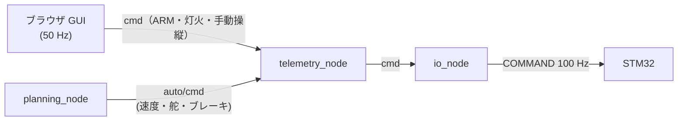

# 上位（Raspberry Pi）の安全設計

!!! note "【設計の説明】"
    対象: [`io_node.py`][io-node]、[`telemetry_node.py`][telemetry-node]、[`planning_node.py`][planning-node]、[`vehicle.toml`][vehicle-toml] の `[safety]`。
    確認した版: 上位 `19291eb`。再 ARM ラッチ（2026-10-14 の修正）は **【未検証】**（[検証状況](../overview/status.md)）。

STM32 側の安全層（[安全層とフェイルセーフ](../stm32/safety.md)）に対して、Pi 側は
**「走ってよい条件を、独立した複数の場所で別々に確かめる」**作りです。どれか 1 つが壊れても走り出さないことを狙っています。

## モータが回るための条件

`io_node` が STM32 へ ARM を送る前に、次の条件が**すべて**そろっている必要があります。判断は `io_node` の 1 か所に閉じています
（「判断が 2 箇所にあると、どこかで解禁されていた、が起きる」）。

1. `--allow-arm` を付けて起動している。**付けなければ DISARM 固定。** GUI・WebSocket・バスに何が流れていても、ここで断つ。
2. STM32 と話が合っている（`_arm_block_reason`）:
    - `protocol_version` が一致している（不一致・未確認なら不可）
    - `vehicle.toml` の `[control]`（ステアのリンク換算を含む）が STM32 に入っている（[同期の仕組み](../link/protocol.md#調整パラメータの同期)）
3. 人が GUI で ARM を保持している。
4. 再 ARM ラッチが掛かっていない（下記）。

`telemetry_node` は `diag/link.arm_inhibited` を GUI に中継するだけで、自分では解禁できません。

### 再 ARM ラッチ【未検証】

E-Stop・駆動電源のラッチ・STM32 の再起動のあとは、**人が ARM を一度外して入れ直すまで ARM を通しません**（`_update_rearm_latch`）。
STM32 は E-Stop を解除した次の周期から指令をそのまま実行するため、ARM 付きの指令を流し続けていると、
**車のそばでボタン 2 を押した瞬間に走り出す**からです。

## 指令の経路は 1 本

**`cmd` を publish するのは `telemetry_node` だけ**です。`planning_node` が直接 `cmd` に出すと、`telemetry_node` が誰も操縦していないときに
流している DISARM と、購読側からは区別できないまま 50 Hz で交互に上書きし合います。
**「勝手にハンドルが戻る」という再現困難な症状になり、しかも止める側が負けることがある**ので、経路を 1 本に保ちます。

`telemetry_node` は engage されている間だけ `auto/cmd` を `cmd` へ中継し、**速度・舵・ブレーキだけを差し替えます。**
灯火・ホーン・`auto_stop`・制動トルク・レート制限は GUI が送ってきた値のままです。

この形にすると、自律走行中も人間の安全網がそのまま生きます:

- **ARM は人間が GUI で保持する。** `planning_node` は ARM を立てられない。
- GUI が 50 Hz で送り続けている限りだけ走る。途絶は DISARM に落とす。
- E-Stop（GUI・STM32 のどちらでも）、操縦権の解放、接続断、デッドマンは、いずれも **engage も同時に落とす**。再開は人の engage から。
- `auto/cmd` が **200 ms** 途絶したら、engage したままでも**制動**に読み替える（`auto_cmd_stale_ms`）。

## デッドマンは 3 段

| 段 | どこで | 時間 | 動作 |
|---|---|---|---|
| 1 | ブラウザ | フォーカスを失う／キーを離す | 送信を止める |
| 2 | `telemetry_node` | GUI からの `cmd` が **150 ms** 途絶 | DISARM をバスに流す |
| 3 | `io_node` | バスの `cmd` が **150 ms** 途絶 | 止める（下記） |

`telemetry_node` は**誰も操縦していなくても 50 Hz で `cmd` を流し続け**ます（操縦者がいなければ DISARM を明示的に）。
「沈黙」ではなく「明示的な DISARM」を流すことで、`io_node` の途絶判定を「`telemetry_node` が死んだか」だけに絞れます。

**自律走行中だけは、GUI からの `cmd` の途絶を 5 秒まで待ちます**（`auto_link_grace_ms = 5000`）。
車は planner の指令で走っているので、Wi-Fi の瞬断で止める理由がありません
（2026-10-06、メッシュ Wi-Fi の中継機の切り替えで走行中に DISARM した、と `vehicle.toml` のコメントにあります）。
**その間は GUI から止められません。** 止まるのは planner 自身の判断（見失い等）、`auto_cmd_stale_ms`、物理の電源遮断だけです。

### 「止める」の順序

`io_node` は `cmd` が途絶えたとき、**走っていたなら、まず最大制動を送り、止まってから DISARM に落とします**（`_failsafe_packet`）。
いきなり DISARM を送ると、STM32 は駆動電源を切り、MD ごと落ちて制動できずに惰行するからです。

## 公開面の守り方

`telemetry_node` は制御 API を持つサーバなので、既定は安全側に倒してあります。

| 層 | 何を止めるか |
|---|---|
| `--host` の既定が `127.0.0.1` | 「打ち忘れ」で外に開くのを止める。外へ出すなら `--host 0.0.0.0` を明示する |
| Origin 検査 | **クロスサイト WebSocket ハイジャック**。操縦中に別タブで開いた悪意あるページが `/ws/control` を張るのを弾く |
| 共有トークン（`--token`） | 同一ネットワーク上の第三者。実際には**隣の班の PC の誤接続**を止める意味が大きい（トークンは `.gitignore` 済みのファイルか環境変数から読む） |
| `engage` に操縦権を要求 | 操縦権を持たない接続が自律走行を**開始**するのを止める |

engage 中は、操縦者以外の接続は自律走行の設定（パラメータ・駐車目標・経路・地図）を変えられません（解除だけできる）。
ARM 中のシャットダウンも受け付けません。操縦権は同時に 1 人だけです（2 つのブラウザから舵を切ると、最後に届いた方が勝つ形になり、再現しにくい症状になるため）。

!!! tip "止める操作には条件をつけない"
    E-Stop・操縦権の解放・engage の解除は、**トークンも操縦権も要求しません。**
    止める指令に条件を足すと、**一番止めたい状況で止まらない**設計になります。

また、受信が止まったクライアントは `SEND_TIMEOUT_S`（0.5 秒）で切ります。待ち続けると、スリープした PC 1 台のせいで
ほかのクライアントへの配信と操縦者の操作の処理まで止まるためです（`PROGRESS.md` 2026-10-14）。

## Pi が落ちたとき

`surge-io` を止める、または Pi が落ちると、GPIO6 のハートビートが止まり、**STM32 が緊急停止をラッチ**します
（`install_services.sh` のコメント。偶発的な実機での観測が `PROGRESS.md` にあります）。
STM32 が止まる側に倒れる設計なので、**Pi 側の不具合の多くは「停止」として現れます。**

## 設計の要点

- **走行許可は「全部の条件が独立に成り立つ」ときだけ**。許可を出す場所は 1 つ。
- **指令の発行元は 1 つ**。中継点で差し替える範囲（速度・舵・ブレーキ）を限る。
- **止める操作は無条件**、走り出す操作は何重にも条件付き。
- **走行中に止めるときは、制動してから DISARM**。電源を先に切らない。
- **通信が途絶えた側が止まる**（Pi → STM32 も、GUI → Pi も）。

[io-node]: https://github.com/banbatakumi/AutonomousCar_RasPi/blob/master/surge_mk2/raspi/nodes/io_node.py
[telemetry-node]: https://github.com/banbatakumi/AutonomousCar_RasPi/blob/master/surge_mk2/raspi/nodes/telemetry_node.py
[planning-node]: https://github.com/banbatakumi/AutonomousCar_RasPi/blob/master/surge_mk2/raspi/nodes/planning_node.py
[vehicle-toml]: https://github.com/banbatakumi/AutonomousCar_RasPi/blob/master/surge_mk2/config/vehicle.toml
