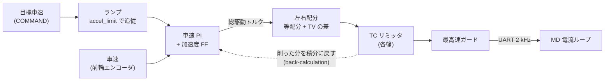

# 駆動制御（車速 PI）

!!! note "【設計の説明】"
    対象: [`src/control/drive.c`][drive-c] / [`drive.h`][drive-h]。確認した版: ファーム `2a2e9a8`。
    加速度フィードフォワードとローンチコントロールは **【未検証】**（[検証状況](../overview/status.md)）。

後輪 2 輪をトルク指令で動かし、**車速の閉ループを STM32 の中で完結**させています。
Pi は目標車速（と加速度の上限）を送るだけです。

## 全体のカスケード



内側の電流（トルク）ループは MD 側にあり、STM32 はトルク指令だけを出します。

## 車速をどう測るか

**車速の真値は、駆動していない前輪のエンコーダ**から取ります。駆動輪の速度は空転すると真の車速から離れますが、
前輪は転がっているだけなので、**後輪の周速との差が「滑り」としてそのまま計算できます**。TC と ABS の前提です。

1. 前輪の角速度（左右）をローパス（時定数 \(\tau \approx 10\,\mathrm{ms}\)、`DRIVE_LPF_TAU_FRONT_S`。係数は毎周期 \(k = e^{-\Delta t/\tau}\)）に通す。
2. 前輪は操舵されているので、転がり速度は車体前後の速度より \(1/\cos\delta\) 倍だけ速い。逆に \(\cos\delta\) を掛けて戻す。
   左右を平均すると、旋回の内外輪差は相殺される。\(\delta\) は路面舵角。
3. \(v = \dfrac{v_L + v_R}{2}\cos\delta\)

!!! warning "エンコーダを微分するときの罠"
    前輪エンコーダは 12 bit の ADC による絶対角で、1 LSB = 2π/4095 = 1.53 mrad です。
    500 µs ごとに微分すると 1 LSB が 3.07 rad/s（= 0.09 m/s）に化けます。実測でもノイズが大きく、
    **静止中でも生の角速度は ±12 m/s 振れる**とコードのコメントにあります。
    このため、ADC を 32 サンプル平均してからローパスをかけ、**生の角速度を上位へ報告しない**ようにしています。

### スリップ判定用の車速は別のフィルタ

PI のフィードバック用（\(\tau \approx 10\,\mathrm{ms}\)）をそのままスリップの基準に使うと、フル加速のようなランプ入力で
\(\tau \times\) 加速度ぶんだけ基準速度が実速度より遅れます。後輪側はほぼ遅れない（\(\tau \approx 4.75\,\mathrm{ms}\)）ので、
**「常に空転している」という誤ったスリップ率**が出ます。

そこで **スリップ判定専用に、より軽い \(\tau \approx 5\,\mathrm{ms}\) のフィルタ**（`DRIVE_LPF_K_FRONT_TC = 0.905`）を別に持っています。
ノイズは残りやすくなりますが、スリップ制限は偏差に比例して絞るだけなので、小さなノイズは効きません。

## 目標車速のランプ

Pi が送った目標（`speed_setpoint`）に、実際の目標（`target_speed`）が `accel_limit` の傾きで追従します。

```c
step = accel_limit * dt;
target_speed += clamp(setpoint - target_speed, -step, +step);
```

- Pi が `accel_limit = 0` を送ると、**「無制限」ではなく既定値 3.0 m/s²** になります
  （0 を「制限なし」と読ませないため。下限は 0.01 m/s²）。
- **ファーム側に加速度の上限は無く**、Pi が送った値がそのまま使われます。路面で出せる加速度が変わる
  （フローリングの同定で約 2.8 m/s²、畳はより高い）ので、固定の上限を置くと同定し直してもファームを書き換えるまで使えない、
  という理由です。滑らせない役目は TC、暴走を止める役目はトルク上限と最高速ガードが持ちます。

## 車速 PI ＋ 加速度フィードフォワード

$$
T_{\mathrm{total}} = K_p\,(v^* - v) + K_i \!\int (v^* - v)\,dt \;+\; \underbrace{k_a\,\dot v^* + k_{rr}\,\mathrm{sgn}(v^*)}_{\text{フィードフォワード}}
$$

- \(K_p, K_i\) はファームに焼き込まず、Pi が送る（[`vehicle.toml`][vehicle-toml] の `[dynamics]`）。微分項は使わない（車速は微分ノイズが乗りやすい）。
- ゲインは手で決めず、**極配置**で決める: 車体を \(\dot v = G\,T\)（\(G\) は同定した車体の利得）とみると閉ループは \(s^2 + G K_p s + G K_i = 0\) なので、狙いの減衰比 \(\zeta\) と固有角周波数 \(\omega_n\) から \(K_p = 2\zeta\omega_n/G\)、\(K_i = \omega_n^2/G\)（今は \(\zeta = 0.90\)、\(\omega_n = 3.6\) rad/s で \(K_p = 0.3\)、\(K_i = 0.6\)）。\(\omega_n\) の上限は、トルクを直接掛けて往復する試験で測ったトルクの遅れから位相余裕で決まる。
- 出力は後輪 2 輪の合計トルクで、±0.26 N·m（1 輪 0.13 N·m ×2）に収める。

### なぜフィードフォワードが要るか

PI だけだと、加速度 \(a\) を出すトルクは「偏差が \(a/(\text{車体の利得}\times K_p)\) だけ溜まるまで」出ません。
**約 0.15 秒の遅れ**です。上位の経路追従では、コーナー手前の減速が遅れて速すぎる速度で入りました（`drive.h` のコメント）。

目標車速のランプの傾きはこのモジュール自身が決めているので、**その傾きはあらかじめ分かっています**。
そこで「その加速に要るトルク」を PI の出力に先に足します。

| パラメータ | 意味 | 現在の値 |
|---|---|---|
| `speed_ff_nm_per_m_s2` | \(k_a\)。車体の利得の逆数 | 0.046 N·m/(m/s²) |
| `speed_ff_rr_nm` | \(k_{rr}\)。転がり抵抗ぶん（進む向きへ） | 0.013 N·m |

- 傾きは上位が 50 Hz で目標を刻むため周期ごとに跳ぶので、その刻みの周期 \(\tau = 20\,\mathrm{ms}\) を時定数にした
  1 次ローパスでならします（`DRIVE_SPEED_FF_TAU_S` = `DRIVE_HOST_COMMAND_PERIOD_S`）。Pi 側は `vehicle.toml` の
  `[dynamics] speed_ff_filter_s` だけが同じ値を持ち（planner とシミュレータが読む）、ファームとの一致は
  `tools/ctrl_tune/tests/test_fw_constants.py` が確かめます。
- 制動・torque_mode・ローンチ・停車中は足しません。2 つとも 0 なら FF なしの PI と同じ動きです。

## アンチウィンドアップ

TC や左右の上限で削られたトルクのぶんだけ、積分を巻き戻します（back-calculation）。

$$
I \mathrel{+}= \frac{T_{\mathrm{applied}} - T_{\mathrm{requested}}}{K_i}\cdot\frac{\Delta t}{T_t},\qquad T_t = 0.1\,\mathrm{s}
$$

PID ライブラリ内蔵のアンチウィンドアップは**自分の出力制限しか見ない**ので、外側で削った分はここで戻す必要があります
（`UnwindIntegral`）。torque_mode とローンチ中は PI を使っていない（毎周期リセット）ので巻き戻しません。

## 停車：トルク 0 を送り続ける

目標も実車速もほぼ 0（< 0.05 m/s）のあいだは、トルク 0 を指令して自由回転させます（惰行）。積分も捨てます
（停止中に溜まった積分が再発進で一気に出るのを防ぐ）。

!!! danger "「送信を止めて惰行させる」は事故のもと"
    **MD は通信が途絶えても、0.5 秒間は直前のトルクを出し続けます。** 減速中の負トルクの最中に送信を止めると、
    停車後もそのトルクが残って**後退**します。`Coast()` は送信停止ではなく「トルク 0 を送り続ける」処理です。
    `BldcMotor_Stop` を「止める」手段に使わない、とファームの `CLAUDE.md` にあります。

## 制動

制動（`Drive_SetBrake`）は **車速 PI を迂回**して、MD の制動モードへ制動トルクを直接渡します。
PI に目標 0 を与えるだけでは、制動力がゲイン任せになり、上位が指定した制動トルクどおりに効かないためです。

- 制動モードでは MD は左右に同じトルクしか出せないので、**TV はこの間、左右差を付けられません**。
- ABS はこの制動トルクに掛かります（[スリップ制御](traction.md#5-abs)）。
- **MD の制動は低速で抜けます。** 20 rad/s（0.6 m/s）以下で弱まり、2 rad/s 未満で 0 になります。
  このため、制動トルクだけでは坂で保持できません。止まったら**後輪を位置制御に切り替える**のがブレーキホールド／サイドブレーキです
  （[安全層](safety.md#ブレーキホールド)）。位置制御は、切り替えの瞬間の機械角度を左右独立にラッチして固定するだけです。

## ローンチコントロール（発進）

【未検証】PI は偏差が溜まるまでトルクが出ないので、停止からの加速で最初の約 0.3 秒を失います。
**上位が要求している間、目標が実車速より 0.5 m/s 以上離れた加速（発進）に限って**、ランプと PI を迂回して全開トルクを要求し、
TC にグリップの限界まで絞らせます。

| 項目 | 条件 |
|---|---|
| 始める | 要求あり、かつ目標が車速より 0.5 m/s 以上速い、かつ目標と逆向きに 0.3 m/s 以上で動いていない、かつ TC が有効 |
| 終わる | 車速が目標の 0.05 m/s 手前に届いた／要求が下りた／制動・torque_mode・サイドブレーキ／3.0 秒経った |
| 回数 | 1 回の要求で 1 回だけ（届かないまま全開を繰り返さないため） |

発進中は目標車速を実車速に合わせ続け、PI に戻すときは**積分を「その車速を保つトルク」（`launch_exit_torque_nm`）から始め**ます
（0 から始めると、積分が溜まるまで車速が落ち込む）。**空転を抑えるのは TC だけ**なので、TC が無効なら始めません。

## トルク上限の決め方

1 輪 0.13 N·m（`DRIVE_MAX_TORQUE_NM`）は、MD に「トルク上限」として送るのと、指令のクランプの両方に使います。
マイコンのバグや通信異常で過大な指令が出ても、最終段で頭打ちになります。

!!! warning "上限は MD の絶対上限を超えてはいけない"
    後輪 MD の絶対上限（Kt × 最大電流 10 A）は約 0.148・0.144 N·m です。**0.15 を設定すると MD が上限を受け入れず**、
    こちらは「指令と完全に一致するまで MD を使えるとみなさない」ので、ARM の 5 秒後に `md_fault` でラッチして走れなくなります。
    タイヤのグリップの限界は約 0.09 N·m なので、0.13 でも走りには出ません。

## 実装上の注意

- **車輪の符号**（`DRIVE_REAR_LEFT_DIR` など）は、左右が鏡像に取り付くために必要です。
  符号を間違えると車が逆に走るだけでなく、**TC がスリップ率を符号ごと誤読して、滑っていないのにトルクを削る**側に倒れる、
  とヘッダにあります（コメント上は「実機で 1 輪ずつ回して確認すること」）。
- 車輪半径は幾何寸法（直径 60 mm）から入れてあり、ゴムタイヤが荷重で潰れるぶん実際の転がり半径は数 % 小さい。
  この誤差はそのまま車速とオドメトリの倍率誤差になります。精度が要るなら、距離を転がして累積角から逆算します。

[drive-c]: https://github.com/banbatakumi/AutonomousCar/blob/FW/MainBoard_V3/Program/MainF446RE_V3/src/control/drive.c
[drive-h]: https://github.com/banbatakumi/AutonomousCar/blob/FW/MainBoard_V3/Program/MainF446RE_V3/src/control/drive.h
[vehicle-toml]: https://github.com/banbatakumi/AutonomousCar_RasPi/blob/master/surge_mk2/config/vehicle.toml
