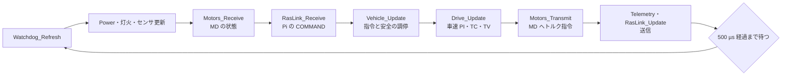
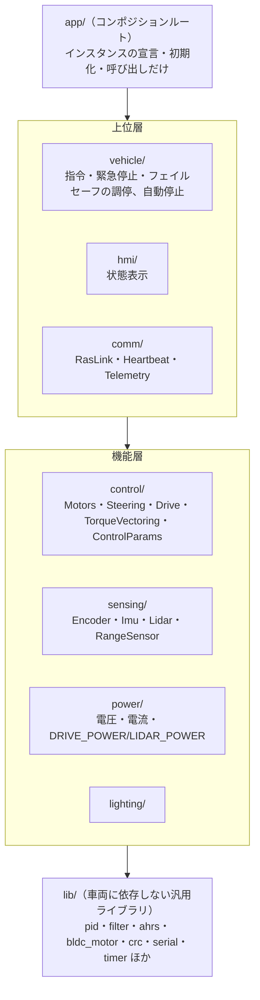

# STM32 ファームウェアの構成

!!! note "【設計の説明】"
    確認した版: ファーム `2a2e9a8`（2026-10-13、ブランチ `FW/MainBoard_V3`）。
    リポジトリの既定ブランチ `main` は基板の履歴で、ファームの最新ではありません。

STM32F446RE（Cortex-M4F、180 MHz）の上で、**500 µs 周期（2 kHz）のメインループ**が全部を回します。
RTOS は使わず、割り込み（DMA を含む）はセンサの取り込みと UART まわりが中心です。

## メインループ

[`app.c`][app-c] の `MainApp()` が毎周期、次の順に呼びます。

**受信を先にして、指令の計算をその後に置く**のが肝です。MD の状態も Pi の COMMAND も、
計算の前に取り込まなければ 1 周期古い値で制御することになります。送信（`RasLink_Update`）は最後です。

- 周期は `CONTROL_INTERVAL_US 500` で固定。`Drive` のフィルタ係数がこの周期を前提にしているため、
  変えるなら `DRIVE_LPF_K_*` も見直す必要があります（`app.c` のコメント）。
- 独立ウォッチドッグ（IWDG）は `WATCHDOG_TIMEOUT_MS 500`。**一度起動すると止められない**ので、
  ブロッキングする初期化（IMU の静止較正、起動時のハザード点滅、ステアの中心点記録）が
  すべて終わってから最後に起動します。裏を返すと **`Setup()` 中のハングは検出できません**。
- ループの先頭で無条件に `Watchdog_Refresh()` を叩きます。「ループが回っていること自体が生存の証拠」で、
  個々のモジュールの異常は別のフォールトとして扱います（IWDG を異常時の停止手段に流用すると、
  リセットで状態が消えて原因が追えなくなる、とコードのコメントにあります）。

## モジュールの層

依存は **一方向**（上から下）に限ります（[`CLAUDE.md`][fw-claude] の規約）。

- `app.c` は配線だけで、制御ロジックを書かない。
- 各モジュールは「struct ＋ `Module_Init()` で依存を渡す ＋ `Module_Update()`」の形で、グローバル変数を参照しない。
- `lib/` は特定の車両を知らない。

この分け方のおかげで、`src/control`（Drive・TorqueVectoring・ControlParams）は **ホスト（Mac/Linux）でそのままコンパイルして
閉ループ試験に使えます**（[検証の仕組み](../dev/workflow.md#ファームの制御コードをそのままホストで回す)）。

## 調整パラメータの扱い

TC・ABS・TV・車速 PI のゲインなどは、ファームに**値を持たせません**。

- `control_params.h` の `CONTROL_PARAM_TABLE` が名前・`param_id`・仮置き値・範囲の**唯一の定義**です。
- 上位（Pi）が接続のたびに全項目を `CONFIG_SET` で送り、`CONFIG_ACK` が返す「実際に適用された値」と突き合わせます。
- Flash には保存しないので、電源を入れ直すと仮置き値（各範囲の下限＝「何もしない値」）に戻ります。
- 値の正は Pi 側の [`vehicle.toml`][vehicle-toml] の `[control]` で、Pi は全項目が揃って確認できるまで ARM（走行許可）を通しません。

「調整値をファームに焼き込むと、書き換えと再書き込みが面倒で、車ごとの違いも持てない」ことへの対策です。
一方で、**Pi が送らない限りファームは仮置き値で動く**ことになるため、ARM の許可側で守っています
（[上位の安全設計](../raspi/safety.md)）。

## 起動時の動作

| 操作 | 動作 |
|---|---|
| 通常起動 | 駆動電源・LiDAR 電源とも **OFF**。Pi が ARM するまで入れない |
| ボタン 1 を押しながら起動 | 現在のステア角を「直進の中心」として記録し Flash に保存。このときだけ駆動電源を一時的に入れる |
| ボタン 2 を押しながら起動 | IMU の静止較正をやり直して Flash に保存（数秒） |
| 緊急停止の解除 | 緊急停止がラッチされている間にボタン 2 を押す（ハートビートが戻っていること） |

ステアの中心が未較正の間は、駆動電源を入れず、舵角指令も送りません（絶対角が信用できないため）。

## 主な仕様値

| 項目 | 値 | 出どころ |
|---|---|---|
| メインループ | 500 µs（2 kHz） | `app.c` |
| Pi との UART | USART1、1 Mbps（誤差 0 %） | `app.c` のコメント |
| MD との UART | USART2（ステア）・USART3（左後輪）・UART4（右後輪）、1 Mbps | `CLAUDE.md` |
| LiDAR | USART6、230400 bps | `app.c` |
| 1 輪の最大トルク | 0.13 N·m | `drive.h` の `DRIVE_MAX_TORQUE_NM` |
| 最高車速（暴走時の防壁） | 5.0 m/s | `drive.h` の `DRIVE_MAX_SPEED_M_S` |
| ハートビート断の判定 | 50 ms | `heartbeat.h` |
| COMMAND 途絶の判定 | 100 ms | `ras_link.h` の `RAS_COMMAND_TIMEOUT_US` |

## 次に読む

- [駆動制御（車速 PI）](drive.md) — 目標車速からトルクまで
- [スリップ制御（TC・ABS）](traction.md)
- [トルクベクタリング](torque-vectoring.md)
- [安全層とフェイルセーフ](safety.md)

[app-c]: https://github.com/banbatakumi/AutonomousCar/blob/FW/MainBoard_V3/Program/MainF446RE_V3/src/app/app.c
[fw-claude]: https://github.com/banbatakumi/AutonomousCar/blob/FW/MainBoard_V3/Program/MainF446RE_V3/CLAUDE.md
[vehicle-toml]: https://github.com/banbatakumi/AutonomousCar_RasPi/blob/master/surge_mk2/config/vehicle.toml
