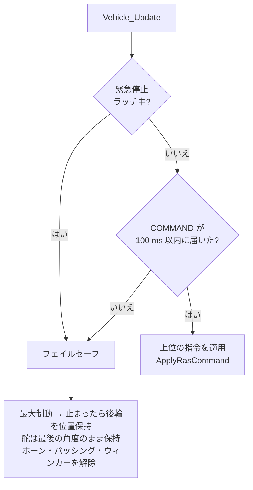
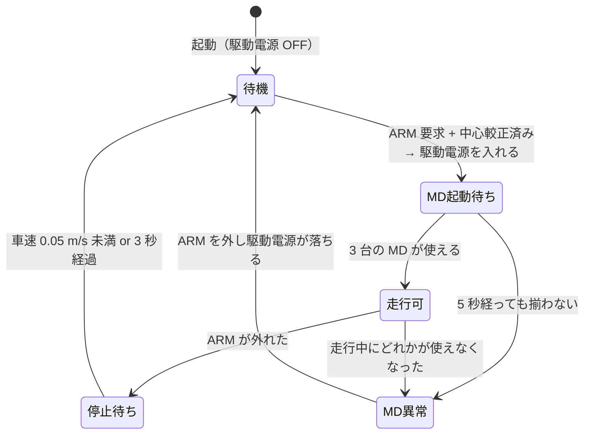

# 安全層とフェイルセーフ

!!! note "【設計の説明】"
    対象: [`vehicle.c`][vehicle-c] / [`vehicle.h`][vehicle-h]、[`heartbeat.c`][heartbeat-c]、[`power.h`][power-h]、[`app.c`][app-c]。
    確認した版: ファーム `2a2e9a8`。自動停止・ブレーキホールドの数値は **【未検証】**（[検証状況](../overview/status.md)）。

**上位（Pi）が落ちても、STM32 単独で車を止められる**のが設計の前提です。ここでは「止め方」を中心に説明します。

## 誰の指令に従うか

`Vehicle_Update()` が毎周期、次の優先順位で決めます。



**Pi が一度も繋がっていない起動直後も「フェイルセーフ」側**です。つまり、Pi が ARM を出さない限り車は押さえ込まれています。

## 4 つの安全層

| 層 | 発動条件 | 動作 | 解除 |
|---|---|---|---|
| ① `DRIVE_POWER` のハード遮断 | 駆動系の過電流 **12 A**（50 ms 継続）。シグナル系の過電流 **6 A**（仮値）では LiDAR と駆動の両方を遮断 | MD への給電を切る | **ラッチ**。マイコンのリセットまで復帰しない |
| ② IWDG（独立ウォッチドッグ） | メインループが 500 ms 止まる | MCU をリセット | — |
| ③ ハートビート断 | Pi の GPIO の **100 Hz 矩形波**が **50 ms** 途切れる | 緊急停止をラッチ（フェイルセーフと同じ制動） | **ラッチ**。ハートビートが戻った状態で**ボタン 2** を押すまで解除しない |
| ④ COMMAND 途絶 | UART の COMMAND が **100 ms** 来ない | 自動でブレーキ（フェイルセーフ） | COMMAND が戻れば復帰 |

③のハートビートは UART とは**別経路**です。UART の COMMAND 途絶（100 ms）より速く（50 ms）、
**通信そのものが生きていても Pi のソフトが固まった**場合を拾えます。

- ハートビートは、**少なくとも 10 エッジを一度でも観測するまで**は監視を始めません。
  配線していない単体のベンチ確認で緊急停止させないためです（`HEARTBEAT_MIN_EDGES`）。
- IMU の I2C が張り付いてメインループが長く止まったあとは、ハートビートの基準時刻をリセットします。
  止まっていた間は判定できていなかっただけなので、直後に偶然エッジを取りこぼして**誤って緊急停止をラッチしない**ための処置です（`app.c`）。
- 電圧低下（8 セル × 1.0 V = 8.0 V、復帰 8.8 V、1 秒継続）は**警告のみ**で何も遮断しません。
  Ni-MH は負荷時のサグが大きいので電圧は長めに平均して判定します。

### 緊急停止でも駆動電源は切らない

!!! danger "電源を切ると止まれない"
    緊急停止がラッチされても、駆動電源は**入れたまま**にします。電源を切ると MD が制動をかけられず惰行に入り、
    かえって止まるまでの距離が伸びるからです。電源を落とすのは過電流のように「流し続けること自体が危険」なときの処置で、
    緊急停止でやるべきなのは**最短で止める**ことです。

## ARM（走行許可）の条件

上位が出す ARM 要求は、次の**すべて**を満たすときだけ「走行してよい」状態（`armed`）になります。

```text
armed = ARM 要求  かつ  ステア中心が較正済み  かつ  3 台の MD が起動済み
        かつ  モードが MANUAL または AUTO
```



- **MD の起動待ち**: MD は給電から約 1 秒、指令を受け付けません。その間に車速 PI を回すと、**積分が振り切れた状態で MD が動き出して
  最大トルクが一気に出る**ため、3 台が使える状態になるまで `armed` にしません（上限 5 秒、`VEHICLE_MD_BOOT_TIMEOUT_S`）。
- **ARM が外れたら、すぐには駆動電源を切らない。** 走行中に外れたら、停車（< 0.05 m/s）するまで最大制動を続けてから切ります
  （上限 3 秒、`VEHICLE_DISARM_BRAKE_TIMEOUT_S`）。上位は通信途絶やデッドマンで「安全側」として DISARM を送ってくるため、
  ARM ビットで即座に電源を切ると惰行になってしまうからです。
- **MD の健全性は毎周期監視**します。走行中にどれかの MD が使えなくなったら、両後輪を最大制動して `md_fault` をラッチします
  （片側の後輪 MD が止まって反対側だけが駆動を続けると、ヨーモーメントが出るため）。強制制動中は、上位のサイドブレーキ要求を聞きません
  （位置保持は制動より優先されるので、走行中に入ると最大制動が効かなくなる）。
- **ステアの中心が未較正の間は、駆動電源を入れません。** 絶対角が信用できないためです。

### 舵の扱い

- 上位の舵角指令は**舵角速度の上限でレート制限**してから渡します（既定 0.5 rad/s。COMMAND が値を載せればそれを使う。
  Pi は 7.0 rad/s を毎回載せています）。急な舵の変化で据え切りの負荷をかけないためです。
- `armed` でない間は舵角を進めず、**最後に送った角度を MD に保持させ続けます。**
  指令フレームを送らないと、ステア MD がトルク上限を適用しないので「MD が揃うまで armed にしない」条件が永久に解けなくなります。
- フェイルセーフでも舵は**最後の角度のまま保持**します（直進に戻すと車体が予期しない方向へ動くため）。

## ブレーキホールド

制動して |車速| が **0.2 m/s 未満** の状態が **0.3 秒**続いたら、後輪を**位置制御**に切り替えて保持します
（サイドブレーキと同じ仕組み）。上位の brake・自動停止・フェイルセーフのどの制動でも同じです。

!!! info "しきい値を「ほぼ 0」にしない理由"
    MD の制動は低速で抜けます（0.6 m/s 以下で弱まり、2 rad/s 未満で 0）。坂ではトルクの釣り合う速度でずるずる動き続けるので、
    しきい値が低いと永久に保持へ移れません。0.2 m/s なら勾配約 12° まで拾えます（0.1 m/s だと約 6°）。
    保持中にこの車速を超えたら（押された・保持し切れない）制動トルクからやり直します。【未検証】

## 自動停止

【未検証】COMMAND の `auto_stop` フラグを立てている間、**走行方向にある障害物を STM32 自身が検出して制動**します。
上位の計画がミスしても、速度に応じて伸びる距離で止まる最後の砦です。

$$
d_{\mathrm{stop}} = v \cdot t_d + \frac{v^2}{2a} + m
$$

| 項目 | 値 | 出どころ |
|---|---|---|
| 遅延 \(t_d\) | 0.1 s | 未実測のプレースホルダー |
| 減速度 \(a\) | 3.0 m/s² | 実測の制動は ABS 込みで約 2.5 m/s² なので少し楽観的 |
| 余裕 \(m\) | 既定 15 cm（0〜100 cm、Pi が `auto_stop_margin_cm` で送る） | `ras_link.h` |

- **LiDAR**: 進行方向（前は 0°、後ろは 180°）を中心に ±20° の扇形で、距離が \(d_{\mathrm{stop}}\) 以内の点が **3 点以上**あれば障害物あり。
  単発のノイズは 1 点しか占めないので、**時間方向のデバウンスではなく空間方向の点密度**で誤検知を弾きます。
- **超音波**: LiDAR が新鮮なデータを持たないときのフォールバック（\(d_{\mathrm{stop}}\) 以内）。それとは独立に、**5 cm 未満なら常に停止**
  （LiDAR の最短測距距離や取付高さの死角を補う保険）。
- センサは車体の先端より内側にあるので、しきい値に**取付オフセット**（LiDAR 前 23 cm・後 14 cm、超音波 前 4 cm・後 3 cm）を足し、
  「車体の先端から障害物まで」で判定します。

??? example "計算例: 2 m/s で走行中"
    \(d_{\mathrm{stop}} = (2\times0.1 + 2^2/(2\times3.0))\times100 + 15 \approx 102\,\mathrm{cm}\)。
    LiDAR の判定距離は \(102+23 \approx 125\,\mathrm{cm}\)。
    開発記録も「2 m/s で約 1.25 m 先の扇形。コースの壁で作動しうる」と書いています。

**進行方向は指令ではなく実車速の符号**で決めます。「前進中に後退を指令」した瞬間でも実車はまだ前進しており、
その一瞬に後方センサへ切り替わって前方の障害物を見失う窓ができるためです。ただし**ほぼ静止（< 0.05 m/s）のときは指令した方向**を使います。
静止中は実車速の符号が定まらず常に前方判定に固定され、「前方に障害物・後方は空いているのに後退できない」デッドロックになるからです。

緊急停止（ハートビート断）のフェイルセーフは**LiDAR を使いません**。

## 再 ARM の扱い

ここは**ファームと Pi の記述が噛み合っていない**ので、注意して読んでください。

- Pi 側（`io_node`）には、「E-Stop・駆動電源ラッチ・STM32 再起動・COMMAND 途絶のあとは、ARM を一度外すまで走らせない」
  再 ARM ラッチの実装があります（`_update_rearm_latch`）。
  理由はコードにあります: **STM32 は E-Stop を解除した次の周期から指令をそのまま実行する**ので、ARM 付きの指令を流し続けていると、
  車のそばでボタン 2 を押した瞬間に走り出すからです。
- 開発記録（`PROGRESS.md` の 2026-10-14）には「ファームも同じ規則を持つ（`vehicle.c` の `rearm_required`）」とありますが、
  **確認したファームのコミット（`2a2e9a8`）の `vehicle.c` にはその名前がありません**。

したがって現時点では「緊急停止の解除で ARM 付きの指令が流れ続けていると走り出す」ことを防ぐのは **Pi 側だけ**だと考えてください。

## この設計から学べること

- **上位が落ちたときの動作を、上位の側ではなく下位に持たせる。** 通信・ソフト・電源の 3 経路それぞれに独立した検出がある。
- **止める＝電源を切る、ではない。** 制動できる状態を保ったまま止める。
- **ラッチは「人が確かめて解除する」。** 原因が消えたら自動復帰、にしない。
- **初期化の完了を条件に走行を許可する。** MD の起動待ち、ステア中心の較正。
- **フェイルセーフ側の動作も「何を保持するか」を決める。** 舵は直進に戻さない。

[vehicle-c]: https://github.com/banbatakumi/AutonomousCar/blob/FW/MainBoard_V3/Program/MainF446RE_V3/src/vehicle/vehicle.c
[vehicle-h]: https://github.com/banbatakumi/AutonomousCar/blob/FW/MainBoard_V3/Program/MainF446RE_V3/src/vehicle/vehicle.h
[heartbeat-c]: https://github.com/banbatakumi/AutonomousCar/blob/FW/MainBoard_V3/Program/MainF446RE_V3/src/comm/heartbeat.c
[power-h]: https://github.com/banbatakumi/AutonomousCar/blob/FW/MainBoard_V3/Program/MainF446RE_V3/src/power/power.h
[app-c]: https://github.com/banbatakumi/AutonomousCar/blob/FW/MainBoard_V3/Program/MainF446RE_V3/src/app/app.c
